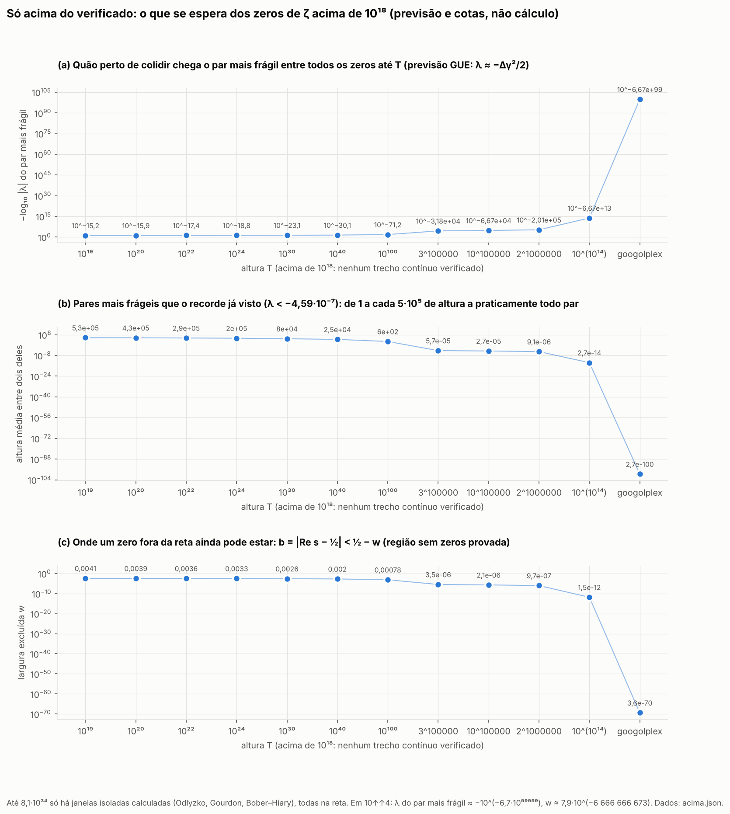
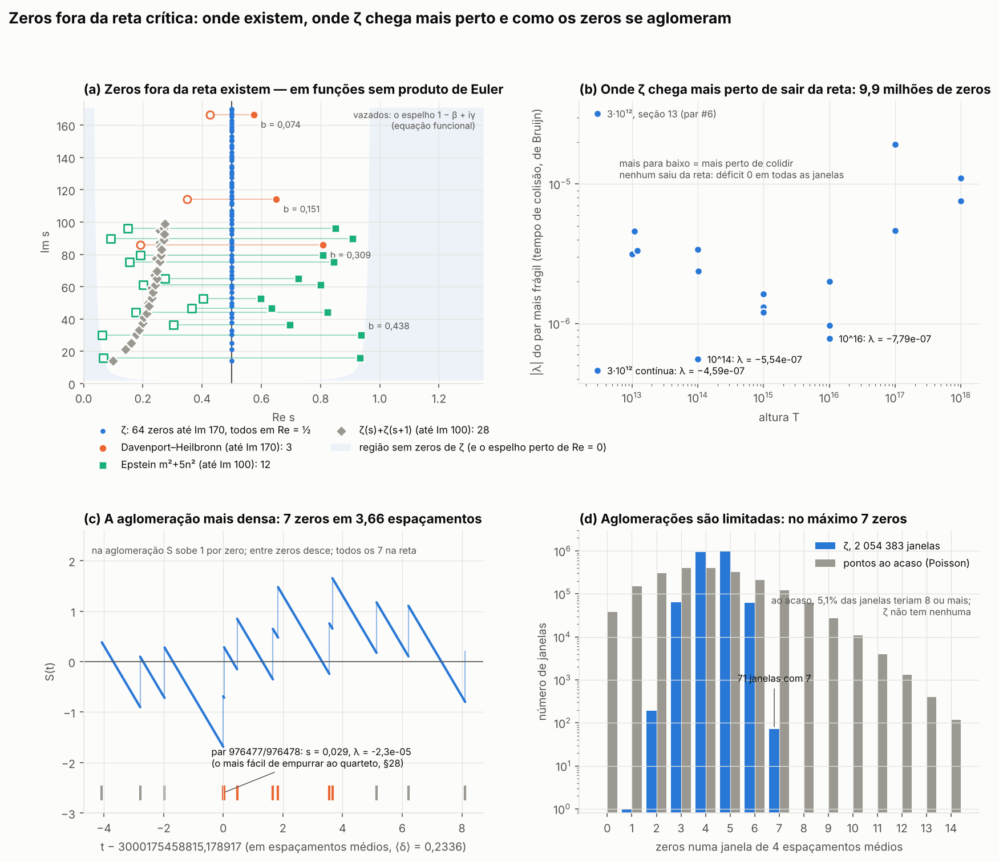
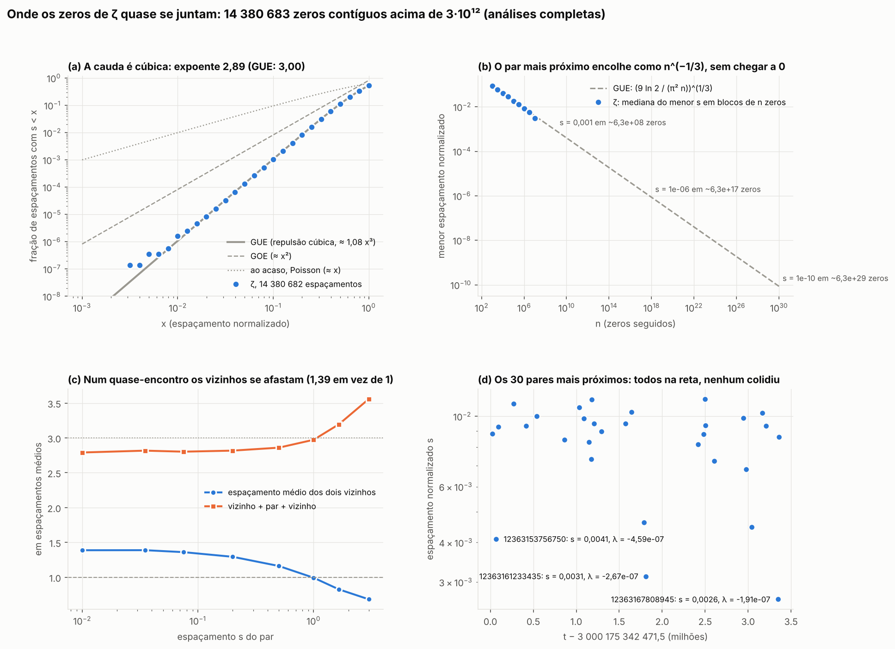
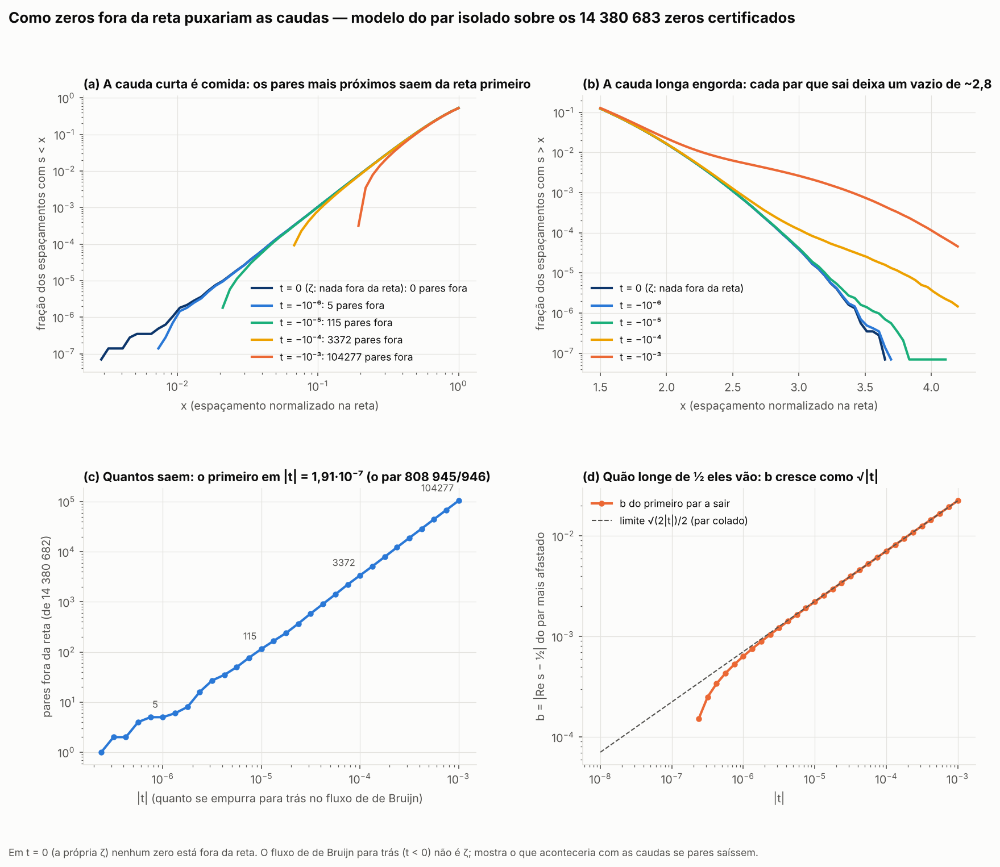
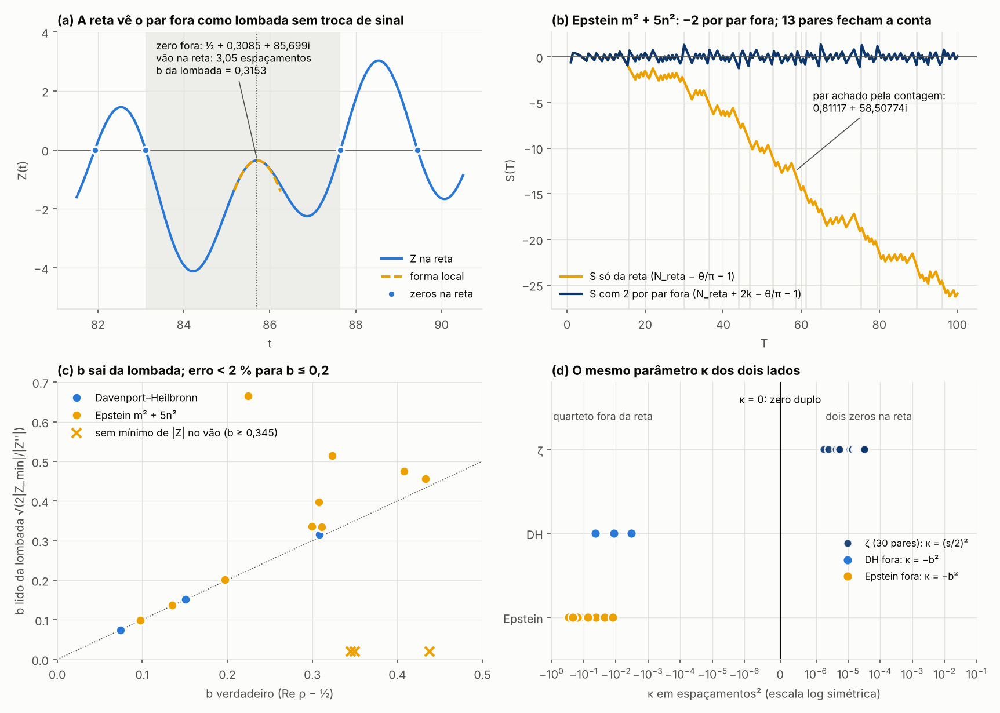
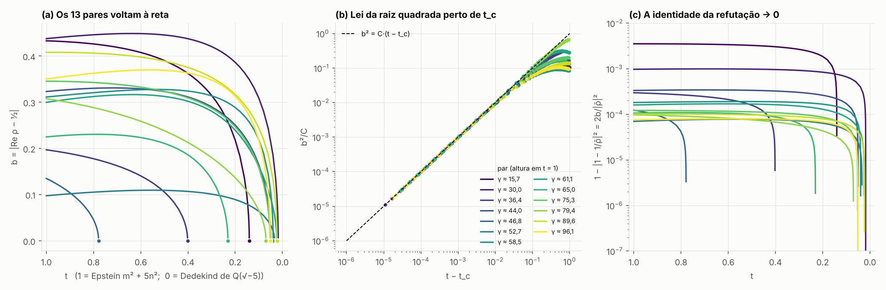
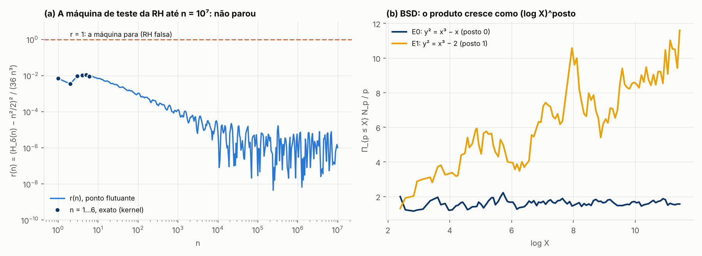
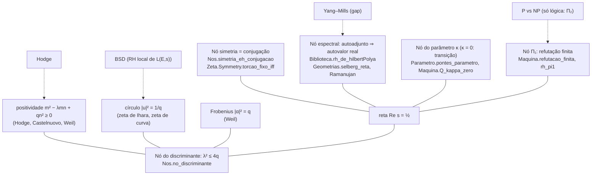
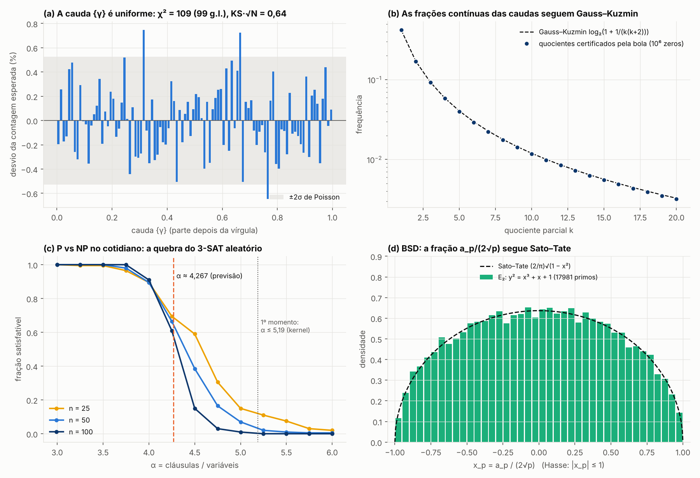

# Hipótese de Riemann — prova (Lean 4 / Mathlib)

Depende do enunciado em [`ShantiDraconis/clay-riemann-statement`](https://github.com/ShantiDraconis/clay-riemann-statement),
fixado no commit `47fe26a`. O alvo é `ClayRiemann.Statement`, sem redefinição
(`abbrev Target := ClayRiemann.Statement`, que é o `RiemannHypothesis` da Mathlib).

Estado: sem prova. `OPEN_MATH = true`. Nada abaixo prova RH: há equivalências exatas (as treze estão reunidas
em `Bridges.pontes`, seção 8), um resultado condicional a um teorema externo e o mundo `Z = 13` certificado.

Regras: nenhum `sorry`, `axiom`, `native_decide` ou marcador; `#print axioms ClayRiemannProof.main` fixado
com `#guard_msgs` quando `main` existir.

Prêmio: a formalização é material suplementar. O Clay e a AMS só consideram soluções publicadas
em periódico referado; o Clay espera ainda dois anos e aceitação geral.

## Auditoria

`ClayRiemannProof/Audit.lean` (importado por último pela raiz) fixa, com `#guard_msgs`, a saída real
de `#print axioms` de 1 212 declarações públicas acrescentadas (todos os teoremas e a maior parte das definições);
`ClayRiemannProof/AuditThirteen.lean` faz o mesmo para as 385 da cadeia certificada até a altura 13, do primeiro zero
na reta (§47) e da bola alargada (§48) (1 597 guardas no total, contadas como linhas que começam com `#guard_msgs`). Todas dependem no máximo de
`[propext, Classical.choice, Quot.sound]` (os axiomas padrão que o próprio Mathlib usa; `Real` já
depende deles). Verificado com Lean 4.36.0-rc2 e Mathlib `8fe7ce4`.

## 1. Critério de Báez-Duarte: `Target ↔ Gap` (equivalência, teorema)

Arquivo: `ClayRiemannProof/BaezDuarteGap.lean`.

```lean
def Gap : Prop := (⨅ N, DN N) = 0
theorem gap_iff_tendsto : Gap ↔ Tendsto DN atTop (𝓝 0)
theorem target_of_gap   : Gap → Target
theorem gap_of_target   : Target → Gap
theorem target_iff_gap  : Target ↔ Gap
```

`DN N = inf_{c ∈ ℝ^N} ∫_{(0,∞)} (χ(t) − Σ_{k=1}^{N} c_k {1/(k t)})² dt`, com `χ = 𝟙_(0,1]`
(`ClayRiemannProof/BaezDuarte/Defs.lean`); o integrando é sempre integrável
(`Faithful.integrable_residual`), logo é a integral de Lebesgue genuína.

**O que é**: o critério de Nyman–Beurling na forma de Báez-Duarte (2003), provado nos dois sentidos
contra a `riemannZeta` e o `RiemannHypothesis` da Mathlib.

* Suficiência `Gap → Target` (`BaezDuarte/Sufficiency.lean`): transformadas de Mellin de `χ` e
  `ρ_k` (`Zeta/Strip.lean`, `BaezDuarte/MellinRho.lean`), uma desigualdade de Cauchy–Schwarz
  elementar e a equação funcional da Mathlib.
* Necessidade `Target → Gap` (`BaezDuarte/Necessity.lean`): fórmula espectral de `D_N`
  (Plancherel de Mellin, `Fourier/*`, `BaezDuarte/Spectral.lean`), mollificador de Möbius suavizado,
  fórmula de Perron suavizada com deslocamento de contorno (`Zeta/PerronSmoothed.lean`), cotas sob RH
  do tipo Titchmarsh 14.2 / Lindelöf (`Zeta/LogBoundRH.lean`), `Γ` em faixas verticais e
  Phragmén–Lindelöf para `ζ(s)/ζ(s+ε)` (`Zeta/GammaVertical.lean`, `Zeta/Ratio.lean`),
  convergência dominada.

**O que NÃO é**: não é prova de RH. `Gap` (`inf_N D_N = 0`) continua aberto; o teorema só diz que
ele tem exatamente a força de RH.

**Origem** (ATK kernel, espelho público do M-Core, `imports/M-Core/atk-kernel/ATK/`):

| aqui | ATK kernel |
|---|---|
| `BaezDuarte/Defs.lean` | `Conditional/Riemann.lean` (definições) + `RiemannConcrete.lean` (monotonia, limite) |
| `BaezDuarte/Faithful.lean` | `RiemannFaithful.lean` |
| `Zeta/Strip.lean` | `ZetaStrip.lean` |
| `BaezDuarte/MellinRho.lean` | `MellinRho.lean` |
| `BaezDuarte/Sufficiency.lean` | `BaezDuarteBridge.lean` (M-Core `9e27bb5`) |
| `Fourier/PlancherelL1L2.lean` | `PlancherelL1L2.lean` |
| `Fourier/MellinPlancherel.lean` | `MellinPlancherel.lean` |
| `BaezDuarte/Spectral.lean` | `EspectralDN.lean` |
| `BaezDuarte/NecessityFramework.lean` | `NecessidadeBD.lean` |
| `Zeta/Bounds.lean` | trechos de `ZetaRetangulo.lean` (`Hr`, `norm_H_le`, `Hr_le`) e `ZetaRegiao.lean` (`zeta_eq`, `norm_zeta_le`) |
| `Zeta/LogBoundRH.lean` | `RHLogZeta.lean` |
| `Zeta/GammaVertical.lean` | `GammaVertical.lean` |
| `Zeta/Ratio.lean` | `RazaoZeta.lean` |
| `Zeta/PerronSmoothed.lean` | `PerronSuave.lean` |
| `BaezDuarte/Necessity.lean` | `NecessidadeRH.lean` (M-Core `f81c6ef`) |

Mudanças na portagem: espaços de nomes `ATK.*` → `ClayRiemannProof.*`; `O1_iff_iInf_zero` →
`tendsto_zero_iff_iInf_eq_zero`; `baezDuarteCriterion` → `baezDuarte_sufficiency`; três ajustes de
compatibilidade com o Mathlib atual (anotação de tipo em `Bounds.integrableOn_g`, `differentiableAt_F`
e `continuous_KK_line` reescritos sem `fun_prop`/`Continuous.div` por timeout de elaboração).
Retirado por não ser necessário ao critério: a "teoria de estados" do ATK (`Indeterminacy*`,
`RiemannStates`, `O1_iff_dissipacao`, `riemann_of_not_finito`), as pontes condicionais
`BaezDuarteCriterion` / `UniformLogBound`, `bdDistSq_iff_rh` (`BDDistSqPort`) e o resto de
`ZetaSimetria` / `ZetaRetangulo` / `ZetaRegiao`.

**Axiomas**: `[propext, Classical.choice, Quot.sound]` (todas as declarações; ver `Audit.lean`).

## 2. RH condicional ao quasi-RH `1/8–7/8` (condicional a resultado externo)

Arquivo: `ClayRiemannProof/QuasiRH.lean`.

```lean
def OpenAIQuasiRH78 : Prop :=
  ∀ s : ℂ, riemannZeta s = 0 → (¬ ∃ n : ℕ, s = -2 * (n + 1)) → s ≠ 1 →
    1 / 8 ≤ s.re ∧ s.re ≤ 7 / 8
def NoZero_half_78 : Prop :=      -- nenhum zero não trivial com 1/2 < Re s ≤ 7/8
def NoZero_right_half : Prop :=   -- nenhum zero não trivial com Re s > 1/2

theorem target_iff_noZero_right_half : Target ↔ NoZero_right_half          -- incondicional
theorem target_iff_noZero_half_78 (hQ : OpenAIQuasiRH78) : Target ↔ NoZero_half_78
theorem openAIQuasiRH78_of_target : Target → OpenAIQuasiRH78               -- sanidade
theorem riemannZeta_one_sub_eq_zero : ζ(s) = 0 → 0 < Re s → Re s < 1 → ζ(1 − s) = 0
```

**O que é**: `OpenAIQuasiRH78` é um **resultado externo** — OpenAI, versão verificada em Lean datada
de 2026-09-30, anunciada em 2026-10-06; reportagem: Quanta Magazine, 2026-10-19,
<https://quantamagazine.org/ai-proved-the-quasi-riemann-hypothesis-what-happens-now-20261019>.
Aqui ele entra só como hipótese nomeada (`def … : Prop`, nunca `axiom`). Sob essa hipótese, RH
equivale a excluir zeros não triviais com `1/2 < Re s ≤ 7/8` (o lado esquerdo da faixa vem de graça
pela simetria `s ↦ 1 − s` da equação funcional da Mathlib, `target_iff_noZero_right_half`).
`openAIQuasiRH78_of_target` mostra que a hipótese é consequência de RH, portanto não é
trivialmente falsa (refutá-la refutaria RH).

**O que NÃO é**: não é prova de RH, nem verificação do resultado da OpenAI. O enunciado formalizado
por eles é `OAI.riemannZeta_ne_zero_of_seven_eighths_lt_re` (`ζ(s) ≠ 0` para `Re s > 7/8`), em
[`openai/math`](https://github.com/openai/math), pasta `lean/`, commit `1581d4c`, com Lean `v4.34.1` e
outra Mathlib; ele não é importado nem recompilado aqui. O artigo de 2026-10-05 da mesma série expõe
separadamente a etapa intermediária `Re s > 11/12`.

**Origem**: escrito neste repositório (a parte da equação funcional segue o argumento de
`riemannHypothesis_of_strip` de `ATK/BaezDuarteBridge.lean`).

**Axiomas**: `[propext, Classical.choice, Quot.sound]`.

## 3. A ponte com as aritméticas finitas (teorema)

Arquivos: `ClayRiemannProof/FiniteWorlds.lean` e `ClayRiemannProof/Zeta/Symmetry.lean`.

```lean
abbrev Sat (Z : ℕ) := Fin (Z + 1)                 -- {0,…,Z}: Z é o último inteiro deste mundo
def satAdd (a b : Sat Z) : Sat Z                  -- a ⊕ b = min Z (a + b)
theorem ultimo_absorve (a : Sat Z) : satAdd (Fin.last Z) a = Fin.last Z
theorem cancelamento_falha (hZ : 1 ≤ Z) : ∃ a b c, satAdd a c = satAdd b c ∧ a ≠ b
theorem nao_ha_ultimo_inteiro : ¬ ∃ Z : ℕ, ∀ n : ℕ, n ≤ Z

def RHateZ (Z : ℕ) : Prop                         -- todo zero não trivial com |Im s| ≤ Z está em Re s = 1/2
def RHnoMundo (Z : ℕ) : Prop := ∀ h : Sat Z, RHateZ h.val
theorem rhNoMundo_iff : RHnoMundo Z ↔ RHateZ Z
theorem target_iff_todos_os_mundos : Target ↔ ∀ Z : ℕ, RHnoMundo Z
theorem not_target_iff_um_mundo : ¬ Target ↔ ∃ Z : ℕ, ¬ RHnoMundo Z
theorem rhNoMundo_zero : RHnoMundo 0              -- certificado: não há zero não trivial real
def PlattTrudgian2021 : Prop := RHateZ 3000175332800
theorem rhNoMundo_platt_trudgian (h : PlattTrudgian2021) : RHnoMundo 3000175332800
```

**O que é**: uma aritmética finita com último inteiro `Z` existe sem contradição (soma saturada, em que
`Z ⊕ 1 = Z`), ao preço do cancelamento. Cada mundo `Sat Z` enxerga os zeros de altura `|Im s| ≤ Z`. O
enunciado do Clay é exatamente "RH vale em todo mundo finito", e RH é falsa exatamente quando falha em
**um** mundo finito: um contraexemplo, se existir, mora numa altura finita. O mundo `Z = 0` está certificado
(a reta real não tem zero não trivial). O mundo `Z = 3 000 175 332 800` vale condicionalmente à
verificação de Platt e Trudgian (*The Riemann hypothesis is true up to 3·10¹²*, Bull. London Math. Soc. 53
(2021) 792–797), que entra como hipótese nomeada.

**O que NÃO é**: nenhum mundo finito isolado implica o enunciado do Clay; a passagem de "cada `Z`" para
"todo `Z`" é o problema em aberto. Um último inteiro dentro de `ℕ` é contraditório
(`nao_ha_ultimo_inteiro`) e não é usado.

**Origem**: `Zeta/Symmetry.lean` é o `ATK/ZetaSimetria.lean` do kernel ATK (espelho público, M-Core
`390e378`), portado; `FiniteWorlds.lean` é novo. A aritmética saturada segue `ATK/ZeroClasses/Finito.lean`
(`satAdd_assoc`, `terminal_absorve`, `cancelamento_falha`).

**Axiomas**: `Sat` e `le_ultimo` não dependem de nenhum; `satAdd`, `satAdd_comm`, `satAdd_assoc` e
`nao_ha_ultimo_inteiro` usam `[propext, Quot.sound]`; os demais `[propext, Classical.choice, Quot.sound]`.
Todas as 68 declarações novas estão fixadas em `ClayRiemannProof/Audit.lean`.

## 4. Nenhum zero de `ζ` na faixa crítica até a altura 13; o mundo `Z = 13` (teorema)

Arquivo: `ClayRiemannProof/HeightThirteen.lean` (certificados em `ClayRiemannProof/CertifiedZeros/`, aritmética
intervalar em `ClayRiemannProof/Cert/`, Euler–Maclaurin em `ClayRiemannProof/EulerMaclaurin/`, faixa baixa em
`ClayRiemannProof/LowStrip/Disc.lean`).

```lean
theorem faixa_ate_13 : ∀ z ∈ ret (1/2) 1 (43/50) 13, 1/50 ≤ ‖riemannZeta z‖   -- [½, 1] × [43/50, 13]
theorem faixa_sem_zeros {s : ℂ} (h0 : 0 < s.re) (h1 : s.re < 1) (ht : |s.im| ≤ 13) :
    riemannZeta s ≠ 0
theorem zeros_acima_13 : ∀ s : ℂ, riemannZeta s = 0 → (¬ ∃ n : ℕ, s = -2 * (n + 1)) → s ≠ 1 →
    13 < |s.im|
theorem rhNoMundo_13 : FiniteWorlds.RHnoMundo 13                              -- certificado (vacuamente)

-- peças usadas
theorem LowStrip.Disc.zeta_ne_zero_disco : 0 < Re s → ‖s − 1‖ < 2 Re s → ζ(s) ≠ 0
theorem LowStrip.Disc.zeta_ne_zero_baixo : 0 < Re s → Re s < 1 → (Im s)² < 3/4 → ζ(s) ≠ 0
theorem EulerMaclaurin.General.norm_zeta_sub_EM_le   -- resto explícito de Euler–Maclaurin de ordem M
theorem CertifiedZeros.Evaluation.mem_zetaIG         -- ζ(σ + it) num retângulo racional (σ, t ∈ ℚ)
theorem CertifiedZeros.Rectangle.peca_ret            -- malha + Cauchy ⟹ |ζ| ≥ δ num retângulo
```

**O que é**: uma verificação numérica rigorosa, feita inteiramente pelo kernel do Lean, de que `ζ` (a
`riemannZeta` da Mathlib) não se anula em `0 < Re s < 1`, `|Im s| ≤ 13`. Três partes:

* faixa baixa `(Im s)² < 3/4`: a região sem zeros `|s − 1| < 2·Re s` (de `ζ(s) = s/(s−1) − s·H(s)` com
  `|H(s)| ≤ 1/(2 Re s)`, já em `Zeta/Bounds.lean`) e a tensão `s ↦ 1 − s`;
* `[½, 1] × [43/50, 13]`: 50 retângulos com malhas de centros, 930 avaliações certificadas de `ζ(σ + it)`
  (`σ`, `t` racionais) por Euler–Maclaurin de ordem `M ≤ 10` com resto explícito; `n^{−σ}` por certificado de
  raiz racional, `log n` pela série de `atanh`, `e^{iθ}` por Taylor com redução por `2π`; tudo em aritmética
  intervalar sobre `ℚ`, decidida por `decide +kernel` (sem `native_decide`). Entre os centros: Cauchy
  (`‖ζ′‖ ≤ B/r`, com `B` uma cota grosseira certificada) e o valor médio dão `|ζ| ≥ 1/50`;
* `0 < Re s < ½` pela torção `s ↦ 1 − s̄`, `Im s < 0` pela conjugação, e `Re s ≤ 0`, `Re s ≥ 1` pelos
  extremos fechados de `Zeta/Symmetry.lean`.

Daí `zeros_acima_13` (todo zero não trivial, no sentido do enunciado da Mathlib, tem `|Im s| > 13`) e
`rhNoMundo_13`: o mundo finito `Z = 13` da seção 3 fica certificado, sem hipótese (até aqui só `Z = 0` estava).
O primeiro zero não trivial conhecido tem altura ≈ 14,1347, logo a altura 13 está abaixo dele.

**O que NÃO é**: não é prova de RH. O mundo `Z = 13` está certificado **vacuamente**: não há zero não trivial com
`|Im s| ≤ 13`, então nenhum zero é testado contra a reta crítica. O zero perto de `½ + 14,1347i` está na §47
(certificado na reta pelo kernel), e o mundo `Z = 3 000 175 332 800` continua condicional a
`PlattTrudgian2021`. RH é `∀ Z, RHnoMundo Z`; um mundo finito isolado não a implica. `OPEN_MATH = true`.

**Origem** (ATK kernel, espelho público do M-Core `390e378`, `imports/M-Core/atk-kernel/ATK/`):

| aqui | ATK kernel |
|---|---|
| `Cert/Interval.lean` | `Cert/Intervalo.lean` (sem `IR.inv`, `absMax`, `IC.sub`, `normMax` e teoremas) |
| `Cert/Transcendental.lean` | `Cert/Transc.lean` (sem `logI`, `sqrtOk`) |
| `EulerMaclaurin/FirstOrder.lean` | `BLEulerMaclaurin.lean` |
| `EulerMaclaurin/General.lean` | `EMGeral.lean` |
| `CertifiedZeros/EulerMaclaurinData.lean` | trechos de `ZeroCertificado.lean` (`Lg`, `fase`, `Btab`, `pochQ`, `PcR`, `Qcoef`, `CbR`, specs, `EM_decomp`) |
| `CertifiedZeros/CrudeBound.lean` | trecho (§5) de `ZeroClasses/QuartoGeral.lean` (`cota_geral`, `cotaQ`) |
| `CertifiedZeros/Evaluation.lean` | `ZeroClasses/FaixaAval.lean` + `rootOk`, `mem_root`, `cpow_gen` de `DeltaCertificado.lean` + `dz`, `nMinSq`, `le_norm_de` de `ZeroClasses/QuartoAval.lean` |
| `CertifiedZeros/Rectangle.lean` | `ZeroClasses/FaixaGeral.lean` + `certificado_malha`, `certificado_derivada` de `ZeroClasses/Regions.lean` + `difOn_zeta` de `ZeroCritico.lean` + `cobre` de `ZeroClasses/QuartoGeral.lean` |
| `CertifiedZeros/Pieces1.lean`, `Pieces2.lean`, `Pieces3.lean` | `ZeroClasses/FaixaPecas1.lean`, `FaixaPecas2.lean`, `FaixaPecas3.lean` (parâmetros numéricos intactos) |
| `LowStrip/Disc.lean` | `zeta_ne_zero_disco`, `zeta_ne_zero_baixo` de `ZetaRetangulo.lean` |
| `HeightThirteen.lean` | `ZeroClasses/Faixa.lean` (`faixa_ate_13`, `cota_metade`, `im_torcao`, `sem_zeros_pos`, `faixa_sem_zeros`, `primeiro_zero_entre`) |
| `CertifiedZeros/FirstZero.lean` (§47) | `ZeroCritico.lean` (a avaliação em `σ = ½` usa `Evaluation.zetaIG`, não `ZeroCertificado.zetaI`) |

Mudanças na portagem: espaços de nomes `ATK.*` → `ClayRiemannProof.<Pasta>.<Arquivo>`; `import Mathlib` → módulos
específicos (inclusive `Mathlib.Analysis.Complex.Liouville`, para a cota de Cauchy);
`Polynomial.eval₂_finset_sum` → `Polynomial.eval₂_finsetSum` (renomeado no Mathlib atual); um `simp [ha0]` com
argumento não usado → `simp`. Reusados sem duplicar: `Zeta/Strip.lean` (`H`, `H_eq_zeta`), `Zeta/Bounds.lean`
(`Hr`, `norm_H_le`, `Hr_le`), `Zeta/Symmetry.lean` (`torcao`, `Z`, `torcao_mem_Z`, `zero_trivial_de_re_nao_pos`).
`zeros_acima_13` foi reenunciado na forma do enunciado da Mathlib (no ATK: `∀ ρ ∈ Z, 13 < |ρ.im|`);
`rhNoMundo_13` é novo; `primeiro_zero_entre` veio com o zero certificado (§47). Não portados, por estarem fora do
fecho mínimo: `verificado_13` (usa `ZeroClasses/Escalas.lean`), `m_pos_ate_13` e `novo_primeiro_ponto_14` (usam os mínimos `m_n` de `ZeroClasses/Regions.lean`); nem `ZeroClasses/FinalAudit.lean`,
`Hipotetico.lean`, `RHTerminal.lean` ou os arquivos de "estados" do ATK, que alguns desses arquivos importavam sem usar.

**Axiomas**: `faixa_sem_zeros`, `zeros_acima_13` e `rhNoMundo_13` dependem de `[propext, Classical.choice, Quot.sound]`.
Das 385 declarações novas (252 da faixa, 70 do primeiro zero na §47 e 63 da bola alargada na §48), 377 usam esses
três; `IR`, `IC`, `IR.pt`, `IR.neg` e `IC.pt` não dependem de nenhum;
`irootAux` e `iroot` usam `[propext]`; `dz` usa `[propext, Quot.sound]`. `decide +kernel` não acrescenta axioma
(não há `Lean.ofReduceBool`). Todas estão fixadas em `ClayRiemannProof/AuditThirteen.lean`.

## 5. O truncamento depois do infinito: `D_ω` (equivalência, teorema)

Arquivo: `ClayRiemannProof/HyperTruncation.lean` (hiper-reais `ℝ*` da Mathlib).

```lean
noncomputable def DOmega : ℝ* := ofSeq (fun n => DN n)       -- D truncado no hipernatural ω = [n ↦ n]
def IsInfinitesimal (x : ℝ*) : Prop := ∀ r : ℝ, 0 < r → |x| < r
theorem target_iff_DOmega_infinitesimal : Target ↔ IsInfinitesimal DOmega
theorem nat_lt_omega (n : ℕ) : (n : ℝ*) < ω                    -- ω vem depois de todo inteiro comum
theorem nat_lt_omega_sub_one (n : ℕ) : (n : ℝ*) < ω - 1        -- não há primeiro inteiro infinito
```

**O que é**: o critério de Báez-Duarte trunca em `N` termos; aqui o truncamento é feito num inteiro **depois de
todos os inteiros comuns**, o hipernatural `ω`. O enunciado do Clay equivale a `D_ω` ser infinitesimal. Não existe
primeiro inteiro infinito (`ω − 1` também é infinito), então `ω` é um representante do "depois do infinito", não
um ponto único.

**O que NÃO é**: reformulação de `target_iff_gap`, não prova de RH; decidir se `D_ω` é infinitesimal é o mesmo
problema. **Origem**: novo neste repositório. **Axiomas**: `[propext, Classical.choice, Quot.sound]`.

## 6. O segundo universo `j`: números bicomplexos (equivalência, teorema)

Arquivo: `ClayRiemannProof/Bicomplex.lean`.

```lean
structure BC where c1 c2 : ℂ                     -- z₁ + j z₂, j² = −1, j comuta com i
theorem k_sq : k * k = 1                          -- k = i j
theorem divisor_de_zero : (1 + k) * (1 - k) = 0 ∧ 1 + k ≠ 0 ∧ 1 - k ≠ 0
theorem plus_mul, minus_mul                       -- w₊ = z₁ − i z₂, w₋ = z₁ + i z₂ são multiplicativas
theorem divisor_iff : (∃ v ≠ 0, w * v = 0) ↔ plus w = 0 ∨ minus w = 0
noncomputable def zetaBC (w : BC) : BC           -- (ζ(w₊), ζ(w₋)) nas coordenadas idempotentes
theorem zetaBC_ofComplex : zetaBC ⟨s, 0⟩ = ⟨riemannZeta s, 0⟩
theorem zetaBC_eq_zero_iff : zetaBC w = 0 ↔ riemannZeta (plus w) = 0 ∧ riemannZeta (minus w) = 0
theorem zetaBC_divisor_iff : (∃ v ≠ 0, zetaBC w * v = 0) ↔ riemannZeta (plus w) = 0 ∨ riemannZeta (minus w) = 0
theorem target_iff_RHbc : Target ↔ RHbc
theorem re_altura_complexa : Re(σ + i (a + i b)) = σ − b
```

**O que é**: a álgebra exata do "segundo universo `j`". Com `k = i j` vale `k² = +1` e há divisores de zero, mas a
decomposição idempotente `w ↦ (z₁ − i z₂, z₁ + i z₂)` transforma `BC` em duas cópias de `ℂ`. Por isso todo zero da
extensão bicomplexa de ζ é um **par de zeros complexos**, e todo valor "divisor de zero" vem de um zero complexo
comum numa das coordenadas: o segundo universo **não cria nem esconde** zeros, e a RH bicomplexa equivale à RH. O
deslocamento `σ_ef = σ − b` acontece dentro de `ℂ` com uma altura complexa `t = a + i b`.

**O que NÃO é**: não é progresso em RH; mostra que estender o domínio para `j` não muda o problema.
**Origem**: novo neste repositório. **Axiomas**: `[propext, Classical.choice, Quot.sound]` (fixados em
`ClayRiemannProof/Audit.lean`).

## 7. As "travas" de Euler: o que é teorema e o que não é

Arquivo: `ClayRiemannProof/Locks.lean`.

```lean
theorem target_iff_desvio_zero : Target ↔ ∀ ρ, ζ ρ = 0 → (não trivial) → ρ ≠ 1 → ρ.re - 1/2 = 0   -- "b = 0"
theorem trava1_algebra (hp : 1 < p) : p ^ (-σ) = p ^ (-(1 - σ)) ↔ σ = 1/2
theorem ponte_vale_em_todo_sigma (s : ℂ) : completedRiemannZeta (1 - s) = completedRiemannZeta s
theorem ponte_em_sete_decimos (t : ℝ) : Λ(0,3 − it) = Λ(0,7 + it)
theorem simetria_nao_basta : ∃ G, (∀ s, G (1 - s) = G s) ∧ G (1/4) = 0 ∧ G (3/4) = 0 ∧ (1/4 : ℂ).re ≠ 1/2
theorem trava2_complexo : (1 + I) * (1 - I) = 2
theorem zeta_tem_zeros_em_C : riemannZeta (-2) = 0
theorem euler_trava (h : 1 ≤ s.re) : riemannZeta s ≠ 0
theorem retangulo (hρ : ρ ∈ Z) : torcao ρ ∈ Z ∧ espelho ρ ∈ Z
```

**O que é**: separa, no kernel, o que é verdadeiro nas duas "travas" propostas. A igualdade `p^{−σ} = p^{−(1−σ)}`
só vale em `σ = ½`, mas isso **não** restringe os zeros: a equação funcional vale em todo `σ`, inclusive `0,7`, e
uma função simétrica pode ter zeros fora de `½`. `ℂ` não ter divisores de zero também não impede zeros (`ζ(−2) = 0`).
A trava efetiva do produto de Euler é `ζ(s) ≠ 0` para `Re s ≥ 1`.

**O que NÃO é**: não é prova nem refutação de RH; mostra que as duas "travas" não implicam RH.
**Origem**: novo neste repositório. **Axiomas**: `[propext, Classical.choice, Quot.sound]`.

## 8. Pontes, nós, leis, operadores, vetores e tensões

Arquivo: `ClayRiemannProof/Bridges.lean`.

```lean
-- vetor de desvio δ(s) = (b, t) = (Re s − ½, Im s) e os operadores de Klein como trocas de sinal
theorem delta_tensao (s) : delta (tensao s) = -delta s                          -- (−b, −t)
theorem delta_espelho (s) : delta (espelho s) = ((delta s).1, -(delta s).2)      -- (b, −t)
theorem delta_torcao (s) : delta (torcao s) = (-(delta s).1, (delta s).2)        -- (−b, t)
theorem delta_compressao (l s) : delta (compressao l s) = l • delta s
-- leis do quarteto (incondicionais)
theorem baricentro (s) : (s + espelho s + tensao s + torcao s) / 4 = 1 / 2
theorem tensoes_cancelam (s) : b(s) + b(s̄) + b(1 − s) + b(1 − s̄) = 0
theorem energia_eq (s) : energia s = 4 * (s.re - 1 / 2) ^ 2
theorem energia_lt_um (hs : s ∈ Z) : energia s < 1
theorem vetor_de_zero (hs : s ∈ Z) : |b| < 1 / 2 ∧ 13 < |t|
-- o nó: a órbita de Klein de um zero
theorem card_orbita_reta (hs : s ∈ Z) (h : s.re = 1 / 2) : (orbita s).card = 2
theorem card_orbita_fora (hs : s ∈ Z) (h : s.re ≠ 1 / 2) : (orbita s).card = 4
theorem target_iff_nos_desfeitos : Target ↔ ∀ s ∈ Z, (orbita s).card = 2
theorem not_target_iff_no : ¬ Target ↔ ∃ s ∈ Z, (orbita s).card = 4
-- parâmetro espectral λ = s(1 − s) (Selberg) e ordenada γ = −i(s − ½)
theorem lam_im (s) : (lam s).im = -2 * (s.re - 1 / 2) * s.im                    -- Im λ = −2bt
theorem lam_na_reta (h : s.re = 1 / 2) : lam s = 1/4 + t²
theorem target_iff_lam_real : Target ↔ ∀ s ∈ Z, (lam s).im = 0
theorem lam_re_gt (hs : s ∈ Z) : 169 < (lam s).re
theorem target_iff_gam_real : Target ↔ ∀ s ∈ Z, (gam s).im = 0
theorem hilbert_polya (T : E →ₗ[ℂ] E) (hT : T.IsSymmetric)
    (h : ∀ s ∈ Z, HasEigenvalue T (gam s)) : Target
-- a ponte única
theorem pontes : List.TFAE [Target, Gap, D_ω infinitesimal, ∀ M, RHnoMundo M, RHbc, b = 0,
    sem zeros em ½ < Re s < 1, ∀ a > ½, FimLivre a, torção fixa os zeros, energia 0, nós desfeitos,
    λ real, γ real]
```

**O que é**: a camada de operadores, vetores e tensões sobre os zeros, e a reunião das treze formulações do
repositório num único `List.TFAE`. São incondicionais o baricentro, o cancelamento das tensões, a energia `< 1`, o
vetor de todo zero em `(−½, ½) × {|t| > 13}` e `Re λ > 169`. `hilbert_polya` é a forma exata da ponte de
Hilbert–Pólya: os autovalores de um operador simétrico são reais.

**O que NÃO é**: `pontes` mostra que as treze formulações são a mesma proposição. Nenhuma é mais fraca, e provar
qualquer uma é provar RH. `hilbert_polya` não constrói operador nenhum. Não é prova de RH.
**Origem**: novo neste repositório. **Axiomas**: `[propext, Classical.choice, Quot.sound]` (28 guardas).

## 9. Identidade de Nyman–Beurling para `θ` real (teorema)

Arquivo: `ClayRiemannProof/BaezDuarte/NymanBeurling.lean`.

```lean
def rhoθ (θ t : ℝ) : ℂ := {θ / t}
def fθ   (θ t : ℝ) : ℂ := {θ / t} − θ {1 / t}

theorem mellin_rhoθ   (hθ : 0 < θ) (0 < Re s < 1) : mellin (rhoθ θ) s = −(θ^s ζ(s) / s)
theorem fθ_eq_zero_of_one_lt (0 < θ ≤ 1) (1 < t) : fθ θ t = 0
theorem mellin_fθ     (hθ : 0 < θ) (0 < Re s < 1) : mellin (fθ θ) s = (θ − θ^s) ζ(s) / s
theorem integral_Ioc_fθ (0 < θ ≤ 1) (0 < Re s < 1) :
    ∫ t in Ioc 0 1, t^(s−1) • fθ θ t = (θ − θ^s) ζ(s) / s
theorem integral_Ioc_fθ_eq_zero : ζ(s) = 0 → ∫ t in Ioc 0 1, t^(s−1) • fθ θ t = 0
```

**O que é**: a transformada de Mellin das funções `f_θ` do critério de Nyman (1950) e Beurling (1955),
para todo `θ ∈ (0,1]` real — a família contínua da qual Báez-Duarte (2003) extrai a enumerável
`θ = 1/k` usada em `MellinRho.mellin_rho` (que é o caso `θ = 1/k` de `mellin_rhoθ`). `f_θ` se anula em
`(1,∞)`, então a transformada em `(0,∞)` é a integral em `(0,1]`, e um zero de `ζ` na faixa anula a
integral contra `t^{s−1}` de toda a família. A prova reaproveita `MellinRho.mellin_fr_neg`,
`Strip.H_eq_zeta` e as mudanças de variável de Mellin da Mathlib (`mellin_comp_mul_left`,
`mellin_comp_inv`).

**O que NÃO é**: não é prova de RH nem um passo novo em direção a ela; é a identidade clássica que liga
a família `f_θ` aos zeros de `ζ`. A identidade vale na faixa `0 < Re s < 1`; a forma
`∫_0^1 {θ/x} x^{s−1} dx` sozinha (sem o termo `θ{1/x}`) tem também o termo `θ/(s−1)` (observação,
não formalizada aqui).

**Origem**: escrito neste repositório.

**Axiomas**: `[propext, Classical.choice, Quot.sound]` (14 declarações; ver `Audit.lean`).

## 10. As três travas juntas: o que seguram e o que não seguram (teorema)

Arquivo: `ClayRiemannProof/TresTravas.lean`.

```lean
structure Travas (F : ℂ → ℂ) : Prop where
  inteira : Differentiable ℂ F
  ponte : ∀ s, F (1 - s) = F s                                  -- ξ(s) = ξ(1 − s)
  conjugacao : ∀ s, F (conj s) = conj (F s)                      -- ζ(s̄) = conj ζ(s)
  euler : ∀ s : ℂ, 1 ≤ s.re → F s ≠ 0                            -- o que o produto de Euler dá

theorem zeta_tem_as_tres : (∀ s, Λ (1 - s) = Λ s) ∧ (∀ s, ζ (conj s) = conj (ζ s)) ∧ (∀ s, 1 ≤ Re s → ζ s ≠ 0)
theorem quarteto (hF : Travas F) (h : F ρ = 0) : F (1 - ρ) = 0 ∧ F (conj ρ) = 0 ∧ F (1 - conj ρ) = 0
theorem tres_travas_nao_bastam :
    ∃ F, Travas F ∧ (∀ a b : ℂ, a * b = 0 → a = 0 ∨ b = 0) ∧ ∃ ρ, F ρ = 0 ∧ 0 < Re ρ < 1 ∧ Re ρ ≠ 1/2
theorem retangulo_nao_colapsa : G (1 − ¼) = 0 ∧ Re (1 − ¼) = ¾        -- G(s) = (s − ¼)(s − ¾)
theorem travas_independentes   -- s − ¾: sem a ponte; (s − 3/2)(s + ½): sem Euler; i(s − ½): sem a conjugação
```

**O que é**: a proposta "precisa das três travas juntas (a ponte `ξ(s) = ξ(1 − s)`, a conjugação e a trava de Euler,
com `ℂ` sem divisores de zero) para segurar ½" separada em duas partes. A parte *necessária* vale no sentido fraco
dos exemplos: tirar uma trava solta um zero da reta (Davenport–Heilbronn sem Euler; `ζ(s) + ζ(s + 1)` sem a ponte;
bicomplexos com `k² = 1` com divisores de zero), e no kernel as três são independentes entre si. A parte
*suficiente* é falsa para as três como propriedades: `G(s) = (s − ¼)(s − ¾)` é inteira, tem as três e se anula em
`¼` e `¾`; as travas dobram o zero no retângulo, não o levam para a reta.

**O que NÃO é**: não refuta RH e não é um passo para ela. Davenport–Heilbronn, Epstein com `h > 1` e
`ζ(s) + ζ(s + 1)` são resultados sobre outras funções, numéricos ou de contagem, e não estão no kernel. O que
falta para segurar ½ não é uma quarta propriedade desse tipo: é a própria hipótese de Riemann. `OPEN_MATH = true`.

**Origem**: novo neste repositório (resposta formal ao "ataque conjunto" dos quase-Riemann).

**Axiomas**: `[propext, Classical.choice, Quot.sound]` (20 guardas em `Audit.lean`).

## 11. O mesmo comportamento em outras áreas: o quarteto, o círculo e as duas saídas da linha

Arquivo: `ClayRiemannProof/Analogs.lean`.

```lean
-- lei abstrata do quarteto: f(−w) = f(w), f(w̄) = conj f(w)  ⟹  zeros em w, −w, w̄, −w̄
theorem quarteto_abstrato (hf : Simetrica f) (h : f w = 0) : f (-w) = 0 ∧ f (conj w) = 0 ∧ f (-conj w) = 0
theorem xi_simetrica : Simetrica (fun w => completedRiemannZeta (1 / 2 + w))
theorem simetria_nao_basta_abstrata : ∃ f, Simetrica f ∧ f (1/4 + I) = 0 ∧ (1/4 + I).re ≠ 0
-- lei universal do círculo (Ihara–Ramanujan; Lee–Yang com q = 1)
theorem ihara_ramanujan (hq : 0 < q) (hu : 1 - λ u + q u² = 0) : q * normSq u = 1 ↔ λ ^ 2 ≤ 4 * q
theorem ihara_fora_real (hq : 0 < q) (hu : …) (h : 4 * q < λ ^ 2) : u.im = 0
theorem ihara_quarteto (hq : 0 < q) (hu : …) : ū e 1/(q u) também são raízes
theorem circulo_iff_reta (hL : L ≠ 0) (s) : e^L * normSq (exp (−L s)) = 1 ↔ s.re = 1 / 2
theorem lee_yang_ferro (hβ : 0 < β) (hz : z² + 2 e^{−2βJ} z + 1 = 0) : normSq z = 1 ↔ 0 ≤ J
-- as duas saídas da linha
theorem lam_real_iff (s) : (lam s).im = 0 ↔ s.re = 1 / 2 ∨ s.im = 0
theorem linha_iff_quarto (h : (lam s).im = 0) : s.re = 1 / 2 ↔ 1 / 4 ≤ (lam s).re      -- λ ≥ ¼ de Selberg
theorem excepcional (h1 : 1/2 < σ) (h2 : σ < 1) : (lam σ).im = 0 ∧ 0 < (lam σ).re ∧ (lam σ).re < 1/4
theorem zeta_sem_saida_real (hs : s ∈ Z) : s.im ≠ 0
theorem selberg_polya (T : E →ₗ[ℂ] E) (hT : T.IsSymmetric) (h : ∀ s ∈ Z, HasEigenvalue T (lam s)) : Target
```

**O que é**: a parte matemática dos análogos entre áreas.
- A lei do quarteto vale para a zeta completada (`xi_simetrica`), para a partição da QCD em `μ̂` e para os
  espectros hamiltonianos. Ela não segura os zeros na linha.
- Uma única lei quadrática dá a cota de Ramanujan dos grafos e o círculo de Lee–Yang para dois spins: no círculo ⟺
  ferromagnético. Fora do círculo, as raízes são reais.
- Com `λ = s(1 − s)` real (sistema autoadjunto), um zero só sai da reta pelo eixo real: os autovalores excepcionais
  de Selberg e os grafos não Ramanujan. Para ζ essa saída está fechada no kernel (`ζ(σ) < 0` em `(0, 1)`), por isso
  `selberg_polya` basta para o enunciado do Clay.

Verificação numérica (fora do kernel): o fulereno C60 é Ramanujan (`|λ| ≤ 2,7566 < 2√2`), então todos os zeros
de Ihara dele estão em `Re s = ½`. A escada `C_n × K_2` deixa de ser Ramanujan para `n` ímpar `≥ 9` e para todo
`n ≥ 15`, com zeros reais fora da linha (`n = 20`: `s = 0,8286` e `0,1714`).

**O que NÃO é**: nenhum desses sistemas tem zeros de ζ; o que se transfere é a geometria e o mecanismo.
`selberg_polya` não constrói operador nenhum. Não é prova de RH.
**Origem**: novo neste repositório. **Axiomas**: `[propext, Classical.choice, Quot.sound]` (16 guardas).

## 12. A fronteira: Hadamard, Li, de Bruijn–Newman e o objeto desejado (enunciados + implicações provadas)

Arquivos: `ClayRiemannProof/Fronteira/Hadamard.lean`, `Li.lean`, `Ht.lean`, `Clay.lean`.

```lean
def xi (s : ℂ) : ℂ := (s * (s - 1) * completedRiemannZeta₀ s + 1) / 2     -- ξ(s) = ½ s(s−1) π^{−s/2} Γ(s/2) ζ(s)
theorem xi_one_sub (s) : xi (1 - s) = xi s
theorem differentiable_xi : Differentiable ℂ xi
theorem xi_eq (h0 : s ≠ 0) (h1 : s ≠ 1) : xi s = s * (s - 1) / 2 * completedRiemannZeta s
def XiHadamard : Prop        -- ξ(s) = e^{A+Bs} ∏ (1 − s/ρ) e^{s/ρ}            (verdadeiro; falta na Mathlib)
def liCoeff (n : ℕ) : ℂ      -- λₙ = 1/(n−1)! · dⁿ/dsⁿ [s^{n−1} log ξ(s)] em s = 1
def CriterioDeLi : Prop      -- RH ⟺ ∀ n ≥ 1, λₙ ≥ 0                           (verdadeiro; não formalizado)
def PositividadeDeLi : Prop  -- ∀ n ≥ 1, λₙ ≥ 0                                 (aberto: é RH)
def H (t : ℝ) (z : ℂ) : ℂ    -- ∫₀^∞ e^{tu²} Φ(u) cos(zu) du
def deBruijnNewman : ℝ       -- inf {t | H_t só tem zeros reais}
def RodgersTao : Prop        -- 0 ≤ Λ                                           (Rodgers–Tao 2018; não formalizado)
def RH_iff_Lambda : Prop     -- RH ⟺ Λ ≤ 0                                      (de Bruijn, Newman; não formalizado)
def PlattTrudgianLambda : Prop -- Λ ≤ 0,2                                        (Platt–Trudgian 2021; não formalizado)
theorem clay_como_proposto_falso : ¬ ∀ ρ, riemannZeta ρ = 0 → ρ.re = 1 / 2      -- ζ(−2) = 0
theorem target_de_li (hLi : CriterioDeLi) (hPos : PositividadeDeLi) : Target
theorem target_de_dbn (h : RH_iff_Lambda) (hΛ : deBruijnNewman ≤ 0) : Target
```

**O que é**: o esqueleto até o objeto desejado, sem `sorry` e sem `axiom`. Os teoremas publicados que faltam na
Mathlib (Hadamard, Li, de Bruijn–Newman, Rodgers–Tao, Platt–Trudgian) ficam como `Prop` com definição de verdade
(`liCoeff`, `H`, `deBruijnNewman` não são marcadores); os dois caminhos ficam como implicações provadas, com as peças
abertas nos argumentos. O alvo proposto `∀ ρ, ζ ρ = 0 → Re ρ = ½` é falso por causa dos zeros triviais; o alvo certo é
`Target` (`RiemannHypothesis`).

**O que NÃO é**: nenhuma peça aberta foi provada. `PositividadeDeLi` e `Λ ≤ 0` são, cada uma, a hipótese de
Riemann. `OPEN_MATH = true`.
**Origem**: enunciados da literatura (Hadamard 1893; Li 1997; Bombieri–Lagarias 1999; de Bruijn 1950; Newman 1976;
Rodgers–Tao 2018; Platt–Trudgian 2021); `xi` e as implicações, novos. **Axiomas**: `[propext, Classical.choice,
Quot.sound]` (20 guardas).

## 13. Zeros de ζ acima de 3·10¹² (cálculo certificado fora do kernel)

Arquivos: `computations/zeros/zeros.c`, `computations/zeros/janelas.py`, `.github/workflows/zeros.yml`.

Platt e Trudgian (2021): até `T_PT = 3 000 175 332 800` há exatamente 12 363 153 437 138 zeros, todos em
`Re s = ½`. Um certificado de mais 20 000 zeros, até `g_b = 3 000 175 337 471,5`, foi citado em outubro de 2026; não o
localizamos, então a faixa `(T_PT, g_b]` é recalculada junto. A faixa nova pedida é `(g_b, g_b + 5000]`.

O workflow usa aritmética intervalar (FLINT 3 / Arb): `N(T)` exato em `T_PT`, `g_b` e `g_b + 5000` (contagem de
Turing) e todos os zeros de índice `N(T_PT) + 1 … N(g_b + 5000)` pelo método local de Platt, cada um como bola
`[t ± r]` com `Z(t) = 0` (em `Re s = ½`). Conferência: o número de zeros na reta em `(a, b]` tem que ser igual a
`N(b) − N(a)`, que conta todos os zeros de `0 < Re s < 1` nessas alturas; um zero fora da reta (com o par `1 − ρ̄` na
mesma altura) quebraria a igualdade. O resultado e a lista de zeros vão para a branch `resultados-zeros`.

**Resultado** (execução 41546782883, 983 s, FLINT 3.0.1, precisão de 256 bits):

| altura `T` | `N(T)` exato |
|---|---|
| `T_PT = 3 000 175 332 800` | 12 363 153 437 138 (igual ao publicado por Platt–Trudgian) |
| `g_b = 3 000 175 337 471,5` | 12 363 153 457 130 |
| `g_b + 5000 = 3 000 175 342 471,5` | 12 363 153 478 531 |

- `(T_PT, g_b]`: 19 992 zeros, todos em `Re s = ½`; igual a `N(g_b) − N(T_PT)`.
- `(g_b, g_b + 5000]`: **21 401 zeros, todos em `Re s = ½`**; igual a `N(g_b + 5000) − N(g_b)`. Primeiro
  `t = 3 000 175 337 471,501016502…`, último `t = 3 000 175 342 471,339274324…`.
- As 41 393 bolas são disjuntas e estão em ordem (maior raio `5,01·10⁻¹⁸`). O par mais próximo — onde um par de zeros
  sairia da reta, se saísse — são os zeros 12 363 153 465 694 e 12 363 153 465 695, em
  `t ≈ 3 000 175 339 472,0499` e `3 000 175 339 472,0579` (distância `0,0080`): os dois estão na reta, separados.
- Conclusão: nenhum zero de ζ com `0 < Re s < 1`, `Re s ≠ ½` e `3 000 175 332 800 < Im s ≤ 3 000 175 342 471,5`.
  Com Platt–Trudgian: RH conferida (numericamente, com intervalos) até a altura `3 000 175 342 471,5`.
  A lista completa (índice, ordenada, raio) está em `zeros_faixa.csv.gz` na branch `resultados-zeros`.

**O que NÃO é**: prova. É a mesma verificação finita que o mundo fez até 3·10¹², levada um pouco além; nenhuma altura
finita fecha RH. Não entra no kernel do Lean.

**Sobre a execução `41542819161`**: ela calculou `N(3·10¹²) = 12 362 403 019 661` (a altura redonda `3·10¹²`, não
`T_PT`) e quebrou ao ler o número, que a Arb imprime com casas decimais. As execuções seguintes calculam em `T_PT`, e
`N(T_PT) = 12 363 153 437 138` sai igual ao publicado. A janela `janelaA` da seção 15, feita à parte com a mesma
biblioteca, começa no índice `12 363 153 437 138` (`t = 3 000 175 332 799,93…`, logo abaixo de `T_PT`) e é coerente com
a lista acima, que começa no índice seguinte (`t = 3 000 175 332 800,2865…`).

## 14. O critério de Li sem Hadamard: a forma finita, `ξ` e o encontro reta–círculo (teorema)

Arquivos: `ClayRiemannProof/LiFinite.lean`, `ClayRiemannProof/Xi.lean`, `ClayRiemannProof/LiCircle.lean`.

```lean
-- a variável de Li w = 1 − 1/ρ leva a reta ao círculo (a mesma lei de Ihara e Lee–Yang)
theorem normSq_cayley_mul (h : ρ ≠ 0) : normSq (cayley ρ) * normSq ρ = normSq ρ - (2 * ρ.re - 1)
theorem norm_cayley_eq_one_iff (h : ρ ≠ 0) : ‖cayley ρ‖ = 1 ↔ ρ.re = 1 / 2
theorem one_lt_norm_cayley_iff (h : ρ ≠ 0) : 1 < ‖cayley ρ‖ ↔ ρ.re < 1 / 2
-- critério de Li finito (Bombieri–Lagarias): família finita de não nulos fechada por ρ ↦ 1 − ρ
theorem li_chave (hs : s.Nonempty) (hu : ∀ j ∈ s, ‖u j‖ = 1) (a) : ∃ n ≥ a, 1/8 ≤ ∑ j ∈ s, (u j ^ n).re
theorem li_finito (h0 : ∀ i, ρ i ≠ 0) (hsym : ∀ i, ∃ j, ρ j = 1 - ρ i) :
    (∀ i, (ρ i).re = 1 / 2) ↔ ∀ n, 0 ≤ (∑ i, (1 - (1 - 1 / ρ i) ^ n)).re
theorem li_no_mundo (hρ : Set.range ρ = {s | s ∈ Z ∧ |s.im| ≤ Zh}) : RHateZ Zh ↔ ∀ n, 0 ≤ (li ρ n).re
theorem li_detecta_fora_da_reta : (li ![1/4, 3/4] 2).re = -64 / 9
-- ξ e o primeiro coeficiente de Li pela definição por derivadas (sem zeros, sem Hadamard)
theorem xi_eq_zero_iff (s) : xi s = 0 ↔ s ∈ Z
theorem li_one_eq : li 1 = 1 + γ/2 − ½ log 4π                -- = 0,0230957…
theorem li_one_pos : (li 1).im = 0 ∧ 0 < (li 1).re
def HadamardXi : Prop ; def Li1997 : Prop                     -- enunciados corretos, hipóteses nomeadas
-- quarteto a quarteto
theorem li_quarteto (hz : z ≠ 0) : (∀ n, 0 ≤ liQ z n) ↔ ‖z‖ = 1
theorem target_iff_li_quartetos : Target ↔ ∀ ρ ∈ Z, ∀ n, 0 ≤ liQ (mob ρ) n
theorem target_iff_ramanujan : Target ↔ ∀ ρ ∈ Z, ∃ c : ℝ, c ^ 2 ≤ 4 ∧ 1 − c·mob ρ + mob ρ² = 0
theorem encontro : List.TFAE [Target, ξ, círculo, Li por quartetos, Ramanujan]
```

**O que é**: a frente da positividade levada ao kernel sem o produto de Hadamard.
- `li_finito` é o critério de Li para qualquer família **finita** simétrica de zeros, provado só com somas
  geométricas e um argumento de média. Fora da reta, a simetria dá um `|w| > 1`, e as potências desse `w` acabam
  tornando algum `λ_n` negativo; `li_detecta_fora_da_reta` mostra isso para `{¼, ¾}`.
- `li_no_mundo` liga o critério aos mundos finitos: RH até a altura `Z` ⟺ positividade de Li dos zeros até `Z`.
- `encontro` liga Li, o círculo de Ihara–Ramanujan e Lee–Yang, e `ξ`.
- `Xi.xi` é a mesma definição de `Fronteira.xi` (arquivo `Fronteira/Hadamard.lean`), em outro espaço de nomes.

**O que NÃO é**: o critério de Li verdadeiro soma sobre **todos** os zeros de ζ; ligar essa soma aos `λ_n` por
derivadas exige o produto de Hadamard (`HadamardXi`), ainda não provado. Não prova RH. `OPEN_MATH = true`.
**Origem**: Li (1997), Bombieri–Lagarias (1999); formalização nova. **Axiomas**: `[propext, Classical.choice,
Quot.sound]` (55 guardas).

## 15. A lógica de Turing no kernel e uma janela certificada acima de Platt–Trudgian

Arquivos: `ClayRiemannProof/Turing.lean`, `computations/zeros/janelaA/`.

```lean
theorem zero_em_aberto : hardyZ a * hardyZ b < 0 → ∃ x ∈ Ioo a b, hardyZ x = 0   -- troca de sinal ⟹ zero na reta
theorem trocas_de_sinal (ht : StrictMono t) (hs : ∀ i, Z(tᵢ) Z(tᵢ₊₁) < 0) : ∃ L, L.card = k ∧ … hardyZ x = 0
theorem turing_logica (hN : (Janela T₁ T₂).encard ≤ k) (hLk : L.card = k) (hL : … hardyZ x = 0) : JanelaNaReta T₁ T₂
theorem turing_janela … : JanelaNaReta T₁ T₂
theorem janelas_colam (h12 : JanelaNaReta T₁ T₂) (h23 : JanelaNaReta T₂ T₃) : JanelaNaReta T₁ T₃
theorem rhateZ_estende (h0 : RHateZ Z₀) (hJ : JanelaNaReta Z₀ Z₁) : RHateZ Z₁
```

**O que é**: as duas metades de toda verificação de RH até uma altura, provadas no kernel. Uma troca de sinal de `Z`
dá um zero na reta. Se a janela tem no máximo `k` zeros, contando todos os `σ`, e há `k` zeros na reta dentro dela,
então todos os zeros da janela estão na reta. As janelas colam e estendem os mundos finitos.

A janela `janelaA` (FLINT 3.6.0, `acb_dirichlet_platt_hardy_z_zeros`, 216 bits, 110 s) traz os 5000 zeros de
índice `12 363 153 437 138` a `12 363 153 442 137`, de `t = 3 000 175 332 799,93…` a `t = 3 000 175 333 968,18…`, como
bolas da Arb. A função só devolve um bloco depois de fixar o índice pela contagem de Turing, então os 4 999 zeros
acima de `T_PT` nessa faixa estão na reta e são simples, segundo a garantia da Arb.

**O que NÃO é**: os números da janela vêm de fora do kernel; ligar `janelaA` a `rhateZ_estende` exigiria a
contagem `N(T)` e os sinais de `Z` provados no Lean. Nenhuma altura finita fecha RH. `OPEN_MATH = true`.
**Origem**: Turing (1953), Platt (2017), FLINT/Arb; formalização nova. **Axiomas**: `[propext, Classical.choice,
Quot.sound]` (11 guardas).

## 16. Onde um zero sairia da reta primeiro: a lei da colisão, pares de Lehmer e a faixa permitida

Arquivos: `ClayRiemannProof/Colisao.lean`, `computations/lehmer/analise.py`, `computations/lehmer/analise.json`.

```lean
def H2 (a t : ℝ) (z : ℂ) : ℂ := z ^ 2 - (a : ℂ) ^ 2 - 2 * (t : ℂ)     -- um par isolado no fluxo de de Bruijn
theorem calor_t : HasDerivAt (fun s => H2 a s z) (-2) t                -- ∂ₜH = −2
theorem calor_z : deriv (deriv (fun w => H2 a t w)) z = 2              -- ∂²_z H = 2, logo ∂ₜH = −∂²_z H
theorem zeros_reais_iff : (∀ z, H2 a t z = 0 → z.im = 0) ↔ -(a ^ 2) / 2 ≤ t
theorem colisao : (∀ z, H2 (Δ / 2) t z = 0 → z.im = 0) ↔ -(Δ ^ 2) / 8 ≤ t   -- tempo de colisão −Δ²/8
theorem mais_proximo_sai_depois (h : |Δ₁| < |Δ₂|) : -(Δ₂ ^ 2) / 8 < -(Δ₁ ^ 2) / 8
theorem raiz_quadrada (ht : t ≤ -(a ^ 2) / 2) : H2 a t (I * √(2(−a²/2 − t))) = 0 ∧ … .im = √(2(−a²/2 − t))
```

**O mecanismo** (kernel): no fluxo do calor de de Bruijn, um zero só sai da reta colidindo com o vizinho; um par a
distância `Δ` colide em `t = −Δ²/8`. Para `ζ`, o critério de Csordas–Smith–Varga acrescenta os vizinhos
(`g = Σ 1/(x_k − x_j)² + 1/(x_{k+1} − x_j)²`, com `x = 2γ`): um par com `Δ²g < 4/5` (par de Lehmer) dá
`Λ ≥ λ = ((1 − (5/4)Δ²g)^{4/5} − 1)/(8g)`, cujo termo principal é o `−Δ²/8` do modelo. O par com `λ` mais perto de 0 é o
mais frágil. Rodgers–Tao (`Λ ≥ 0`) diz que esses `λ` chegam tão perto de 0 quanto se queira ("RH, se for verdade, é
verdade por pouco").

**Os pares mais frágeis da faixa certificada** (41 393 zeros, seção 13; `g` com os zeros da janela e a cauda pela
densidade — estimativa fora do kernel):

| índice | `γ_k` | `γ_{k+1} − γ_k` | espaçamento normalizado | `Δ²g` | `λ` (CSV) |
|---|---|---|---|---|---|
| 12 363 153 465 694 | 3 000 175 339 472,0499 | 0,007987 | 0,0342 | 0,0057 | −3,19·10⁻⁵ |
| 12 363 153 454 258 | 3 000 175 336 800,2785 | 0,009027 | 0,0386 | 0,0059 | −4,08·10⁻⁵ |
| 12 363 153 460 076 | 3 000 175 338 159,6114 | 0,009484 | 0,0406 | 0,0055 | −4,50·10⁻⁵ |
| 12 363 153 476 424 | 3 000 175 341 979,2703 | 0,010024 | 0,0429 | 0,0077 | −5,03·10⁻⁵ |
| 12 363 153 445 940 | 3 000 175 334 856,7921 | 0,011684 | 0,0500 | 0,0131 | −6,84·10⁻⁵ |

370 dos 400 menores intervalos são pares de Lehmer. Todos estão na reta (seção 13).

**A mesma lei em outra área** (matrizes aleatórias): os espaçamentos normalizados da faixa têm média 1,0000 e
variância 0,1756 (Wigner–GUE: 0,1781; Poisson: 1); a repulsão é cúbica (`P(s < 0,1)` observado `9,2·10⁻⁴`, GUE
`1,1·10⁻³`); o menor espaçamento, 0,0342, está na escala que o GUE prevê para 41 393 níveis (≈ 0,028). É a
estatística de autovalores de matrizes hermitianas aleatórias (Montgomery–Odlyzko), a mesma de espectros de
sistemas quânticos caóticos sem simetria de reversão temporal.

**A faixa onde um zero fora da reta ainda poderia estar**, na altura `T ≈ 3·10¹²`: a região sem zeros de
Mossinghoff–Trudgian–Yang (`σ ≥ 1 − 1/(5,558691 log t)`) dá `0,006262 < β < 0,993738`; abaixo de
`3 000 175 342 471,5` não há nenhum (seção 13). As estimativas de densidade `N(σ, T)` caem com `σ − ½`: se houvesse
zeros fora, a maior parte estaria perto da reta, num par de Lehmer forte, numa altura maior que a verificada.

**O que NÃO é**: nenhum desses números diz que existe zero fora da reta, nem onde; `λ < 0` em todos os pares, e
`Λ ≥ 0` já é teorema. O modelo de dois zeros é exato só para um par isolado. `OPEN_MATH = true`.
**Origem**: de Bruijn (1950), Newman (1976), Csordas–Smith–Varga (1994), Montgomery (1973), Odlyzko (1987),
Rodgers–Tao (2018), Mossinghoff–Trudgian–Yang (2022); a lei da colisão no kernel, nova. **Axiomas**:
`[propext, Classical.choice, Quot.sound]` (8 guardas).

## 17. Unicidade por simetria: verificar zeros na reta sem contar zeros (teorema)

Arquivo: `ClayRiemannProof/Verification.lean`.

```lean
theorem injetiva_de_derivada (hf : ∀ z ∈ ball c r, DifferentiableAt ℂ f z)
    (hd : ∀ z ∈ ball c r, ‖deriv f z - deriv f c‖ ≤ ε) (hε : ε < ‖deriv f c‖) : InjOn f (ball c r)
theorem torcao_mem_ball (hc : c.re = 1 / 2) (hz : z ∈ ball c r) : torcao z ∈ ball c r
theorem zero_na_bola_simetrica (hc : c.re = 1 / 2) (hinj : InjOn riemannZeta (ball c r))
    (hρ : ρ ∈ ball c r) (hz : ρ ∈ Z) : ρ.re = 1 / 2
theorem zero_unico_na_bola (hinj : InjOn riemannZeta (ball c r)) (hab : a ≤ b) (hs : hardyZ a * hardyZ b < 0)
    (hseg : ∀ t ∈ Icc a b, naReta t ∈ ball c r) :
    ∃ t ∈ Ioo a b, riemannZeta (naReta t) = 0 ∧ ∀ ρ ∈ ball c r, riemannZeta ρ = 0 → ρ = naReta t
theorem janelaNaReta_de_bolas (hc : centros na reta) (hinj : ζ injetiva em cada bola)
    (hcov : ∀ s ∈ Janela T₁ T₂, ∃ p ∈ B, s ∈ ball p.1 p.2) : JanelaNaReta T₁ T₂
theorem rhAteZ_de_bolas … : FiniteWorlds.RHateZ T
theorem logDeriv_completada (hs : 1 < s.re) :
    logDeriv completedRiemannZeta s = -L ↗Λ s - logDeriv (fun z => (Gammaℝ z)⁻¹) s
```

**O que é**: uma segunda rota para ligar uma janela calculada ao kernel. `Turing.turing_logica` precisa da cota
`(Janela T₁ T₂).encard ≤ k`, que vem do princípio do argumento para ζ (fora da Mathlib). Aqui a contagem não é
necessária:
- a torção `s ↦ 1 − s̄` leva cada bola centrada na reta nela mesma e leva zero em zero;
- numa bola onde ζ é injetiva, isso força todo zero a estar na reta;
- uma troca de sinal de `Z` dentro da bola dá a existência.

Os insumos são certificados numéricos finitos: a cota da derivada na bola e `|ζ| > 0` fora das bolas, do mesmo
tipo dos 930 que fecham a altura 13. `logDeriv_completada` é o lado dos primos da identidade em que as frentes se
encontram. O lado dos zeros, `Σ_ρ 1/(s − ρ)`, é o produto de Hadamard (seção 12, enunciado).

**O que NÃO é**: nenhuma bola concreta foi certificada no kernel ainda; nenhuma altura finita fecha RH.
`OPEN_MATH = true`.
**Origem**: argumento clássico de simetria; formalização nova. **Axiomas**: `[propext, Classical.choice,
Quot.sound]` (8 guardas).

## 18. A teia: a mesma colisão em todas as áreas e a escala em que um quarteto apareceria

Arquivos: `computations/alturas/alturas.py`, `.github/workflows/alturas.yml` (resultado na branch
`resultados-alturas`).

**A teia.** Em cada área há uma trava que segura os zeros (ou autovalores) numa reta ou num círculo, e só duas
saídas quando ela cai:

| área | trava | saída quando a trava cai | no kernel |
|---|---|---|---|
| curvas sobre corpos finitos | positividade (Weil, Deligne) | nenhuma: RH provada | — |
| grafos, química (Ihara) | `λ² ≤ 4q` (Ramanujan) | eixo real (escada `C_n × K₂`, `n = 20`: `s = 0,8286`) | `ihara_ramanujan`, `ihara_fora_real` |
| Lee–Yang | ferromagnetismo `J ≥ 0` | eixo real (antiferro) | `lee_yang_ferro` |
| Selberg | `λ ≥ ¼` | eixo real (autovalor excepcional) | `linha_iff_quarto`, `excepcional` |
| quântica PT, Krein, Hopf | PT não quebrada / assinatura definida | colisão de dois níveis → par complexo (ponto excepcional) | `raiz_quadrada` |
| fase linear FIR | nenhuma | quarteto `z, 1/z, z̄, 1/z̄` sempre | `quarteto_abstrato` |
| Davenport–Heilbronn, Epstein `h > 1` | sem produto de Euler | zeros fora da reta (DH: `0,8085 + 85,699i`) | `simetria_nao_basta_abstrata` |
| `ζ` | ? (é RH) | eixo real fechado (`zeta_sem_saida_real`); sobra a colisão | `colisao`, `quarteto_abstrato` |

Fechada a saída real, um zero de `ζ` só sairia da reta por **colisão de dois zeros vizinhos**, e a colisão tem a
mesma forma normal em todas as áreas: no limiar os dois se fundem, e depois saem perpendiculares à reta a uma
distância `√(2(t* − t))` (`raiz_quadrada`). Com a simetria `w ↦ −w` da equação funcional, o par vira o quarteto
`½ ± b ± iγ`.

**A escala.** O par mais frágil de uma janela de `N` zeros na altura `T` tem, pela repulsão do GUE e pela cota de
Csordas–Smith–Varga,

    λ ≈ −s_min² / (2ρ²),   ρ = log(T/2π)/2π,   s_min ≈ (9/(π²N))^{1/3}.

Na faixa da seção 13 (`N = 41 393`, `T ≈ 3·10¹²`) a fórmula com o `s_min` observado (0,0342) dá `−3,19·10⁻⁵`, igual
ao `λ` de Csordas–Smith–Varga do par 12 363 153 465 694. `λ` vai a 0⁻ como `N^{−2/3}(log T)^{−2}`: o tamanho da
varredura pesa mais que a altura. Previsão para as janelas do workflow:

| altura | `N` | `ρ` | `s_min` (GUE) | `λ` previsto |
|---|---|---|---|---|
| 10¹⁴ | 20 000 | 4,838 | 0,0357 | −2,7·10⁻⁵ |
| 10¹⁶ | 20 000 | 5,571 | 0,0357 | −2,1·10⁻⁵ |
| 10¹⁷ | 20 000 | 5,938 | 0,0357 | −1,8·10⁻⁵ |
| 10¹⁸ | 20 000 | 6,304 | 0,0357 | −1,6·10⁻⁵ |

**O primeiro run (41554617926) não certificou nenhuma janela.** Pedidos de 20 002 zeros numa só chamada, o método
local de Platt devolveu 8 048 (10¹⁴), 8 664 (10¹⁶) e 17 848 (10¹⁸), e a chamada de 10²⁰ não terminou em 4 h. O
custo de uma chamada cresce com a altura e quase não depende de quantos zeros se pedem: 157 s, 336 s e 4 906 s. Entre
10¹⁶ e 10¹⁸ isso é cerca de `T^{0,58}`, o que dá umas 19 h por chamada em 10²⁰. Por isso 10²⁰ e 10²² ficam fora do
alcance deste método num runner de 6 h (a fronteira, seção 23, varre essas alturas com blocos menores). O
`alturas.py` agora fica com os zeros que cada chamada devolveu e recomeça dali, e grava o estado depois de cada
chamada. O workflow roda uma tarefa por altura (10¹⁴, 10¹⁶, 10¹⁷, 10¹⁸) em paralelo e `junta.py` monta o
`alturas.json`.

**O segundo run (41588835957) certificou 10¹⁴, 10¹⁶ e 10¹⁷.** Em cada uma, 20 000 zeros consecutivos todos na reta.
O índice do primeiro zero confere com `N(T_a)`, `N(T_b) − N(T_a) = 20 000` pela contagem de Turing intervalar
(contagem fechando: nenhum zero fora da reta em `T_a < Im s ≤ T_b`), e as bolas são disjuntas. Resultado na branch
`resultados-alturas` (`alturas.json`, `alturas_1eXX.json`, `zeros_1eXX.csv.gz`):

| altura | `T_a` | `N(T_a)` | `N(T_b)` | maior raio | `s_min` (GUE: 0,0357) | var. de `s` (GUE: 0,1781) | `λ` do par mais frágil | previsto | zeros / contagem (s) |
|---|---|---|---|---|---|---|---|---|---|
| 10¹⁴ | 99 999 999 999 999,53 | 467 888 702 914 981 | …934 981 | 7,6·10⁻³ | 0,0323 | 0,1797 | −2,23·10⁻⁵ | −2,7·10⁻⁵ | 731 / 89 |
| 10¹⁶ | 9 999 999 999 999 999,67 | 54 118 226 280 292 476 | …312 476 | 6,2·10⁻³ | **0,0078** | 0,1761 | **−9,73·10⁻⁷** | −2,1·10⁻⁵ | 1 299 / 1 116 |
| 10¹⁷ | 99 999 999 999 999 999,67 | 577 829 042 746 896 153 | …916 153 | 8,5·10⁻⁴ | 0,0401 | 0,1783 | −2,28·10⁻⁵ | −1,8·10⁻⁵ | 6 341 / 3 053 |
| 10¹⁸ | — | — | — | — | — | — | — | −1,6·10⁻⁵ | 10 891 / > 3 580 |

Em 10¹⁶ o par 54 118 226 280 296 885/886 está a 0,0013949 um do outro (`s = 0,0078`, um quinto do mínimo esperado
pelo GUE em 20 000 zeros). É o mais perto da colisão entre as três janelas e 21 vezes mais perto de `0⁻` que a
previsão. Mesmo assim fica 2 vezes mais longe que o par da continuação em 3·10¹² (`−4,59·10⁻⁷`, em 2 milhões de
zeros). As variâncias dos espaçamentos ficam a 1% da de Wigner (GUE) nas três alturas. Em 10¹⁸ a Arb achou os
20 002 zeros (em 10 891 s), mas a contagem de Turing em `T_b` passou do limite de 3 580 s por chamada; sem ela a
janela não fecha, e a lista não foi gravada. As faixas de `λ` dos três pares, com as bolas da Arb como hipótese,
estão em `ClayRiemannProof/Alturas.lean` (no kernel, com as bolas como hipótese).

**A faixa provável, se existisse um quarteto**: altura além da verificada; no par de menor `s` de uma varredura
grande (é lá que `λ` chega mais perto de 0); com `β − ½` pequeno, porque logo depois do limiar o afastamento é
`√(2(t* − t))`. Cada janela do workflow certifica a contagem (`N(T_b) − N(T_a) = N`) e lista os pares mais frágeis.

**O que NÃO é**: a fórmula de escala é heurística (GUE + o termo principal de CSV), não teorema; ela diz onde olhar,
não que exista algo. `λ < 0` em todos os pares medidos e `Λ ≥ 0` é teorema. `OPEN_MATH = true`.
**Origem**: Csordas–Smith–Varga (1994), Montgomery (1973), Odlyzko (1987), Rodgers–Tao (2018); a tabela da teia junta
resultados clássicos de cada área; a lei da raiz quadrada no kernel, nova.

## 19. Álgebra bicomplexa de coordenadas, ponte condicional e coordenada centrada (suplementar; não prova RH)

Arquivos: `ClayRiemannProof/BicomplexCoordinates.lean`, `ClayRiemannProof/BicomplexConditional.lean`,
`ClayRiemannProof/CenteredStabilityBridge.lean`; notas de escopo em `BICOMPLEX_SCOPE.md` e `CROSS_DOMAIN_SCOPE.md`
(branch `bicomplex-coordinate-algebra`, trazida ao `main`).

O módulo formaliza identidades de coordenadas: `i²=j²=-1`, `ij=ji=k`, `k²=1`,
`(1+k)(1-k)=0` com fatores não nulos, o inverso de `j`, e as contas de
`-1+i(a+ib)` versus `-1+i(a+jb)`. Também verifica que as coordenadas reais
dos componentes idempotentes são `σ+b` e `σ-b`, ambas iguais a `σ` quando `b=0`.

Aqui `a+ib` usa a unidade complexa ordinária: `-1+i(a+ib)=(-1-b)+ia`; isso não requer
uma extensão bicomplexa. Com uma unidade independente `j`, `i(a+jb)=ia+kb`, e o
coeficiente escalar real não muda. Zero-divisores são elementos não nulos cujo produto
pode ser zero; isso não torna um valor de função igual a zero quando apenas um componente
idempotente se anula.

Esta seção não define `ζ` sobre os bicomplexos e não implica que os zeros da zeta clássica
estejam ou não na linha crítica. A Hipótese de Riemann continua aberta neste repositório.

Os outros dois módulos da branch:
- `BicomplexConditional.both_components_RH_force_center`: se as duas componentes `σ ± b + it` são zeros na faixa e
  RH vale para elas, então `σ = ½` e `b = 0`. Uma componente sozinha não força `b = 0`.
- `CenteredStabilityBridge.riemann_iff_centered_neutral`: RH ⟺ todo zero não trivial tem `Re(ρ − ½) = 0`. Entra
  na ponte total da seção 21.

O zero de Epstein citado em `CROSS_DOMAIN_SCOPE.md`, para `m² + 5n²`, foi conferido numericamente (fora do kernel).
Com `Z_Q(s) = ζ(s)L(s, χ₋₂₀) + L(s, χ₋₄)L(s, χ₅)`, fórmula que confere com a soma direta em `s = 2`, o zero refinado é
`0,932969697485414 + 15,668249531278472i`, com `|Z_Q| ≈ 10⁻³¹`. O espelho `0,067030302514586 + 15,668…i` também é
zero.

**Axiomas**: 34 guardas. As identidades por `decide` em `BicomplexCoordinates` não dependem de axioma nenhum ou só
de `propext`; as demais usam `[propext, Classical.choice, Quot.sound]`.

## 20. Se existir zero fora da reta, existe um de altura mínima (teorema condicional)

Arquivo: `ClayRiemannProof/PrimeiroFora.lean`.

```lean
theorem zeros_isolados (hz : z ≠ 1) : ∀ᶠ w in 𝓝[≠] z, riemannZeta w ≠ 0
theorem zeros_finitos (T : ℝ) : ((Icc 0 1 ×ℂ Icc 1 T) ∩ riemannZeta ⁻¹' {0}).Finite
theorem primeiro_fora (h : ∃ ρ ∈ Z, ρ.re ≠ 1 / 2) :
    ∃ ρ ∈ Z, ρ.re ≠ 1 / 2 ∧ 0 < ρ.im ∧ ∀ σ ∈ Z, σ.re ≠ 1 / 2 → ρ.im ≤ |σ.im|
theorem primeiro_fora_acima (hW : RHateZ W) (h : ∃ ρ ∈ Z, ρ.re ≠ 1 / 2) : … (W : ℝ) < ρ.im …
theorem primeiro_fora_acima_13 (h : …) : … 13 < ρ.im …                                   -- sem hipótese
def JanelaArb2026 : Prop := Turing.JanelaNaReta 3000175332800 3000175342471             -- seção 13, hipótese nomeada
theorem rhAteZ_janela (hPT : PlattTrudgian2021) (hJ : JanelaArb2026) : RHateZ 3000175342471
theorem primeiro_fora_acima_janela (hPT) (hJ) (h : …) : … 3000175342471 < ρ.im …
```

**O que é**: o enunciado **condicional**. Se existe um zero não trivial fora da reta, existe um de altura mínima. A
prova:
- ζ é analítica em `ℂ ∖ {1}`, que é conexo, e não é identicamente nula; pelo princípio da identidade, seus zeros
  são isolados;
- num retângulo compacto, zeros isolados são finitos;
- até a altura de um zero fora da reta só há um número finito deles, logo o mínimo existe.

Com RH verificada até `W`, esse primeiro zero tem `Im > W`. Isso vale para `W = 13` sem hipótese, para
`W = 3 000 175 332 800` com Platt–Trudgian e para `W = 3 000 175 342 471` com a janela da seção 13.

**O que NÃO é**: não afirma que exista zero fora da reta. Isolamento e finitude não implicam existência; o teorema só
diz onde estaria o primeiro, se existir. `OPEN_MATH = true`.
**Origem**: argumento clássico (zeros isolados de funções analíticas); formalização nova. **Axiomas**:
`[propext, Classical.choice, Quot.sound]` (11 guardas).

## 21. A ponte total: as 22 formulações são a mesma proposição (teorema)

Arquivo: `ClayRiemannProof/PontesTotal.lean`.

```lean
theorem pontes_total : List.TFAE
  [Target, Gap, D_N → 0, D_ω infinitesimal, ∀ M, RHnoMundo M, RHbc, b = 0, sem zeros em ½ < Re s < 1,
   fins fechados livres, inícios fechados livres, torção fixa os zeros, compressão preserva Re,
   colares arbitrariamente finos, energia 0, nós desfeitos, λ real, γ real, coordenada centrada neutra,
   zeros de ξ na reta, 1 − 1/ρ no círculo, Li por quartetos, Ramanujan]
```

**O que é**: junta num único `List.TFAE` toda equivalência com o enunciado do Clay que existe no repositório:
`Bridges.pontes` (13), `LiCircle.encontro` (5), Báez-Duarte na forma `D_N → 0`, os inícios fechados, a compressão,
os colares e a coordenada centrada da seção 19.

**O que NÃO é**: as 22 são a mesma proposição; provar qualquer uma é provar RH, e nenhuma é mais fraca.
`OPEN_MATH = true`. **Axiomas**: `[propext, Classical.choice, Quot.sound]` (1 guarda).
## 22. Forçar o zero no quarteto

Arquivos: `ClayRiemannProof/QuartetoForcado.lean`, `computations/lehmer/forca.py`, `computations/lehmer/forca.json`.

```lean
def Q (γ₀ κ : ℝ) (w : ℂ) : ℂ := ((w - I * γ₀) ^ 2 + κ) * ((w + I * γ₀) ^ 2 + κ)   -- w = s − ½
theorem Q_simetrica : Simetrica (Q γ₀ κ)                     -- Q(−w) = Q(w), Q(w̄) = conj Q(w), como ξ
theorem Q_na_reta (hκ : 0 ≤ κ) : ∀ w, Q γ₀ κ w = 0 → w.re = 0
theorem Q_quarteto (hκ : κ < 0) : Q γ₀ κ (√(−κ) + iγ₀) = 0 ∧ Q γ₀ κ (−√(−κ) + iγ₀) = 0 ∧ … ∧ 0 < √(−κ)
theorem quarteto_forcado : (∀ w, Q γ₀ ((a² + 2t)/4) w = 0 → w.re = 0) ↔ -(a ^ 2) / 2 ≤ t
theorem Q_quarteto_abstrato (h : Q γ₀ κ w = 0) : Q γ₀ κ (-w) = 0 ∧ Q γ₀ κ (conj w) = 0 ∧ Q γ₀ κ (-conj w) = 0
```

**O que é**: em `ζ` o quarteto não se força (a função é fixa e, na faixa da seção 13, todos os zeros estão na reta).
Força-se na deformação de de Bruijn: abaixo do tempo de colisão `t_c` de um par, o par sai da reta, e as duas
simetrias de `ξ` o completam em quarteto `½ ± b ± iγ_c`, com `b = √(2(t_c − t))/2`. Pelo teorema de Rodgers–Tao
(`Λ ≥ 0`), para todo `t < 0` a deformação `H_t` tem zeros fora da reta.

**O quarteto forçado nos pares mais frágeis da faixa certificada** (vizinhos congelados durante a colisão; `t_c`
coincide com o `λ` de Csordas–Smith–Varga até a quarta casa):

| par (índice) | centro `γ_c` | `t_c` | quarteto em `t = 2t_c`: `½ ± b ± iγ_c` |
|---|---|---|---|
| 12 363 153 465 694 | 3 000 175 339 472,05388 | −3,1927·10⁻⁵ | `b = 3,995·10⁻³` |
| 12 363 153 454 258 | 3 000 175 336 800,28301 | −4,0783·10⁻⁵ | `b = 4,516·10⁻³` |
| 12 363 153 460 076 | 3 000 175 338 159,61616 | −4,5018·10⁻⁵ | `b = 4,744·10⁻³` |

O primeiro quarteto que a deformação para trás cria nessa faixa nasce no par 12 363 153 465 694, em
`t = −3,1927·10⁻⁵`, com afastamento `b ∝ √(t_c − t)`: em `t = 2t_c` são os zeros `½ ± 0,003995 ± i·3 000 175 339 472,0539`
de `H_t` (não de `ζ`).

**O que NÃO é**: um zero de `ζ`. Em `t = 0` (a própria `ζ`) esse par está na reta, certificado. O modelo `Q` é exato;
os números da tabela são a dinâmica dos zeros com os vizinhos congelados (estimativa fora do kernel). `OPEN_MATH = true`.
**Origem**: de Bruijn (1950), Newman (1976), Csordas–Smith–Varga (1994), Rodgers–Tao (2018); o quarteto forçado no
kernel, novo. **Axiomas**: `[propext, Classical.choice, Quot.sound]` (7 guardas).

## 23. Onde o zero fora da reta estaria: a tendência de todas as varreduras e o ataque na escala escolhida

Arquivos: `computations/fronteira/varre.py`, `computations/fronteira/agrega.py`, `computations/ataque/ataque.py`,
`.github/workflows/fronteira.yml`, `.github/workflows/ataque.yml` (resultados nas branches `resultados-fronteira`,
`resultados-ataque` e `resultados-onda`).

**Comparar todos os números.** Cada varredura dá um ponto (altura `T`, zeros `N`, `s_min`, `λ` do par mais frágil,
zeros por segundo). Pela repulsão do GUE e pelo termo principal de Csordas–Smith–Varga,

    λ_min ≈ −½·(9/(π²N))^{2/3} / ρ²,   ρ = log(T/2π)/2π.

A curva vai a `0⁻` quando `N·ρ³` cresce e **não cruza 0 em nenhum `N` finito**. Por isso não existe uma altura em
que a tendência "aponte" o zero: se ele existir, aparece como quebra da tendência — um par com `λ ≥ 0` (já colidido
em `t = 0`) ou uma contagem de Turing que não fecha —, não como continuação da curva.

**A escala a atacar** é a que dá o maior `N·ρ³` por hora de cálculo; `ataque.py` mede os zeros por segundo em cada
altura e calcula onde concentrar a próxima onda. Zeros necessários para o par mais frágil chegar a cada `λ`:

| altura | `λ = −10⁻⁷` | `λ = −10⁻⁹` | recorde `−1,14541·10⁻¹¹` |
|---|---|---|---|
| 10¹³ | 1,1·10⁸ | 1,1·10¹¹ | 9,3·10¹³ |
| 10¹⁶ | 5,9·10⁷ | 5,9·10¹⁰ | 4,8·10¹³ |
| 10²⁰ | 2,9·10⁷ | 2,9·10¹⁰ | 2,4·10¹³ |
| 10²² | 2,2·10⁷ | 2,2·10¹⁰ | 1,8·10¹³ |

(O recorde de Saouter–Gourdon–Demichel veio de uma computação da ordem de 10¹³ zeros, na escala que a fórmula dá.)

**A primeira onda da fronteira (run 41557877448) quase não varreu.** O `varre.py` exigia exatamente 10 000 zeros
por chamada. O método local de Platt devolve menos que isso quando o pedido é grande (7 503 em 10¹³), a chamada contava
como falha e, depois de cinco falhas seguidas, a varredura parava. Em 10¹⁸ as chamadas vieram cheias: 28 200 pares em
5 h. Em 10²⁰ a 10²² uma chamada passa de 4 h (seção 18). O `varre.py` agora fica com os zeros que vieram e recomeça
dali. A matriz trocou 10²⁰ a 10²² por mais janelas em 10¹³ a 10¹⁸, onde o mérito `N·ρ³` por hora é maior. A melhor
medida até agora é a da continuação contígua (seção 26): 2 054 383 zeros em `T ≈ 3·10¹²`, par mais frágil com
`λ = −4,593·10⁻⁷`. A fórmula prevê `−1,6·10⁻⁶` para esse `N`; o par observado está 3,5 vezes mais perto de `0⁻`, dentro
da flutuação do mínimo de 2 milhões de espaçamentos.

**O que a primeira onda deu** (branch `resultados-fronteira`): 65 800 zeros, todos em 10¹⁸ (37 600 no deslocamento
0 e 28 200 no deslocamento 10¹²; as tarefas de 10¹³, 10¹⁴ e 10¹⁶ pararam no retorno parcial e as de 10²⁰–10²² foram
canceladas pelo tempo sem dados). O par mais frágil: zeros 6 144 758 226 908 699 989/…990, `γ ≈ 10¹⁸ + 3 899,320`,
intervalo 0,004024, `s = 0,0254` (GUE para 37 600 espaçamentos: 0,0290), `λ = −8,10·10⁻⁶` contra `−1,05·10⁻⁵` previsto.
No kernel, com as bolas da Arb (raio 2,4·10⁻³⁰) como hipótese: `−1,013·10⁻⁵ ≤ λ ≤ −8,09·10⁻⁶`
(`Continuacao.par_mais_fragil_1e18`). É 4 vezes mais perto de `0⁻` que o par da seção 13 e 18 vezes mais longe que o
da continuação (2 milhões de zeros): de novo, quem manda é `N`.

**Zeros por segundo medidos e a escala escolhida** (um job, método local de Platt; o mérito é `N·ρ³` por hora):

| altura | origem | zeros/s | `ρ` | mérito `N·ρ³`/h |
|---|---|---|---|---|
| 3·10¹² | continuação contígua (513 596 zeros por faixa) | 44,0 | 4,280 | 1,24·10⁷ |
| 10¹⁴ | alturas, run 41554617926 (8 048 zeros numa chamada) | 51,1 | 4,838 | **2,08·10⁷** |
| 10¹⁶ | idem (8 664 zeros) | 25,8 | 5,571 | 1,61·10⁷ |
| 10¹⁸ | idem (17 848 zeros) | 3,6 | 6,304 | 3,3·10⁶ |

A escala de maior mérito é 10¹⁴. A onda do ataque (`varre2.py`, com a mesma correção do retorno parcial) varre 16
janelas ali, com deslocamentos de 3·10¹² a 18·10¹² no índice, sem repetir as da fronteira.

**A 2ª onda da fronteira** (run 41591657623, `varre.py` corrigido): 7 791 406 zeros em 16 janelas de 10¹³ a 10¹⁸,
todos na reta. A tabela completa está em `RESUMO.md` da branch `resultados-fronteira`; a 1ª onda ficou em
`historico/run-41557877448/`. O par mais frágil são os zeros 467 888 702 979 044/…045 (`γ ≈ 10¹⁴ + 13 241,144`):
intervalo 0,0010522, `s = 0,0051` (o GUE espera 0,0123 para os 492 030 espaçamentos da janela),
`λ = −5,536·10⁻⁷`, contra `−3,22·10⁻⁶` previsto. No kernel, com as bolas da Arb (raio 7,8·10⁻²⁹) como hipótese,
`−6,93·10⁻⁷ ≤ λ ≤ −5,53·10⁻⁷` (`Continuacao.par_mais_fragil_onda2`). O 2º e o 3º pares vêm de 10¹⁶ (−7,79·10⁻⁷, e o par 54 118 226 280 296 885/886 da seção 18, −9,73·10⁻⁷).

| conjunto | zeros | `λ` do par mais frágil |
|---|---|---|
| seção 13 (3·10¹²) | 41 393 | −3,19·10⁻⁵ |
| fronteira, 1ª onda (10¹⁸) | 65 800 | −8,10·10⁻⁶ |
| alturas, 10¹⁶ (seção 18) | 20 000 | −9,73·10⁻⁷ |
| **fronteira, 2ª onda (10¹⁴)** | **7 791 406** | **−5,54·10⁻⁷** |
| continuação (3·10¹²) | 2 054 383 | −4,59·10⁻⁷ |
| recorde publicado (Saouter–Gourdon–Demichel 2011) | ≈ 10¹³ | −1,14541·10⁻¹¹ |

Com 3,8 vezes mais zeros que a continuação, a 2ª onda não passou dela (−5,54 contra −4,59·10⁻⁷). O mínimo de cada
varredura flutua muito em torno da lei de escala: na janela de 10¹⁴ ele ficou 6 vezes mais perto de `0⁻` que a
previsão; na de 10¹⁷, no deslocamento 10¹², 1,9 vez mais longe.

**A onda em 10¹⁴** (run 41594905434, `varre2.py`): 16 janelas com deslocamentos de 3·10¹² a 18·10¹² no índice, 8 661 651
zeros, todos na reta, contagem sem nenhum zero fora da reta em cada janela. Ela teve 1 109 violações da regra de
Rosser, 21,6% de pontos de Gram ruins e `S` entre −2,35 e +2,43 (5,8 desvios). O par mais frágil são os zeros
472 888 703 009 302/…303 (`γ ≈ 1,0103·10¹⁴`): intervalo 0,0012132, `s = 0,0059` (GUE: 0,0121), `λ = −7,36·10⁻⁷`
contra `−3,13·10⁻⁶` previsto. No kernel, com as bolas da Arb (raio 6,9·10⁻²⁸): `−9,20·10⁻⁷ ≤ λ ≤ −7,35·10⁻⁷`
(`Continuacao.par_mais_fragil_onda_1e14`). Somando a onda e a 2ª onda da fronteira,
foram 16,5 milhões de zeros em 10¹³–10¹⁸ sem nenhum fora da reta. O par mais perto de `0⁻` continua sendo o da
continuação (−4,59·10⁻⁷), seguido do de 10¹⁴ da fronteira (−5,54·10⁻⁷) e do desta onda (−7,36·10⁻⁷). O recorde
publicado, −1,14541·10⁻¹¹, veio de cerca de 10¹³ zeros: pela lei de escala, chegar perto dele pede da ordem de 10⁶
vezes mais zeros do que os varridos aqui. O ataque local desse run foi cortado pelo tempo (cancelado depois de 5 h).

**O ataque local**: para cada par mais frágil, `N(T)` exato nos pontos médios antes e depois do par;
`N(T_b) − N(T_a) = 2` quer dizer que os dois zeros da reta são os únicos zeros de `ζ` em `0 < Re s < 1` naquela faixa
de alturas — nenhum quarteto escondido no lugar mais provável.

**O que NÃO é**: a fórmula é heurística (GUE + CSV); o ataque é cálculo finito fora do kernel. `OPEN_MATH = true`.

## 24. Todas as quebras de tendência (Gram, Rosser, `S(t)`, extremos, `λ ≥ 0`)

Arquivos: `computations/quebras/quebras.py`, `computations/quebras/resumo.py`, `computations/ataque/varre2.py`,
`computations/quebras/resultados/` (e `QUEBRAS.md` nas branches `resultados-ataque` e `resultados-onda`).

Uma quebra é qualquer lugar em que os zeros saem do comportamento típico. Com os índices certificados pela Arb
(`N(t)` exato) e os pontos de Gram `g_m` (`θ(g_m) = mπ`, onde `ζ(½ + ig_m)` é real), `S(g_m) = N(g_m) − m − 1` é
inteiro e o ponto é "bom" quando ele é par. As seis quebras procuradas:

1. contagem: zeros fora da reta (`N(t)` maior que os zeros na reta) — a quebra que um zero fora da reta causaria;
2. lei de Gram: intervalos `[g_m, g_{m+1})` com 0, 2 ou 3 zeros;
3. regra de Rosser: um bloco de Gram de `k` intervalos sem exatamente `k` zeros (a quebra clássica mais rara);
4. `S(t)` extremo contra Selberg (média 0, variância `log log T / (2π²)`);
5. espaçamentos extremos contra o GUE (`s_min ≈ (9/(π²N))^{1/3}`, `s_max ≈ √((π/4) ln N)`);
6. par de Lehmer com `λ ≥ 0` (já colidido em `t = 0`).

**Na faixa certificada** (seção 13: 41 393 zeros, `T_PT < t ≤ g_b + 5000`):

| quebra | resultado |
|---|---|
| contagem | 0 zeros fora da reta |
| lei de Gram | 20,6% dos pontos de Gram ruins; 29,6% dos intervalos fora da lei (6 172 com 0 zeros, 6 017 com 2, **77 com 3**) |
| regra de Rosser | **1 violação** (2 blocos): o ponto de Gram `m = 12 363 153 449 050` abre um bloco de comprimento 1 com **3 zeros**, seguido de um bloco de comprimento 2 com **0 zeros** |
| `S(t)` | máximo **2,041** (4,9 σ) no zero 12 363 153 449 054 — no mesmo lugar da violação de Rosser; mínimo −1,981 (−4,8 σ) no zero 12 363 153 471 562 |
| espaçamentos | `s_min = 0,0342` (GUE: 0,028), `s_max = 2,950` (GUE: 2,890) |
| `λ ≥ 0` | nenhum; o mais perto de 0 é `−3,19·10⁻⁵` (par 12 363 153 465 694) |

A quebra mais forte da faixa é o aglomerado em `t ≈ 3 000 175 335 583,73 … 583,87`: três zeros (12 363 153 449 052,
…053, …054, com o par 052/053 a 0,0316 de distância) espremidos num só intervalo de Gram, `S(t)` subindo a 2,04, e
depois um vazio de 2,2 intervalos até o próximo zero. É onde a regra de Rosser falha e onde a contagem por trocas de
sinal nos pontos de Gram erraria; a contagem de Turing da Arb fecha ali também: os três zeros estão na reta.

As varreduras novas (`varre2.py`, usado pela onda do ataque) fazem a mesma detecção em cada bloco de 10 000 zeros, e
o ataque roda `quebras.py` em todas as listas completas (faixa da seção 13 e janelas das alturas).

**O que NÃO é**: violações de Rosser e `S(t)` grande são irregularidades conhecidas e esperadas (a primeira violação
de Rosser está perto do zero 13 999 525); nenhuma é zero fora da reta, e todas aparecem com a contagem fechando.
`OPEN_MATH = true`.

## 25. Todos os nós onde um zero fora da reta poderia estar, e o ataque em cada um

Arquivos: `computations/nos/nos.py`, `computations/nos/ataca_nos.py`, `computations/nos/resumo_nos.py`,
`.github/workflows/nos.yml` (resultado na branch `resultados-nos`), `computations/nos/resultados/`.

**Os nós.** Em cada lista certificada, `nos.py` marca os trechos curtos em que os zeros fogem do típico: aglomerações
e vazios (excesso ou falta de zeros em janelas de 2, 5, 10 e 25 espaçamentos médios, contra a variância de número do
GUE), intervalos de Gram com 3 zeros, violações de Rosser, `|S(t)|` além de 4 desvios de Selberg e pares com `s < 0,08`;
nós que se tocam viram um só, ordenados por quantos tipos de anomalia juntam.

Na faixa da seção 13: 17 aglomerações, 19 vazios, 77 intervalos de Gram com 3
zeros, 1 violação de Rosser, 95 pontos com `S` extremo, 14 pares frágeis. Os dez
nós mais fortes:

| índices | `t` (início) | tipos | o que é |
|---|---|---|---|
| 12363153449051–12363153449061 | 3000175335583.5382404124 | Gram triplo/Rosser/S extremo/vazio | Rosser: bloco de 1 intervalos com 3 zeros (g_12363153449050) |
| 12363153461936–12363153461951 | 3000175338593.8758254031 | S extremo/aglomeração/vazio | vazio L=5: 3 zeros onde se esperam 5 (Σ = 0.620) |
| 12363153475647–12363153475653 | 3000175341797.5889242977 | S extremo/aglomeração | S extremo: S = -0.692 logo depois do zero (−1.692 antes) |
| 12363153470346–12363153470354 | 3000175340559.2460942361 | S extremo/aglomeração | aglomeração L=5: 8 zeros onde se esperam 5 (Σ = 0.620) |
| 12363153453044–12363153453068 | 3000175336516.3577681856 | S extremo/vazio | S extremo: S = 1.935 logo depois do zero (−-0.935 antes) |
| 12363153440983–12363153440993 | 3000175333698.3233541651 | S extremo/vazio | vazio L=10: 8 zeros onde se esperam 10 (Σ = 0.674) |
| 12363153457676–12363153457681 | 3000175337598.5655661999 | S extremo/vazio | vazio L=5: 3 zeros onde se esperam 5 (Σ = 0.620) |
| 12363153441244–12363153441250 | 3000175333759.5644196185 | Gram triplo/S extremo | Gram triplo: 3 zeros em [g_12363153441243, g_12363153441244) |
| 12363153459933–12363153459947 | 3000175338126.2581073803 | S extremo/aglomeração | S extremo: S = -0.729 logo depois do zero (−1.729 antes) |
| 12363153451456–12363153451465 | 3000175336145.3595681893 | S extremo/vazio | S extremo: S = 1.783 logo depois do zero (−-0.783 antes) |

**O ataque** (`ataca_nos.py`, no workflow): para cada nó, os zeros de novo pelo método local de Platt com 384 bits
(têm de cair nas bolas da lista), nos mais fortes também pelo método geral da Arb (Gram/Rosser/Turing), e `N(T)` exato
nos pontos médios antes e depois do nó. `N(T_a) = a − 1` e `N(T_b) = b` quer dizer que os zeros do nó, todos na reta,
são os únicos zeros de `ζ` em `0 < Re s < 1` naquela faixa de alturas: nenhum quarteto no nó. O workflow roda em todas
as listas certificadas (faixa da seção 13, janelas das alturas, continuação contígua) assim que elas ficam prontas.

**Resultado** (run 41560374464, branch `resultados-nos`): 25 nós atacados na faixa da seção 13, **contagem local
fechando nos 25**. Em todos, os zeros recalculados pelo método local de Platt com 384 bits caem nas bolas da lista
(raios até 5·10⁻³⁶); nos 6 mais fortes o método geral da Arb (Gram/Rosser/Turing) dá os mesmos zeros. No
aglomerado: `N(T_a) = 12 363 153 449 050` e `N(T_b) = 12 363 153 449 061` com `T_a = …583,3969` e `T_b = …586,1004`,
os 11 zeros do nó na reta. Pela paridade no kernel (seção 26, `Paridade.fecha_de_contagens`,
`Paridade.no_aglomerado_sem_fora`), essas duas contagens implicam que não há zero fora da reta nessa janela; um furo
teria aparecido como diferença de pelo menos 2 (`Paridade.furo_de_dois`).

**O que NÃO é**: aglomerações, vazios e violações de Rosser são irregularidades esperadas numa sequência do tipo GUE;
um nó só seria zero fora da reta se a contagem local não fechasse. `OPEN_MATH = true`.

## 26. Formalização dos cálculos: o que o kernel confere em cada número

Arquivos: `ClayRiemannProof/Lehmer.lean`, `ClayRiemannProof/Paridade.lean`, `ClayRiemannProof/Gram.lean`,
`ClayRiemannProof/QuartetoDesenhado.lean`.

Os números das seções 13, 16, 24 e 25 vêm da Arb, fora do kernel. Cada lei que leva desses números a uma conclusão
agora está no kernel. Os números entram como hipóteses nomeadas (bolas `|γ − c| ≤ r`, valores de `N` nos pontos de
Gram, a condição de Lehmer `Δ²g ≤ 4/5`) e o kernel confere a aritmética.

| cálculo | lei | no kernel |
|---|---|---|
| contagem de Turing numa janela | zeros fora da reta vêm aos pares `ρ`, `1 − ρ̄` na mesma altura: são em número par | `Paridade.fora_par` |
| contagem que fecha | zeros na janela = zeros na reta ⟹ nenhum fora da reta | `Paridade.contagem_fecha`, `Paridade.fecha_de_contagens` |
| o nó do aglomerado (seção 25) | `N(T_b) − N(T_a) = 11` e 11 zeros na reta ⟹ nenhum fora | `Paridade.no_aglomerado_sem_fora` |
| contagem que não fecha | a diferença é **pelo menos 2**, nunca 1 | `Paridade.furo_de_dois` |
| lei de Gram | `S(g_m) = N(g_m) − m − 1` é inteiro; zeros no bloco = comprimento + variação de `S` | `Gram.S_gram`, `Gram.zeros_no_bloco` |
| regra de Rosser | entre dois pontos de Gram bons, excesso e falta só de 2 em 2 | `Gram.bloco_par` |
| o aglomerado | pontos bons, `S = 0, 2, 0`, bloco de comprimento 1 com 3 zeros e bloco de comprimento 2 com 0 | `Gram.aglomerado_rosser` |
| cota de CSV de um par de Lehmer | `−(5/32)Δ² ≤ λ ≤ −Δ²/8` para `Δ²g ≤ 4/5`; logo `λ < 0` | `Lehmer.csv_ge`, `Lehmer.csv_le_isolado`, `Lehmer.csv_neg` |
| CSV e a lei da colisão (seção 16) | sem vizinhos (`g → 0⁺`), `λ → −Δ²/8` | `Lehmer.csv_limite` |
| unidades | em `x = c·γ`, `λ` vezes `c²`; de `γ` para `x = 2γ` (o tempo de de Bruijn), vezes 4 | `Lehmer.csv_escala`, `Lehmer.csv_x_de_gamma` |
| par 052/053 do aglomerado | `−6,23·10⁻⁴ ≤ λ ≤ −4,98·10⁻⁴` para todo `g` | `Lehmer.aglomerado_052_053` |
| par mais frágil (694/695) | `−3,99·10⁻⁵ ≤ λ ≤ −3,18·10⁻⁵` para todo `g` | `Lehmer.par_mais_fragil` |
| par mais frágil da fronteira em 10¹⁸ | `λ ∈ [−1,013·10⁻⁵, −8,09·10⁻⁶]` | `Continuacao.par_mais_fragil_1e18` |
| continuação contígua até `…822 471,5` | RH até 3 000 175 822 471 (condicional às janelas); par mais frágil `λ ∈ [−5,75·10⁻⁷, −4,59·10⁻⁷]` | `Continuacao.rhAteZ_continuacao`, `Continuacao.par_mais_fragil_continuacao` |
| quarteto desenhado em `0,3 ± 14i`, `0,7 ± 14i` | `|ζ| ≥ 1/10` nos quatro pontos (avaliação certificada no kernel) | `QuartetoDesenhado.quarteto_desenhado` |

**O aglomerado, conferido na lista certificada** (`t − 3 000 175 335 000`):

| | `t` | distância ao próximo | `s` | `S` logo depois |
|---|---|---|---|---|
| zero …051 | 583,53824041 | 0,1945668 | 0,8327 | 0,454 |
| zero …052 | 583,73280730 | 0,0315609 | 0,1351 | 0,621 |
| zero …053 | 583,76436820 | 0,1039775 | 0,4450 | 1,486 |
| zero …054 | 583,86834571 | 0,5180912 | 2,2174 | **2,041** |
| zero …055 | 584,38643694 | 0,2753771 | 1,1786 | 0,823 |

Pontos de Gram: `g_{…050} = 583,64425247`, `g_{…051} = 583,87789923`, `g_{…052} = 584,11154599`,
`g_{…053} = 584,34519274` (espaçamento 0,233647). O intervalo `[g_{…050}, g_{…051})` tem os zeros 052, 053 e 054;
`[g_{…051}, g_{…053})` não tem nenhum. A exceção de Rosser (no sentido estrito, bloco com menos zeros que intervalos)
é o bloco vazio `[g_{…051}, g_{…053}]`; os dois zeros que faltam nele estão no intervalo anterior. Para o par 052/053,
`g` (±300 vizinhos e a cauda pela densidade, em `x = 2γ`) é 57,673, `Δ²g = 0,2298` e `λ = −5,143·10⁻⁴`, dentro do
intervalo do kernel. Em coordenadas `γ` o mesmo número é `−1,286·10⁻⁴` (um quarto). O tempo do fluxo de de Bruijn
é o de `x`.

Na faixa há 202 nós distintos. A soma 17 + 19 + 77 + 1 + 95 + 14 = 223 conta duas vezes um nó com dois tipos.

**A continuação contígua** (run 41559243734, branch `resultados-continuacao`; `ClayRiemannProof/Continuacao.lean`):
quatro faixas de 120 000 unidades acima da seção 13, `3 000 175 342 471,5 < Im s ≤ 3 000 175 822 471,5`, com
2 054 383 zeros, todos na reta. Em cada faixa `N(b) − N(a)` = zeros na reta (déficit 0), as faixas colam (o `N`
na mesma altura é igual pelas duas) e o maior raio é 5,01·10⁻¹⁸. No kernel: com Platt–Trudgian e as duas janelas
como hipóteses nomeadas, RH até 3 000 175 822 471 (`Continuacao.rhAteZ_continuacao`), e o primeiro zero fora da
reta, se existir, está acima disso (`Continuacao.primeiro_fora_acima_continuacao`). O par mais próximo dos 2 milhões
de zeros (12 363 153 756 750/…751, `t ≈ 3 000 175 407 476,415`, a 0,000958 um do outro, `s = 0,0041`) tem
`−5,75·10⁻⁷ ≤ λ ≤ −4,59·10⁻⁷` (`Continuacao.par_mais_fragil_continuacao`; CSV calculado: −4,593·10⁻⁷). É o par
mais perto da colisão em todos os dados até então (a §31 achou pares mais perto depois), cerca de 70 vezes mais perto de `0⁻` que o da seção 13, e ainda negativo,
como a cota exige. A agregação do workflow parou num erro de serialização (booleano do numpy no JSON) depois de
gravar as quatro faixas; a colagem e os pares foram refeitos com o mesmo `agrega.py` fora do CI.

**O que NÃO é**: os teoremas com hipóteses de dados não provam os dados. Eles dizem: se as bolas da Arb estão certas,
então isto vale. O teorema de Csordas–Smith–Varga (`Λ ≥ λ`) não está no kernel. Nada aqui prova ou refuta RH.
`OPEN_MATH = true`.

## 27. A força mínima que tira um par de zeros da reta: os pontos mais fáceis

Arquivos: `ClayRiemannProof/Forca.lean`, `computations/forca/forca_rs.py` (estimativa por Riemann–Siegel),
`computations/forca/forca.c` e `forca_arb.py` (bolas da Arb; workflow `forca.yml`, branch `resultados-forca`),
`computations/forca/resultados/`.

**A força.** Na reta, `ζ(½ + it) = e^{−iθ(t)} Z(t)` com `Z` real. Entre dois zeros vizinhos, `Z` faz uma lombada de
altura `|Z*|`. Um empurrão `ε` que preserve as simetrias de `ζ` (equação funcional e conjugação: `Z` continua real)
só tira os dois zeros da reta quando passa da altura da lombada. No kernel (`Forca.lombada_reais_iff`,
`Forca.par_fora_da_reta`, `Forca.limiar_do_par`):

    ε ≤ |Z*|  ⟺  os dois zeros ficam na reta;     ε > |Z*|  ⟹  ½ ± b + it*,   b = √(2(ε − |Z*|)/|Z''|),

e com a conjugação, o quarteto `½ ± b ± it*`. No modelo do par, `|Z*| = |Z''|Δ²/8`. A outra força é o tempo do fluxo
de de Bruijn: voltar o tempo de `|t|` é empurrar `2|t|` (`Forca.calor_eh_empurrao`), e o par isolado colide em
`Δ_x²/8` (`x = 2γ`, seção 16). O par mais apertado tem o menor tempo do calor, mas o menor empurrão é o de
`|Z''|Δ²` menor: não é o mesmo ponto.

**Os pontos mais fáceis em 3·10¹²** (Riemann–Siegel com 691 010 termos e fases com 60 dígitos, nos 300 pares mais
apertados dos 2 095 776 zeros da seção 13 e da continuação; conferência: `|Z|` nos próprios zeros ≤ 1·10⁻⁸, quatro
ordens abaixo das forças; a força relativa divide pela média quadrática de `Z`, `√log(t/2π) ≈ 5,19`):

| par (índice) | `t` (início) | `Δ` | `s` | força `|Z*|` | relativa | `Z''` | tempo do calor `Δ_x²/8` |
|---|---|---|---|---|---|---|---|
| **12 363 153 570 515** | 3 000 175 363 963,243 | 0,002058 | 0,0088 | **5,3·10⁻⁵** | 1,0·10⁻⁵ | −101 | 2,1·10⁻⁶ |
| 12 363 153 765 891 | 3 000 175 409 612,264 | 0,002854 | 0,0122 | 1,05·10⁻⁴ | 2,0·10⁻⁵ | −103 | 4,1·10⁻⁶ |
| 12 363 153 756 750 | 3 000 175 407 476,415 | 0,000958 | 0,0041 | 1,23·10⁻⁴ | 2,4·10⁻⁵ | +1 069 | **4,6·10⁻⁷** |
| 12 363 153 873 626 | 3 000 175 434 784,313 | 0,002166 | 0,0093 | 1,23·10⁻⁴ | 2,4·10⁻⁵ | +210 | 2,3·10⁻⁶ |
| 12 363 153 976 477 | 3 000 175 458 815,179 | 0,006793 | 0,0291 | 1,30·10⁻⁴ | 2,5·10⁻⁵ | −23 | 2,3·10⁻⁵ |
| 12 363 155 255 037 | 3 000 175 757 546,373 | 0,002182 | 0,0093 | 1,35·10⁻⁴ | 2,6·10⁻⁵ | −227 | 2,4·10⁻⁶ |

O ponto mais fácil por empurrão é o par 12 363 153 570 515: um empurrão de 5,3·10⁻⁵ (cerca de 10⁻⁵ do tamanho típico
de `Z`) num trecho de 0,002 junta os dois zeros. Logo acima disso o par sai da reta: com `ε = |Z*| + b²|Z''|/2`, `b =
0,001` pede `ε ≈ 1,04·10⁻⁴` e `b = 0,01` pede `ε ≈ 5,1·10⁻³`. Um quarteto visível como `0,3/0,7 ± 14i` (`b = 0,2`, da
ordem do espaçamento) já sai do modelo quadrático: precisaria mudar `Z` na escala do próprio `Z`, e na altura 14 o
kernel refuta esse quarteto (seção 26). O par 976 477 é largo (`s = 0,029`) e mesmo assim está entre os seis mais
fáceis, porque ali `Z` é quase plano (`|Z''| ≈ 23`).

**Os nós da seção 25, pela força** (o menor `|Z*|` dentro de cada nó; os 25 atacados):

| nó | tipos | força mínima | par |
|---|---|---|---|
| 12363153465693–697 | S extremo / par frágil | **1,03·10⁻³** | 465 694 (`s = 0,0342`) |
| 12363153463169–172 | Gram triplo / par frágil | 1,85·10⁻³ | 463 170 |
| 12363153459933–947 | S extremo / aglomeração | 3,11·10⁻³ | 459 936 |
| 12363153473934–938 | S extremo / par frágil | 6,06·10⁻³ | 473 936 |
| 12363153449051–061 | Gram triplo / Rosser / S extremo / vazio (o aglomerado) | 7,72·10⁻³ | 449 052 |
| os 20 restantes | S extremo, vazio, aglomeração | 1,2·10⁻² a 0,45 | |

O nó do aglomerado de Rosser, a quebra mais forte da contagem, precisa de 7,5 vezes mais força que o par frágil
465 694 e de 145 vezes mais que o ponto mais fácil da continuação. `S(t)` extremo mede excesso ou falta de zeros na
contagem, não proximidade de dois zeros; os nós que só têm `S` extremo estão entre os mais duros (0,07 a 0,45).

**As alturas** (seção 18; run 41588835957): 10¹⁴, 10¹⁶ e 10¹⁷ certificadas, 20 000 zeros cada, contagem fechando e índice
conferindo. Em 10¹⁴: `s_min = 0,0323`, `λ = −2,23·10⁻⁵` (previsto `−2,73·10⁻⁵`). Em 10¹⁶ apareceu um par com
`s = 0,0078` em só 20 000 zeros (o GUE espera 0,036; acontece com probabilidade de cerca de 1%), `λ = −9,73·10⁻⁷`:
o par mais perto da colisão por zero varrido em todos os dados.

**O ponto mais fácil de todos, na segunda extensão (seção 31)**: os zeros 12 363 161 233 435/…436
(`γ ≈ 3 000 177 154 379,7294` e `…379,7302`, a 0,00073130 um do outro, `s = 0,0031`). A lombada entre eles tem
`|Z*| = 1,07·10⁻⁵`, com `Z'' = −161` (Riemann–Siegel no extremo, `computations/forca/resultados/vizinhos_12363161233435.json`;
o modelo do par dá `|Z''|Δ²/8 = 1,07·10⁻⁵`). É 5 vezes mais fácil que o par 570 515 e cerca de 2·10⁻⁶ da média
quadrática de `Z`. É também o par de menor `λ` (−2,67·10⁻⁷): por empurrão e por calor, é o mesmo ponto. As lombadas
vizinhas são 10⁵ vezes mais altas: −1,25 à esquerda (zeros 434/435) e −2,07 à direita (436/437), com intervalos de
0,364 e 0,462.

**A força certificada pela Arb não saiu** (run 41603222260, branch `resultados-forca`). Nos quatro grupos
(3·10¹², 10¹⁴, 10¹⁶, 10¹⁸), a primeira avaliação de `Z` com três derivadas (`acb_dirichlet_hardy_z`, 256 bits) no
extremo da lombada passou do limite de 19 000 s por chamada sem terminar. Isso aconteceu inclusive em `3·10¹²`, onde a
soma de Riemann–Siegel em ponto flutuante leva menos de um segundo. Os outros pares de cada grupo ficaram sem
orçamento. As forças desta seção continuam sendo estimativas de Riemann–Siegel conferidas nos zeros (`|Z|` nos
próprios zeros ≤ 10⁻⁸, quatro ordens abaixo das forças). Certificá-las pede outro caminho: por exemplo, cotas de `Z`
entre os dois zeros a partir das bolas do método de Platt, que já são certificadas.

**O que NÃO é**: `ζ` não muda; as forças medem quão perto `ζ` está, em cada ponto, de uma função com as mesmas
simetrias e um zero fora da reta ali. Toda força medida é positiva, e é isso que significa todos os zeros estarem na
reta. Mudar `ζ` de verdade quebra o produto de Euler (é o que faz Davenport–Heilbronn, seção 18). As forças de
Riemann–Siegel são estimativas em ponto flutuante conferidas nos zeros; a tentativa de certificá-las pela Arb não
terminou (acima). Nada aqui
prova ou refuta RH. `OPEN_MATH = true`.

## 28. Mudando `Z` na escala do próprio `Z`

Arquivos: `computations/forca/lombadas.py`, `escala.py`, `trilha.py`, `computations/forca/resultados/`
(`lombadas_faixa_3e12.json.gz`, `escala_faixa_3e12.json`).

**A função empurrada.** `Z − ε` na reta é `ζ_ε(s) = ζ(s) − ε·χ(s)^{1/2}` no plano (`χ(s) = ζ(s)/ζ(1 − s)`, e
`χ(½ + it)^{1/2} = e^{−iθ(t)}`). `ζ_ε` tem a mesma equação funcional (`ζ_ε(s) = χ(s)ζ_ε(1 − s)`) e a mesma conjugação
de `ζ`, e não tem produto de Euler. Por isso seus zeros fora da reta vêm em quartetos `½ ± b ± it`. No kernel, na
forma de `ξ`: `Forca.empurrao_simetrico` (com `f` e `g` simétricas e `ε` real, `f − ε·g` é simétrica),
`Forca.constante_simetrica` (`g = 1` serve) e `Forca.zeta_empurrada_quarteto` (os zeros de `ξ(½ + w) − ε·g(w)` vêm em
quartetos `w, −w, w̄, −w̄`), só com `propext`, `Classical.choice` e `Quot.sound`. `Z − ε` (ε > 0) só
perde zeros reais nas lombadas positivas: cada lombada positiva mais baixa que `ε` é engolida e seus dois zeros saem
da reta. `Z + ε` faz o mesmo com as negativas.

**Todas as lombadas da faixa da seção 13** (41 393 zeros, 41 392 lombadas; `Z`, `Z'`, `Z''` por Riemann–Siegel no
ponto médio e um passo de Newton até o extremo; média quadrática de `Z`: `√log(t/2π) = 5,19`):

| `ε` | `ε`/média quadrática | zeros fora da reta, `Z − ε` | `Z + ε` |
|---|---|---|---|
| 1·10⁻³ | 2·10⁻⁴ | 0 | 0 |
| 3,2·10⁻³ | 6·10⁻⁴ | 2 (0,005%) | 12 (0,03%) |
| 1·10⁻² | 2·10⁻³ | 64 (0,16%) | 64 (0,16%) |
| 0,1 | 0,02 | 1 404 (3,4%) | 1 382 (3,3%) |
| 0,32 | 0,06 | 5 668 (13,7%) | 5 472 (13,2%) |
| 1 | 0,19 | 16 314 (39%) | 16 020 (39%) |
| 1,78 | 0,34 | 23 474 (57%) | 23 224 (56%) |
| 3,16 | 0,61 | 30 208 (73%) | 30 234 (73%) |
| 5,6 | 1,1 | 35 598 (86%) | 35 536 (86%) |
| 10 | 1,9 | 38 924 (94%) | 38 940 (94%) |
| 31,6 | 6,1 | 41 152 (99,4%) | 41 180 (99,5%) |
| 129,5 | 25 | todos | todos (a partir de 110,2) |

As alturas das lombadas: mediana 1,43 (0,28 da média quadrática); 1% abaixo de 0,041; a mais baixa é a do par frágil
465 694 (−1,03·10⁻³), a mais baixa positiva a do par 470 301 (2,97·10⁻³). A mais alta (129,5) fica no maior vazio
da faixa (zeros 448 671/672, intervalo 0,657, `s = 2,81`, `t ≈ 3 000 175 335 494,90`): é o ponto mais rígido, onde
só um empurrão de 25 vezes a média quadrática tira os zeros da reta.

**O caminho dos zeros até o quarteto visível** (o zero de `Z(t* + u) − sinal(Z*)·ε` com `u` complexo, seguido em `ε`;
`b = |Im u|` é a distância à reta; os 15 pontos: os seis mais fáceis da continuação e os nós mais fortes da faixa;
`computations/forca/resultados/trilha_3e12.json`):

| par | `|Z*|` | `Z''` | `b = 0,001` | `b = 0,01` | `b = 0,05` | `b = 0,1` | `b = 0,2` |
|---|---|---|---|---|---|---|---|
| 12 363 153 976 477 | 1,30·10⁻⁴ | −22,6 | 1,4·10⁻⁴ | 1,3·10⁻³ | 0,039 | 0,26 | **2,56** |
| nó 459 933–947 | 3,11·10⁻³ | +45,6 | 3,1·10⁻³ | 5,5·10⁻³ | 0,065 | 0,32 | 2,65 |
| nó 461 936–951 | 0,0571 | −51,5 | 0,057 | 0,060 | 0,129 | 0,41 | 2,93 |
| 12 363 153 765 891 | 1,05·10⁻⁴ | −103 | 1,6·10⁻⁴ | 5,3·10⁻³ | 0,136 | 0,63 | 4,33 |
| 12 363 153 570 515 (o mais fácil no limiar) | 5,3·10⁻⁵ | −101 | 1,04·10⁻⁴ | 5,1·10⁻³ | 0,134 | 0,64 | 4,63 |
| nó 463 169–172 (Gram triplo) | 1,85·10⁻³ | +72,3 | 1,9·10⁻³ | 5,5·10⁻³ | 0,106 | 0,57 | 4,82 |
| aglomerado de Rosser 052/053 | 7,72·10⁻³ | +62,9 | 7,8·10⁻³ | 0,011 | 0,098 | 0,51 | 4,92 |
| nó 465 693–697 (par frágil 465 694) | 1,03·10⁻³ | +130 | 1,1·10⁻³ | 7,6·10⁻³ | 0,177 | 0,87 | 6,60 |
| nó 440 983–993 | 0,0124 | −74,6 | 0,0125 | 0,016 | 0,131 | 0,75 | 7,12 |
| nó 473 934–938 | 6,06·10⁻³ | +183 | 6,2·10⁻³ | 0,016 | 0,254 | 1,22 | 8,79 |
| 12 363 155 255 037 | 1,35·10⁻⁴ | −227 | 2,5·10⁻⁴ | 0,012 | 0,297 | 1,36 | 8,82 |
| 12 363 153 873 626 | 1,23·10⁻⁴ | +210 | 2,3·10⁻⁴ | 0,011 | 0,281 | 1,34 | 9,23 |
| aglomerado de Rosser 053/054 | 0,0984 | −113 | 0,098 | 0,105 | 0,286 | 1,37 | 13,2 |
| nó 455 300–304 (o mais duro) | 0,455 | +453 | 0,455 | 0,48 | 1,09 | 3,41 | 21,3 |
| 12 363 153 756 750 (o mais apertado) | 1,23·10⁻⁴ | +1 069 | 6,6·10⁻⁴ | 0,054 | 1,4 | 6,3 | não chega (`b` máx. 0,194 com `ε = 34`) |

Até `b ≈ 0,05` vale o modelo quadrático (`ε = |Z*| + b²|Z''|/2`). Depois disso o par se afasta mais devagar que o
modelo prevê: em `b = 0,2` o `ε` medido é 1,9 a 5,7 vezes o do modelo (4,63 contra 2,0 no par 570 515). O caminho
inteiro é monótono nos 15 pontos e os valores de `ε` coincidem, até o terceiro algarismo, em duas execuções com bases
de fase diferentes. (O campo `convergiu` fica falso em parte dos passos porque o critério `|passo| < 10⁻¹³` está
abaixo do ruído de ponto flutuante de `Z` em `3·10¹²`, ≈ 10⁻¹⁰.)

**Quem chega primeiro ao quarteto visível não é quem sai primeiro da reta.** Perto do limiar manda a altura da
lombada `|Z*|`: o par 570 515 sai com `ε = 5,3·10⁻⁵`. Em `b = 0,2` manda a curvatura: a ordem dos 14 pontos que chegam
lá segue `|Z''|` (correlação de postos de Spearman 0,86; com `|Z*|`, 0,38). O mais fácil é o par 976 477, largo e com a
lombada mais chata (`Z'' = −22,6`, `ε = 2,56`, metade da média quadrática de `Z`). Logo depois vêm dois nós da faixa
com `|Z*|` 24 e 440 vezes maior, mas curvatura pequena. Os que resistem são os de `Z` íngreme: o nó 455 300–304 pede
`ε = 21,3` (4 vezes a média quadrática), e o par mais apertado (`Z'' = +1 069`) não passa de `b = 0,194` com `ε = 34`.
Um quarteto visível pede sempre mudar `Z` na escala do próprio `Z`.

**A leitura.** Com `ε` da ordem de `Z`, 86% dos zeros saem da reta, sempre em quartetos. A reta só segura todos os
zeros para `ε` menor que a lombada mais baixa, e a lombada mais baixa desce quando se olham mais zeros: 1,03·10⁻³ em
41 393 zeros e 5,3·10⁻⁵ em 2 095 776 (51 vezes mais zeros, lombada 19 vezes mais baixa). Pela repulsão do GUE,
`|Z*|_min ≈ |Z''|Δ_min²/8` desce como `N^{−2/3}`, logo qualquer empurrão fixo `ε > 0` acaba tirando zeros da reta em
algum lugar mais alto. É a versão por empurrão do que Rodgers–Tao provaram para o fluxo do calor (`Λ ≥ 0`: qualquer
tempo `t < 0` cria zeros fora da reta). Aqui é observação nos dados, não teorema. A reta é propriedade de `ζ`
exatamente, não de uma vizinhança de `ζ`. `OPEN_MATH = true`.

**A largura das lombadas cresce como `½ log log T`** (`computations/forca/loglog.py`, `resultados/loglog.json`).
A variância de `log|Z*|` é 1,804 ± 0,014 nas 41 392 lombadas de `3·10¹²` e 1,896 ± 0,063 numa amostra de 2 000
lombadas da janela certificada de `10¹⁴` (`resultados/lombadas_1e14_amostra.json.gz`). Selberg e o CUE preveem um
aumento de 0,061; o medido é 0,09 ± 0,06. Com só essas duas alturas (`Δ log L = 0,12`) a inclinação fica mal
determinada (`0,75 ± 0,52`). Nos sete tamanhos do CUE da seção 35 (`N = 27` a `2 301`), o ajuste
`var = A·log N + B` dá `A = 0,516` e `B = 0,21`, com resíduo máximo de 0,10; Selberg prevê `A = ½`. A mediana fica em
1,40 ± 0,04 em todos os tamanhos. Um modelo lognormal com essa mediana e essa variância bate com o próprio CUE em
`N = 2 301` a menos de um ponto (43,5% contra 44,1% com `ε = 1`; 95,8% contra 96,2% com `ε` = média quadrática). Na
amostra de `10¹⁴` o CUE também acerta: 40,2% medido contra 39,5% com `ε = 1`, e 85,3% contra 84,9% com
`ε = √log(T/2π)`.

Extrapolando (é extrapolação condicional: o CUE é modelo, e a lei de Selberg é teorema para `t` aleatório, não para
lombadas):

| altura | var. de `log` lombada | tirados com `ε = 1` | com `ε` = 0,1 da média quadrática | com `ε` = média quadrática |
|---|---|---|---|---|
| 3·10¹² (medido) | 1,80 | 39% | 22% | 84% |
| 10¹⁰⁰⁰ | 4,2 | 44% | 73% | 96% |
| 10^(10⁹) | 11,3 | 46% | 99,2% | 99,90% |
| 10^(10²⁴) | 29,1 | 48% | 99,9999% | 1 − 1,4·10⁻⁷ |
| 10^(10^(11·10^7000000)) | 13,1·10^7000000 | → ½ | → 1 | 1 − 10^(−2,67·10^7000000) |

Com a mediana parada perto de 1,4 e a largura crescendo sem limite, um empurrão fixo tira da reta uma fração que
tende a ½. Um empurrão proporcional à média quadrática tira todos os pares, menos uma fração que vai a zero. Isso
corrige os números da conta rápida feita antes (lognormal com `A = ½` exato e sem calibração).

## 29. Leis, operadores e teoremas: o documento em domínio público

Arquivo: [`LEIS.md`](LEIS.md) (CC0 1.0, ORCID 0009-0006-6874-3910). Junta tudo o que saiu das seções 13 em diante: os
teoremas no kernel com o nome exato, os teoremas com hipótese nomeada (dados da Arb), os teoremas clássicos ligados
aos dados com o teste que os dados permitem, as leis empíricas, os operadores e conjuntos e as linhas de pesquisa
abertas, cada uma classificada (ferramenta, consequência, reformulação ou candidata a novo, que só vira novo com uma
Proposta R1xx aceita).

Dois testes novos de teoremas clássicos nas 41 392 lombadas da seção 13:

- **Conrey–Ghosh e Hughes–Lugmayer–Pearce-Crump (2024)**, sob RH: média de `Z*²` medida 34,91 ± 1,13; previsto 34,90
  com os termos de ordem menor (`aL + 2a + α₋₁`, `a = (e² − 5)/2`, `α₋₁ = 5 − e² − 10γ₀ + 2e²γ₀`), 32,12 só com o
  termo principal.
- **A lombada do par**: `log|Z*| = 2,02·log Δ + c` nos 1 119 pares com `s < 0,3`, a lei `|Z*| = |Z''|Δ²/8`
  (`Forca.limiar_do_par`) nos dados.

E o operador de empurrão (`ClayRiemannProof/Empurrao.lean`, no kernel): contagem monótona, limiar da janela, soma em
janelas disjuntas, semigrupo de translações, mínimo que só desce com a janela, e o teorema condicional "se a lombada
mais baixa tende a 0, todo empurrão fixo acaba tirando zeros da reta". Gráfico da fração tirada da reta:
`computations/forca/resultados/fracao_fora.png`.

**Licença do repositório**: CC0 1.0 (domínio público), arquivo `LICENSE`.

## 30. As leis por trás dos gráficos: `S(t)`, Gram e Rosser; unidades de de Bruijn; matrizes; habitantes (teorema)

Arquivo: `ClayRiemannProof/Leis.lean`.

```lean
-- S(t) = N(t) − θ(t)/π − 1, N(t) = N₀ + #{γ ≤ t}
theorem lei_mestra (h : t₁ ≤ t₂) : S t₂ − S t₁ = #zeros(t₁, t₂] − (θ t₂ − θ t₁)/π
theorem lei_vazio (hθ : StrictMono θ) (h : t₁ < t₂) (hv : entre t₁ t₂ = 0) : … ∧ S t₂ < S t₁   -- o vazio faz S descer
theorem S_gram (hg : θ g = m·π) : S g = N(g) − m − 1                                         -- inteiro em Gram
theorem lei_gram : S g_{m+k} − S g_m = #zeros(g_m, g_{m+k}] − k
theorem vazio_gram (hv : sem zeros) : S g_{m+k} = S g_m − k
theorem gram_triplo (3 zeros em um intervalo) : S g_{m+1} = S g_m + 2
theorem rosser_bloco : S g_{m+k} = S g_m ↔ #zeros = k
theorem aglomerado_e_vazio (3 zeros, depois 2 intervalos vazios) : S g_{m+3} = S g_m
-- de Bruijn: s = ½ + iz/2
theorem re_s_de_z (z) : (½ + I z/2).re − ½ = −(Im z)/2
theorem colisao_em_gama : zeros reais ↔ −Δγ²/2 ≤ t                                   -- Δz = 2Δγ
theorem colisao_par_mais_fragil : −(0,007987)²/2 = −63 792 169/(2·10¹²) ∈ (−3,2·10⁻⁵, −3,1·10⁻⁵)
theorem sem_deslocamento_em_2e5 : em t = −2·10⁻⁵ o par mais frágil ainda está na reta
theorem deslocamento_forcado (ht : t ≤ −Δγ²/2) : ∃ z, … Re s − ½ = −√(−Δγ² − 2t)/2
-- matrizes no vetor (Re s − ½, Im s)
theorem vec_tensao : vec (tensao s) = diag(−1, −1) *ᵥ vec s      -- vec_espelho, vec_torcao
theorem klein : involuções; espelho·tensão = torção; …
-- produto e habitantes
theorem produto_quarteto : (w − z)(w + z)(w − z̄)(w + z̄) = w⁴ − 2 Re(z²) w² + |z|⁴
theorem produto_na_reta (Re z = 0) : … = (w² + (Im z)²)²
theorem target_iff_fora_vazio : Target ↔ Fora = ∅
theorem fora_vazio_ou_quatro : Fora = ∅ ∨ 4 ≤ Fora.encard
theorem classes_orbita : (orbita s).card = 2 ∨ (orbita s).card = 4
theorem fora_em_pares (h : ρ ∈ Fora ∩ Janela T₁ T₂) : 1 − ρ̄ ∈ Fora ∩ Janela T₁ T₂ ∧ 1 − ρ̄ ≠ ρ ∧ Im(1 − ρ̄) = Im ρ
theorem deficit_ao_menos_dois (h : (Fora ∩ Janela T₁ T₂).Nonempty) : 2 ≤ (Fora ∩ Janela T₁ T₂).encard
theorem sem_habitantes_ate_13 : {s ∈ Z | |Im s| ≤ 13} = ∅
theorem fora_ate_janela_vazio (hPT) (hJ) : {s ∈ Fora | |Im s| ≤ 3 000 175 342 471} = ∅
theorem fora_ate_continuacao_vazio (hPT) (hJ) (hC) : {s ∈ Fora | |Im s| ≤ 3 000 175 822 471} = ∅
```

**O que é**: as leis exatas por trás dos gráficos de `S(t)`, Gram, Rosser e dos pares forçados.
- **Um vazio faz `S` descer**: `S` desce `1` por intervalo de Gram sem zero, e só sobe nos zeros. Depois do aglomerado
  da violação de Rosser (`S = 2,04`), os 2,2 intervalos vazios trazem `S` de volta para perto de 0
  (`aglomerado_e_vazio`); `S` não fica parado.
- **Unidades**: na variável de de Bruijn `z = 2γ`, o par mais frágil (`Δγ = 0,007987`) colide em `−Δγ²/2 = −3,19·10⁻⁵`,
  que é o próprio `λ` da tabela. Em `t = −2·10⁻⁵` ele ainda está na reta, e depois do limiar o desvio é
  `√(−Δγ² − 2t)/2`.
- **Operadores**: as três simetrias são as matrizes de sinal do grupo de Klein.
- **Produto do quarteto**: é um polinômio par real, e na reta vira um quadrado perfeito (par duplo).
- **Habitantes**: Clay é `Fora = ∅`; `Fora` vazio ou com pelo menos 4 habitantes; órbitas só das classes 2 e 4.
- **Como um zero fora da reta apareceria numa verificação**: numa janela de alturas, `ρ` e `1 − ρ̄` estão na mesma
  altura e são distintos (`fora_em_pares`); logo o déficit `(N(T₂) − N(T₁)) − (zeros na reta)` é 0 ou pelo menos 2
  (`deficit_ao_menos_dois`; a mesma lei que `Paridade.furo_de_dois`, na forma de conjunto). Na altura do par, `N`
  sobe 2 e `S` sobe 2 (não desce), sem as duas trocas de sinal de `Z(t)` correspondentes.

Conferência independente dos números da seção 24, feita a partir da lista certificada de 41 393 zeros (fora do kernel):
- intervalos de Gram com 0, 1, 2 e 3 zeros: 6 172, 29 125, 6 017 e 77;
- 20,59% de pontos de Gram ruins;
- `S` máximo 2,0409 no zero …449 054 e `S` mínimo −1,981 antes do zero …471 562;
- uma única quebra da regra de Rosser, em `g_…449 050` (1 intervalo com 3 zeros, depois 2 com 0).

**O que NÃO é**: as leis de `S` e de Gram são identidades de contagem; não dizem onde estão os zeros. O deslocamento
forçado é do modelo `H_t` com `t < 0`, não de `ζ`. `OPEN_MATH = true`.
**Origem**: Gram (1903), Rosser–Yohe–Schoenfeld (1969), de Bruijn (1950); formalização nova. **Axiomas**: `[propext,
Classical.choice, Quot.sound]` (32 guardas).

## 31. Continuação contígua: RH conferida até 3 000 189 142 471,5 (cálculo certificado fora do kernel)

Arquivos: `computations/continuacao/` (`continua.py`, `agrega.py`, `gram.py`, `inicio.json`),
`.github/workflows/continuacao.yml`. Execução 41559243734 do GitHub Actions
(FLINT 3 / Arb, 256 bits). Faixas, zeros (`zeros{0..3}.csv.gz`) e log na raiz da branch `resultados-continuacao`;
os agregados em `computations/continuacao/resultados/de_3000175342471.5/` (`continuacao.json`, `gram.json`).

Logo acima do fim da seção 13 está onde o primeiro zero fora da reta estaria, se existisse
(`PrimeiroFora.primeiro_fora_acima_janela`). Quatro faixas contíguas de 120 000 unidades de altura:

| faixa | `(a, b]` | `N(a)` | `N(b)` | zeros na reta | déficit |
|---|---|---|---|---|---|
| 0 | `(3 000 175 342 471,5; …462 471,5]` | 12 363 153 478 531 | 12 363 153 992 127 | 513 596 | 0 |
| 1 | `(…462 471,5; …582 471,5]` | 12 363 153 992 127 | 12 363 154 505 723 | 513 596 | 0 |
| 2 | `(…582 471,5; …702 471,5]` | 12 363 154 505 723 | 12 363 155 019 318 | 513 595 | 0 |
| 3 | `(…702 471,5; …822 471,5]` | 12 363 155 019 318 | 12 363 155 532 914 | 513 596 | 0 |

- `N` exato nas cinco pontas (`acb_dirichlet_zeta_nzeros`, contagem de Turing intervalar). O `N(a)` da faixa 0 é o
  `N` do fim da seção 13, e cada `N(b)` é igual ao `N(a)` da faixa seguinte, calculado por outro job.
- 2 054 383 zeros pelo método local de Platt: índices seguidos, bolas disjuntas e em ordem, raio máximo
  `5,01·10⁻¹⁸`, todos com `Z(t) = 0`, isto é, em `Re s = ½`.
- Com Platt–Trudgian e a seção 13: todo zero não trivial com `0 < Im s ≤ 3 000 175 822 471,5` está na reta, e
  `N(3 000 175 822 471,5) = 12 363 155 532 914 = 12 363 153 437 138 + 41 393 + 2 054 383`.

**Estatística da faixa** (fora do kernel):
- espaçamento normalizado `s`: variância 0,1761 (GUE 0,1781); fração com `s < 0,08` igual a `5,30·10⁻⁴`
  (GUE `≈ 5,61·10⁻⁴`); 4 pares com `s < 0,01`.
- Gram: intervalos com 0, 1, 2, 3 e 4 zeros: 307 766, 1 442 949, 299 567, 4 098 e 1; 20,66% de pontos de Gram ruins.
  O intervalo com 4 zeros é `[g_{12363155349036}, g_{12363155349037})`, zeros …349 037 a …349 040, em
  `t ≈ 3 000 175 779 509,21` a `509,44`.
- Rosser: 88 exceções. Cada uma é um par de blocos vizinhos, um com excesso e outro com falta (`Gram.bloco_par`).
- `S(t)`: máximo 2,326 logo depois do zero 12 363 154 829 321 (`t ≈ 3 000 175 658 078,709`); mínimo −2,226 logo
  antes do zero 12 363 154 660 798 (`t ≈ 3 000 175 618 704,687`); desvio-padrão 0,393.

**Pares mais frágeis** (`λ` de Csordas–Smith–Varga em `x = 2γ`, com `g` pela faixa mais a cauda pela densidade;
estimativa fora do kernel):

| zeros | `t` | `Δγ` | `s` | `Δ²g` | `λ_CSV` |
|---|---|---|---|---|---|
| 12 363 153 756 750/751 | 3 000 175 407 476,4146 | `9,585·10⁻⁴` | 0,0041 | `4,98·10⁻⁵` | `−4,59·10⁻⁷` |
| 12 363 153 570 515/516 | 3 000 175 363 963,2429 | `2,058·10⁻³` | 0,0088 | `3,93·10⁻⁴` | `−2,12·10⁻⁶` |
| 12 363 153 873 626/627 | 3 000 175 434 784,3130 | `2,166·10⁻³` | 0,0093 | `3,52·10⁻⁴` | `−2,35·10⁻⁶` |
| 12 363 155 255 037/038 | 3 000 175 757 546,3725 | `2,182·10⁻³` | 0,0093 | `3,40·10⁻⁴` | `−2,38·10⁻⁶` |
| 12 363 154 627 231/232 | 3 000 175 610 861,4975 | `2,562·10⁻³` | 0,0110 | `3,43·10⁻⁴` | `−3,28·10⁻⁶` |

O primeiro par está 8,3 vezes mais próximo que o par 694/695 da seção 13 (`Δγ = 0,007987`), e seu `λ` é cerca de 70
vezes menor em módulo. Para 2,05 milhões de espaçamentos do GUE, o mínimo típico é `≈ 0,0076` e a chance de algum
`s < 0,0041` é `≈ 14%`: não é anomalia.

No kernel, os teoremas desta faixa estão em `ClayRiemannProof/Continuacao.lean` (seção 26:
`JanelaContinuacao2026` como hipótese nomeada, `rhAteZ_continuacao`, `primeiro_fora_acima_continuacao`,
`par_mais_fragil_continuacao` com `−5,75·10⁻⁷ ≤ λ ≤ −4,59·10⁻⁷`) e em `Leis.fora_ate_continuacao_vazio`
(`{s ∈ Fora | |Im s| ≤ 3 000 175 822 471} = ∅`, condicional às mesmas três verificações).

**A próxima execução** começa onde esta terminou: `inicio.json` tem `C0 = 3 000 175 822 471,5` e
`N(C0) = 12 363 155 532 914`, e a faixa 0 recalcula esse `N` para colar. Resultados em `resultados-continuacao/de_<C0>/`.

**A segunda extensão: 16 faixas, até 3 000 177 742 471,5** (runs 41632268598 e 41652868086; branch
`resultados-continuacao`, pastas `de_3000175822471.5/` e `de_3000175822471.5/faixas_4-15/`; colagem conjunta em
`de_3000175822471.5/juntas_0-15/`). As faixas 0 a 15, de 120 000 unidades cada, cobrem
`3 000 175 822 471,5 < Im s ≤ 3 000 177 742 471,5` com **8 217 533 zeros, todos na reta**. `N(T)` é exato nas 17
pontas (`N(3 000 177 742 471,5) = 12 363 163 750 447`), as 16 colagens conferem (inclusive a 3→4, entre os dois runs)
e o déficit é 0 em cada faixa. Com Platt–Trudgian, a seção 13 e a primeira extensão, isso é RH conferida até
**3 000 177 742 471,5**: 2 409 671,5 unidades e 10 313 309 zeros acima do recorde publicado (3 000 175 332 800).
É cálculo certificado com aritmética intervalar, não verificação publicada. No kernel, com as janelas como
hipóteses nomeadas: `Continuacao.rhAteZ_continuacao2` e `Continuacao.primeiro_fora_acima_continuacao2`.

O par mais frágil das 16 faixas é o mais perto da colisão em todos os dados: zeros 12 363 161 233 435/…436
(`γ ≈ 3 000 177 154 379,729`), a 0,00073130 um do outro, `s = 0,0031`, `λ = −2,674·10⁻⁷`. Ele bate o da primeira
extensão (`−4,59·10⁻⁷`). No kernel: `−3,35·10⁻⁷ ≤ λ ≤ −2,67·10⁻⁷` (`Continuacao.par_mais_fragil_continuacao2`).
**Faixas 16–23** (run 41675244133; colagem conjunta em `de_3000175822471.5/juntas_0-23/`): as 24 faixas juntas vão
até **3 000 178 702 471,5**, com 12 326 300 zeros, todos na reta, as 24 colagens conferindo e déficit 0 em cada
faixa. Somando tudo, ficam 3 369 671,5 unidades e 14 422 076 zeros acima do recorde publicado. A faixa 23 trouxe um
par ainda mais perto da colisão: os zeros 12 363 167 808 945/…946 (`γ ≈ 3 000 178 690 726,1623`), a 0,00061840 um do
outro, `s = 0,0026`, `λ = −1,912·10⁻⁷`.

**Faixas 24–35** (run 41690164119; colagem conjunta em `de_3000175822471.5/juntas_0-35/`): as 36 faixas juntas vão
até **3 000 180 142 471,5**, com 18 489 450 zeros, todos na reta, as 36 colagens conferindo e déficit 0 em cada
faixa (`N(3 000 180 142 471,5) = 12 363 174 022 364`). Somando tudo, ficam 4 809 671,5 unidades e 20 585 226 zeros
acima do recorde publicado. O par 808 945/946 continua sendo o mais frágil. No kernel, com a terceira janela como
hipótese nomeada: `Continuacao.rhAteZ_continuacao3` e `par_mais_fragil_continuacao3`
(`−2,40·10⁻⁷ ≤ λ ≤ −1,91·10⁻⁷`).

**Faixas 36–44** (run 41709096981; colagem conjunta em `de_3000175822471.5/juntas_0-44/`): as 45 faixas juntas vão
até **3 000 181 222 471,5**, com 23 111 813 zeros, todos na reta, as 45 colagens conferindo e déficit 0 em cada
faixa (`N(3 000 181 222 471,5) = 12 363 178 644 727`; lacuna média `5 400 000/23 111 813 ≈ 0,2336468`). Somando tudo, ficam 5 889 671,5 unidades e 25 207 589 zeros
acima do recorde publicado. O par 808 945/946 continua sendo o mais frágil; o das faixas 36–44 é o 12 363 175 635
090/…091 (`γ ≈ 3 000 180 519 279,4651`, a 0,0016675 um do outro, `s = 0,0071`, `λ = −1,390·10⁻⁶`). No kernel, com
a quarta janela como hipótese nomeada: `Continuacao.rhAteZ_continuacao4`, `primeiro_fora_acima_continuacao4` e
`par_mais_fragil_continuacao4` (`−1,74·10⁻⁶ ≤ λ ≤ −1,39·10⁻⁶`).

**Faixas 0–5 do `C0 = 3 000 181 222 471,5`** (run 41749059161; colagem em `de_3000181222471.5/juntas_0-5/`): a faixa 0
começa em `N(C0) = 12 363 178 644 727`, o fim da quarta extensão, e as 6 faixas vão até **3 000 181 942 471,5**, com
3 081 576 zeros, todos na reta, déficit 0 em cada faixa (`N(3 000 181 942 471,5) = 12 363 181 726 303`). Somando tudo,
ficam 6 609 671,5 unidades e 28 289 165 zeros acima do recorde publicado. O par mais frágil destas faixas é o
12 363 179 255 965/…966 (`s = 0,0078`, `λ = −1,673·10⁻⁶`); o de todos os dados continua o 808 945/946. No kernel:
`Continuacao.rhAteZ_continuacao5`, `primeiro_fora_acima_continuacao5` e `par_mais_fragil_continuacao5`
(`−2,10·10⁻⁶ ≤ λ ≤ −1,67·10⁻⁶`).

**Faixas 6–17 do mesmo `C0`** (runs 41777848348 para as faixas 6, 7, 9, 10 e 11, 41809658688 para a faixa 8, refeita
sozinha depois que o runner caiu, e 41809668823 para as faixas 12–17; colagem das 18 faixas em
`de_3000181222471.5/juntas_0-17/`): as 18 colagens conferem e o déficit é 0 em todas; de 3 000 181 222 471,5 até
**3 000 183 382 471,5** são 9 244 726 zeros, todos na reta (maior raio das bolas 5,01·10⁻¹⁸). Faixas 6–11: `N` de
12 363 181 726 303 a 12 363 184 807 878; faixas 12–17: até `N(3 000 183 382 471,5) = 12 363 187 889 453` (3 081 575 zeros
em cada bloco de seis). Somando tudo, ficam 8 049 671,5 unidades e 34 452 315 zeros acima do recorde publicado. Os pares
mais frágeis: 12 363 184 245 937/…938 nas faixas 6–11 (`s = 0,0070`, `λ = −1,329·10⁻⁶`) e 12 363 185 811 880/…881 nas
12–17 (`s = 0,0050`, `λ = −6,881·10⁻⁷`); o de todos os dados continua o 808 945/946 (`s = 0,0026`). No kernel, com as
janelas como hipóteses nomeadas `JanelaContinuacao2026f` e `JanelaContinuacao2026g`: `Continuacao.rhAteZ_continuacao6`,
`rhAteZ_continuacao7`, `primeiro_fora_acima_continuacao6`/`7` e `par_mais_fragil_continuacao6`
(`−1,67·10⁻⁶ ≤ λ ≤ −1,32·10⁻⁶`) e `par_mais_fragil_continuacao7` (`−8,61·10⁻⁷ ≤ λ ≤ −6,88·10⁻⁷`).

**Oitava e nona extensões: faixas 0–11 a partir de `C0 = 3 000 183 382 471,5`** (runs 41842620648 para as faixas 0–5 e
41842633223 para as 6–11; colagem das 12 faixas em `de_3000183382471.5/juntas_0-11/`): a faixa 0 recalcula
`N(3 000 183 382 471,5) = 12 363 187 889 453`, o fim da sétima extensão, as 12 colagens conferem e o déficit é 0 em
todas; até **3 000 184 822 471,5** são 6 163 151 zeros, todos na reta (maior raio das bolas 5,01·10⁻¹⁸). Faixas 0–5:
`N` de 12 363 187 889 453 a 12 363 190 971 028 (3 081 575 zeros); faixas 6–11: até
`N(3 000 184 822 471,5) = 12 363 194 052 604` (3 081 576 zeros). Somando tudo, ficam 9 489 671,5 unidades e 40 615 466
zeros acima do recorde publicado. A faixa 0 trouxe o par mais perto da colisão de todos os dados certificados até aqui:
os zeros 12 363 187 982 787/…788 (`γ ≈ 3 000 183 404 278,7579`), a 0,00036432 um do outro, `s = 0,0016`,
`λ = −6,636·10⁻⁸`, abaixo do 808 945/946 (`s = 0,0026`); a estatística das §36–§37 continua sendo a dos 14,4 milhões de
zeros daquela etapa. O par mais frágil das faixas 6–11 é o 12 363 193 959 653/…654 (`s = 0,0075`, `λ = −1,526·10⁻⁶`).
No kernel, com as janelas como hipóteses nomeadas `JanelaContinuacao2026h` e `JanelaContinuacao2026i`:
`Continuacao.rhAteZ_continuacao8`, `rhAteZ_continuacao9`, `primeiro_fora_acima_continuacao8`/`9`,
`par_mais_fragil_continuacao8` (`−8,30·10⁻⁸ ≤ λ ≤ −6,63·10⁻⁸`) e `par_mais_fragil_continuacao9`
(`−1,91·10⁻⁶ ≤ λ ≤ −1,52·10⁻⁶`).

**Décima e décima primeira extensões: faixas 0–11 a partir de `C0 = 3 000 184 822 471,5`** (runs 41889064559 para as
faixas 0–5 e 41889069781 para as 6–11; colagem das 12 faixas em `de_3000184822471.5/juntas_0-11/`): a faixa 0 recalcula
`N(3 000 184 822 471,5) = 12 363 194 052 604`, o fim da nona extensão, as 12 colagens conferem e o déficit é 0 em
todas; até **3 000 186 262 471,5** são 6 163 150 zeros, todos na reta (maior raio das bolas 5,01·10⁻¹⁸). Faixas 0–5:
`N` de 12 363 194 052 604 a 12 363 197 134 179; faixas 6–11: até `N(3 000 186 262 471,5) = 12 363 200 215 754`
(3 081 575 zeros em cada bloco de seis). Somando tudo, ficam 10 929 671,5 unidades e 46 778 616 zeros acima do recorde
publicado. Os pares mais frágeis: 12 363 196 174 310/…311 nas faixas 0–5 (`s = 0,0060`, `λ = −9,901·10⁻⁷`) e
12 363 199 737 223/…224 nas 6–11 (`s = 0,0031`, `λ = −2,549·10⁻⁷`); o de todos os dados continua o 787/788
(`s = 0,0016`). No kernel, com as janelas como hipóteses nomeadas `JanelaContinuacao2026j` e `JanelaContinuacao2026k`:
`Continuacao.rhAteZ_continuacao10`, `rhAteZ_continuacao11`, `primeiro_fora_acima_continuacao10`/`11`,
`par_mais_fragil_continuacao10` (`−1,24·10⁻⁶ ≤ λ ≤ −9,90·10⁻⁷`) e `par_mais_fragil_continuacao11`
(`−3,19·10⁻⁷ ≤ λ ≤ −2,54·10⁻⁷`).

**Décima segunda e décima terceira extensões: faixas 0–11 a partir de `C0 = 3 000 186 262 471,5`** (runs 41928307909
para as faixas 0–5 e 41928311888 para as 6–11; colagem das 12 faixas em `de_3000186262471.5/juntas_0-11/`): a faixa 0
recalcula `N(3 000 186 262 471,5) = 12 363 200 215 754`, o fim da décima primeira extensão, as 12 colagens conferem e o
déficit é 0 em todas; até **3 000 187 702 471,5** são 6 163 152 zeros, todos na reta (maior raio das bolas
5,01·10⁻¹⁸). Faixas 0–5: `N` de 12 363 200 215 754 a 12 363 203 297 331 (3 081 577 zeros); faixas 6–11: até
`N(3 000 187 702 471,5) = 12 363 206 378 906` (3 081 575 zeros). Somando tudo, ficam 12 369 671,5 unidades e
52 941 768 zeros acima do recorde publicado. Os pares mais frágeis: 12 363 202 900 336/…337 nas faixas 0–5
(`s = 0,0046`, `λ = −5,872·10⁻⁷`) e 12 363 204 425 878/…879 nas 6–11 (`s = 0,0073`, `λ = −1,437·10⁻⁶`); o de todos os
dados continua o 787/788 (`s = 0,0016`). No kernel, com as janelas como hipóteses nomeadas `JanelaContinuacao2026l` e
`JanelaContinuacao2026m`: `Continuacao.rhAteZ_continuacao12`, `rhAteZ_continuacao13`,
`primeiro_fora_acima_continuacao12`/`13`, `par_mais_fragil_continuacao12` (`−7,34·10⁻⁷ ≤ λ ≤ −5,87·10⁻⁷`) e
`par_mais_fragil_continuacao13` (`−1,80·10⁻⁶ ≤ λ ≤ −1,43·10⁻⁶`).

**Décima quarta e décima quinta extensões: faixas 0–11 a partir de `C0 = 3 000 187 702 471,5`** (runs 41993718376
para as faixas 0–5 e 41993732554 para as 6–11; colagem das 12 faixas em `de_3000187702471.5/juntas_0-11/`): a faixa 0
recalcula `N(3 000 187 702 471,5) = 12 363 206 378 906`, o fim da décima terceira extensão, as 12 colagens conferem e o
déficit é 0 em todas; até **3 000 189 142 471,5** são 6 163 149 zeros, todos na reta (maior raio das bolas
5,01·10⁻¹⁸). Faixas 0–5: `N` de 12 363 206 378 906 a 12 363 209 460 481 (3 081 575 zeros); faixas 6–11: até
`N(3 000 189 142 471,5) = 12 363 212 542 055` (3 081 574 zeros). Somando tudo, ficam 13 809 671,5 unidades e
59 104 917 zeros acima do recorde publicado. Os pares mais frágeis: 12 363 208 353 330/…331 nas faixas 0–5
(`s = 0,0064`, `λ = −1,117·10⁻⁶`) e 12 363 211 536 708/…709 nas 6–11 (`s = 0,0082`, `λ = −1,842·10⁻⁶`); o de todos os
dados continua o 787/788 (`s = 0,0016`). No kernel, com as janelas como hipóteses nomeadas `JanelaContinuacao2026n` e
`JanelaContinuacao2026o`: `Continuacao.rhAteZ_continuacao14`, `rhAteZ_continuacao15`,
`primeiro_fora_acima_continuacao14`/`15`, `par_mais_fragil_continuacao14` (`−1,40·10⁻⁶ ≤ λ ≤ −1,11·10⁻⁶`) e
`par_mais_fragil_continuacao15` (`−2,31·10⁻⁶ ≤ λ ≤ −1,84·10⁻⁶`).

**O que NÃO é**: uma verificação finita, que não diz nada sobre alturas maiores. O kernel não refaz o cálculo da Arb:
ele entra como hipótese nomeada. `λ` de um par de Lehmer é cota inferior para a constante de de Bruijn–Newman `Λ`
(teorema de Csordas–Smith–Varga, fora do kernel), mas Rodgers–Tao provaram `Λ ≥ 0`, e por pares de Lehmer já se tinha
`Λ > −1,1·10⁻¹¹` (Saouter–Gourdon–Demichel, 2011): estes pares não melhoram nada sobre `Λ`. `OPEN_MATH = true`.

## 32. As correções no kernel: cada afirmação errada dos gráficos, com o teorema que a decide

Arquivo: `ClayRiemannProof/Correcoes.lean`.

Os textos e gráficos colados em 3/11/2026 traziam afirmações sobre como um zero fora da reta apareceria, quanto um
par precisaria ser empurrado e onde estaria o fechamento. Cada uma está abaixo, com o enunciado correto e o teorema.

| afirmação | correto | teorema |
|---|---|---|
| um quarteto faz `S` saltar −2 | um par `ρ, 1 − ρ̄` sozinho numa janela conta 2 em `N` e 0 na reta (déficit exatamente 2); `S` **sobe**, entre 0 e 2 | `par_fora_na_janela`, `S_sobe_no_par`; `Leis.fora_em_pares`, `Leis.deficit_ao_menos_dois`, `Paridade.furo_de_dois` |
| `N` na caixa `[0,51; 0,99]` seria 1 | com `b < 0,01`, nenhum dos dois zeros do par está na caixa | `par_fora_da_caixa` |
| o par #6 forçado tem `b = 0,00245` em `λ = −3,19·10⁻⁵` | na colisão `b = 0` | `b_na_colisao`, `par6_valores_errados` |
| `b = 0,00678` em `λ = 10⁻⁴` | `b(−5·10⁻⁵) ∈ (0,0030; 0,0031)`, `b(−10⁻⁴) ∈ (0,0058; 0,0059)`, `b(−2·10⁻⁴) ∈ (0,0091; 0,0092)` | `par6_forcado`, `bForcado_eh_desvio` |
| a escala de fechamento é `Λ → 0⁻` | com Rodgers–Tao, `Λ < 0` é impossível e RH ⟺ `Λ = 0` | `lambda_negativo_impossivel`, `rh_iff_lambda_zero` |
| o par #6 "precisa só de 10⁻⁵ de força" para fechar | qualquer `λ < 0` de par de Lehmer é estritamente mais fraco que `Λ ≥ 0` | `cota_de_lehmer_mais_fraca` |
| Gram triplo é `Z` roçando 0 sem cruzar | 3 zeros num intervalo são 3 trocas de sinal; `j` zeros fazem `S` subir `j − 1` | `gram_k_zeros`, `Leis.gram_triplo`, `gram_quadruplo` |
| — (lacuna) | `JanelaContinuacao2026` sai das quatro contagens exatas da Arb e da fatia da seção 13 | `continuacao_de_contagens`, `janelaContinuacao_de_contagens`, `rhAteZ_de_contagens` |

**Correções que são de dados, não de teorema** (fonte: as listas certificadas das seções 13 e 31):
- `⟨δ⟩ = 2π/log(T/2π)`: 0,2337 em `3·10¹²`, 0,2067 em `10¹⁴`, 0,1795 em `10¹⁶`, 0,1287 em `10²²` (não 0,118).
- A fração de espaçamentos com `s < 0,08` é `5,30·10⁻⁴` em 2,05 milhões de zeros (GUE `≈ 5,61·10⁻⁴`), não
  `14/41 393 = 3,4·10⁻⁴`. As contagens "esperadas até `10²²`" são médias estatísticas, não candidatos a quarteto.
- A frequência não é "a cada ~500/690 em `t`, independente de `T`": em número de zeros ela é quase constante; em `t`
  ela escala com `2π/log(T/2π)`. As exceções de Rosser crescem com `T`: 1 em 41 393 zeros na seção 13, 88 em
  2 054 383 (1 a cada ~23 000) na seção 31.
- `0,006262 < β < 0,993738` em `3·10¹²` é a região **ainda permitida** pela região sem zeros explícita
  (`1 − 1/(5,5587 log t)`), não uma "região livre"; e até `3 000 175 822 471,5` tudo já está na reta.
- Análogos fora da reta: Davenport–Heilbronn `0,808517 + 85,699348i` e `ζ(s) + ζ(s + 1)` em
  `0,0988845 + 14,1534792i` conferem (`mpmath`, `|f| ≈ 5·10⁻³²`). "Epstein `0,65 + 100i`" e "Ihara `0,25 + 20i`" não
  existem. O zero de Epstein conferido (forma `m² + 5n²`) é `0,932970 + 15,668250i` (seção 19). Num grafo
  `(q+1)`-regular a adjacência é simétrica, logo seus autovalores `l` são reais, e fora do círculo os zeros de Ihara
  ficam no eixo real (`Analogs.ihara_fora_real`).
- As curvas "P fechar" não têm modelo de probabilidade por trás. O painel de Li não foi calculado.
- `Λ ≤ 0,1787854` (atribuído a um blog) não foi verificado; o provado é `Λ ≤ 0,2` (seção 12).

**Auditoria do repositório** (3/11/2026, refeita depois do rebase sobre `Alturas`, `Forca` e `Empurrao`): os 68 arquivos
`.lean` são alcançados pela raiz; nenhum `sorry`, `admit`,
`axiom` ou `native_decide`; todas as referências `Módulo.nome` do README existem; todo teorema tem guarda, depois de
corrigir uma guarda duplicada (`Leis.colisao_em_gama` no lugar de `Leis.colisao_em_gama'`).

**O que NÃO é**: as correções não aproximam nem afastam RH; dizem só o que cada número significa. `OPEN_MATH = true`.
**Axiomas**: `[propext, Classical.choice, Quot.sound]` (24 guardas, mais a de `PrimeiroFora.JanelaArb2026`).

## 33. Como os zeros se comportariam em alturas gigantes: só as leis que dependem de `ln T`

Arquivos: `computations/gigantes/gigantes.py` e `gigantes.json` (`mpmath`, 40 dígitos).

Acima de `8,1·10³⁴` (a maior altura em que já se calculou `Z(t)`, Bober–Hiary) nenhum zero pode ser calculado: em
`T = 10^100000` um único valor de `Z(t)` pede `10^50000` termos de Riemann–Siegel, ou `10^30769` operações pelo
algoritmo de Hiary. O que se sabe nessas alturas sai de leis que dependem de `T` só por `L = ln T`:

| altura `T` | `log₁₀ N(T)` | espaçamento médio | cota de `\|S(T)\|` | `S` típico | largura sem zeros `w` | `s` mínimo (GUE) | `λ` do par mais frágil | termos de R–S |
|---|---|---|---|---|---|---|---|---|
| 3·10¹² (faixa contígua certificada) | 13.09212933 | 0.233647 | 6.86209 | 0.4124 | 0.006262 | 4.194e-5 | −4.801e-11 | 6.91e5 |
| 10¹⁸ (Fronteira, 1ª onda) | 18.7885048 | 0.158632 | 8.32942 | 0.4344 | 0.00434 | 5.294e-7 | −3.527e-15 | 3.989e8 |
| 10²³ (Odlyzko) | 23.90184489 | 0.122907 | 9.64014 | 0.4484 | 0.003397 | 1.046e-8 | −8.258e-19 | 1.262e11 |
| 8,1·10³⁴ (Bober–Hiary, maior altura calculada) | 35.99984148 | 0.0799979 | 12.7279 | 0.4714 | 0.002238 | 9.698e-13 | −3.01e-27 | 1.135e17 |
| 10¹⁰⁰ (googol) | 101.55865 | 0.0275071 | 29.3545 | 0.5249 | 0.0007813 | 1.361e-34 | −7.005e-72 | 3.989e49 |
| 3^100000 | 47716.36813 | 5.7193e-5 | 11414.9 | 0.7668 | 3.486e-6 | 3.393e-15906 | −1.883e-31820 | 4.609e23855 |
| 10^100000 | 100004.564 | 2.72877e-5 | 23912.4 | 0.7909 | 2.085e-6 | 1.355e-33335 | −6.837e-66680 | 3.989e49999 |
| 2^1000000 | 301035.0383 | 9.06474e-6 | 71960.5 | 0.8254 | 9.719e-7 | 9.416e-100346 | −3.643e-200701 | 3.97e150514 |
| 10^(10¹⁴) | 1.0e+14 | 2.72875e-14 | 2.39008e+13 | 1.294 | 1.501e-12 | 1.355e-33333333333338 | −6.837e-66666666666704 | 3.989e49999999999999 |
| 10^(10¹⁰⁰) (googolplex) | 1.0e+100 | 2.72875e-100 | 2.39008e+99 | 3.422 | 3.645e-70 | 10^(-3.33333e+99) | −10^(-6.66667e+99) | 10^(5.0e+99) |
| 10↑↑4 = 10^10^10^10 | 1.0e+10000000000 | 2.72875e-10000000000 | 2.39008e+9999999999 | 3.415e+4 | 7.862e-6666666673 | 10^(-3.33333e+9999999999) | −10^(-6.66667e+9999999999) | 10^(5.0e+9999999999) |

- **Contagem**: `N(T) = (T/2π)(ln(T/2π) − 1) + 7/8 + S(T) + O(1/T)`, com `|S(T)| ≤ 0,1038 L + 0,2573 ln L + 8,3675`
  (Hasanalizade–Shen–Wong 2021). Em `10^(10¹⁴)` isso deixa `N` com incerteza de `±2,4·10¹³` zeros: sem calcular
  zeros, não há déficit para medir.
- **Espaçamento**: `⟨δ⟩ = 2π/ln(T/2π)` encolhe como `1/L`. Em unidades normalizadas (`s = Δγ/⟨δ⟩`) a estatística é a
  mesma (GUE: conjectura de Montgomery–Odlyzko, conferida até `10²³`).
- **`S(t)` cresce**: o tamanho típico `√(ln L/(2π²))` passa de 0,41 em `3·10¹²` a 3,4 no googolplex, e
  `|S| = Ω((ln T)^{1/3}(ln ln T)^{−1/3})` sem hipótese (Tsang). A lei de Gram falha cada vez mais e a regra de Rosser
  falha infinitas vezes (Lehman 1970): o método de Turing continua valendo, os atalhos de Gram e Rosser não.
- **Onde um zero fora da reta poderia estar**: em `w < β < 1 − w`, com `w` da região sem zeros
  (Mossinghoff–Trudgian–Yang 2022: `1/(5,558691 L)` clássica, `1/(55,241 L^{2/3}(ln L)^{1/3})` de Korobov–Vinogradov,
  esta a mais larga para `T > e^52238`). Em `10^100000`, `w = 2,1·10⁻⁶`: nada exclui um zero com `b` até
  `0,499998`. As estimativas de densidade (`N(σ, T) ≪ T^{1 − (σ − ½)/4} ln T`, Selberg) dizem só que zeros longe da reta
  seriam uma fração que vai a 0, sem constante explícita.
- **Os pares ficam cada vez mais frágeis**: o par mais próximo entre os `N(T)` zeros tem `s ≈ (9/(π²N))^{1/3}`
  (GUE) e colide no fluxo de de Bruijn em `λ ≈ −Δγ²/2`. Em `3·10¹²` isso dá `−4,8·10⁻¹¹` (o recorde publicado por
  pares de Lehmer é `−1,1·10⁻¹¹`, Saouter–Gourdon–Demichel 2011); em `10^100000`, `−6,8·10⁻⁶⁶⁶⁸⁰`. É o mecanismo do
  teorema de Rodgers–Tao (`Λ ≥ 0`): se `Λ` fosse negativo, os zeros altos teriam de ser regulares demais. Pares frágeis
  não indicam zeros fora da reta (`Correcoes.cota_de_lehmer_mais_fraca`).

**Só acima do verificado** (`acima.py`, `figura_acima.py`, `acima.png`): de `10¹⁹` ao googolplex, sem repetir nada
do que já foi conferido.



- O par mais frágil esperado entre os zeros até `T` (GUE) tem `|λ| ≈ 10^−15,2` em `10¹⁹`, `10^−71` em `10¹⁰⁰` e
  `10^−66 679` em `10^100000`.
- Pares mais frágeis que o recorde já visto (`λ < −4,59·10⁻⁷`) aparecem em média a cada `5,3·10⁵` de altura em
  `10¹⁹`, a cada 600 em `10¹⁰⁰`; acima de `3^100000` o espaçamento médio já é menor que o do recorde e praticamente
  todo par é mais frágil que ele.
- A região sem zeros exclui só `w = 0,0041` em `10¹⁹`, `7,8·10⁻⁴` em `10¹⁰⁰`, `2,1·10⁻⁶` em `10^100000`: um zero fora
  da reta continua permitido em quase toda a faixa.

**O que NÃO é**: nenhum número desta tabela é um zero calculado nem uma verificação; são as leis e cotas conhecidas
avaliadas em `L = ln T`. A coluna GUE é heurística (modelo de matrizes aleatórias), não teorema. `OPEN_MATH = true`.

## 34. Aglomerações, e onde os zeros fora da reta existem ou chegam mais perto

Arquivos: `computations/aglomeracoes/` (`aglomeracoes.py`, `analogos_fora.py`, `figura.py`, os `.json` e
`aglomeracoes_e_fora_da_reta.png`).



- **Fora da reta de verdade só sem produto de Euler** (painel a; `mpmath`, malha e `findroot`, `|f| < 10⁻³⁰`):
  - Davenport–Heilbronn até `Im 170`: 3 zeros, `0,808517 + 85,699348i` (`b = 0,3085`), `0,650830 + 114,163343i`
    (`b = 0,1508`), `0,574356 + 166,479306i` (`b = 0,0744`), mais os espelhos `1 − β + iγ`;
  - Epstein `m² + 5n²` até `Im 100`: 12, de `b = 0,0974` a `b = 0,4377` (`0,937667 + 29,983395i`); a malha pulou um
    13º, `0,81117 + 58,50774i`, achado depois pela contagem na reta (§39);
  - `ζ(s) + ζ(s + 1)` até `Im 100`: 28, todos com `0,099 ≤ Re ≤ 0,275` (não tem equação funcional);
  - `ζ`: os 64 zeros até `Im 170` estão em `Re = ½`.
- **Onde `ζ` chega mais perto de sair** (painel b): o par mais frágil de cada janela certificada (9,9 milhões de zeros:
  seção 13, seção 31 e as 16 varreduras da Fronteira de `10¹³` a `10¹⁸`). O mais perto de colidir de todos é o par
  12 363 153 756 750/751 da seção 31 (`λ = −4,59·10⁻⁷`); depois `10¹⁴` (`−5,54·10⁻⁷`) e `10¹⁶` (`−7,79·10⁻⁷`).
  Nenhum saiu da reta: déficit 0 em todas as janelas.
- **A aglomeração mais densa** (painel c): 7 zeros em 3,66 espaçamentos médios a partir de
  `t = 3000175458815,17891772…`, com o par 12363153976477/478 (`s = 0,029`,
  `λ = -2,31e-05`), o mais fácil de empurrar até o quarteto `b = 0,2` (seção 28). `S` sobe 1 em
  cada zero e desce entre eles.
- **Aglomerações são limitadas** (painel d): numa janela de 4 espaçamentos médios há no máximo 7 zeros (71 janelas
  em 2 054 383); pontos ao acaso dariam 8 ou mais em 5,1% das janelas. O maior vazio tem `s = 3,44`, e `S`
  cai de 1,97 a -1,46 nele.

**O que NÃO é**: as funções do painel (a) não são `ζ`; mostram que sem produto de Euler a reta não segura os zeros.
Os pares do painel (b) são aproximações de uma colisão no fluxo de de Bruijn (`t < 0`), não zeros fora da reta.
`OPEN_MATH = true`.

## 35. As alturas 10⁵⁰, 10¹⁰⁰, 10²⁵⁷, 10⁵⁵⁷ e 10¹⁰⁰⁰ medidas: o produto de Euler, a matriz aleatória calibrada e onde ζ é mais fraca

Arquivos: `computations/gigantes/` (`euler.py`, `valida.py`, `valida_alturas.py`, `cue.py`, `varre_euler.py`,
`confere.py`, `resumo.py`; resultados em `computations/gigantes/resultados/`). Complementa a seção 33 (as leis que
dependem só de `ln T`): aqui entram o que se mede nessas alturas e o modelo calibrado nos dados.

**Nessas alturas ninguém calcula zeros.** Um único valor de `Z(t)` em `10⁵⁰` pede `10^24,6` termos de
Riemann–Siegel. Pelo algoritmo de Hiary (`T^{1/3}`, o melhor implementado), com a constante calibrada no recorde de
Bober–Hiary (`t ≈ 8,1·10³⁴`, 22,5 anos-núcleo), um valor custaria `2·10⁶` anos-núcleo em `10⁵⁰`, `10²³` em `10¹⁰⁰`,
`10⁷⁵` em `10²⁵⁷`, `10¹⁷⁵` em `10⁵⁵⁷` e `10³²³` em `10¹⁰⁰⁰`. O que roda está em três camadas, e cada uma tem o seu nome
abaixo.

**1. O que é teorema e conta exata** (seção 33 para as outras alturas). Pela cota de Hasanalizade–Shen–Wong
(Corolário 1.2: `|N(T) − (T/2π)log(T/2πe)| ≤ 0,1038 log T + 0,2573 log log T + 9,3675`), `N(10¹⁰⁰⁰)` tem 1 003
algarismos (começa por 36 601 613 727 670 769 617…) e fica determinado a menos de ±250. `N(10⁵⁰)` tem 52 algarismos
(17 871 727 808 979 519 260…), a menos de ±23.

**2. O que se mede: o produto de Euler.** O fator aritmético de `ζ` na reta é
`P_X(t) = Π_{p ≤ X}(1 − p^{−1/2−it})^{−1}`. As fases `t·log p mod 2π` foram calculadas exatamente, com o expoente mais
40 algarismos (1 040 em `10¹⁰⁰⁰`). Antes de usar o produto nas alturas gigantes, testei se ele prevê o que medimos:

* Nas 41 392 lombadas de `3·10¹²` (seção 28), `log|P_X|` no extremo tem correlação **0,89** com `log|Z*|`
  (`X = 10⁴`; 0,60 com `X = 10`, 0,75 com 100, 0,83 com 1 000). No 1% das lombadas com o menor `P_X`, a mediana de
  `|Z*|` é 0,079, contra 1,44 no total, e 58% delas ficam abaixo de 0,1, contra 3,4% no total (17 vezes mais). As 100
  lombadas mais baixas têm `P_X` no percentil mediano 2,4%. Resumindo: o produto acha onde estão as lombadas baixas,
  que são os pares mais fáceis de tirar da reta por empurrão.
* Para os pares mais apertados ele acerta menos. Nas janelas certificadas de `10¹⁴`, `10¹⁶` e `10¹⁷` (seção 18), a
  correlação de `log s` com `log|P_X|` é 0,49, 0,43 e 0,40, e os 100 pares mais apertados têm `P_X` no percentil
  mediano 19, 30 e 25. O par de `10¹⁶` com `s = 0,0078` fica no percentil 41. Isso é a lei empírica 7 de novo: o
  empurrão e o calor escolhem pontos diferentes, e o produto de Euler enxerga o empurrão.

Nas alturas gigantes, varri `P_X` (`X = 10⁵`, 9 592 primos; `varre_euler.py`) na janela `10^k ≤ t ≤ 10^k + 200`, com malha 0,004 (o
produto varia na escala `1/log X ≈ 0,09`). Os vales mais fundos são onde a parte aritmética de `ζ` é mais fraca. O
valor de `log|P_X|` em cada vale foi conferido por outro caminho (`confere.py`: fases calculadas direto em `t*`, sem
a soma `fase(10^k) + u·log p`), e a diferença ficou abaixo de `10⁻¹³`:

| altura | vale mais fundo (± 0,004) | `log|P_X|` no vale | desvios abaixo da média | 2º vale |
|---|---|---|---|---|
| 10⁵⁰ | `10⁵⁰ + 7,388` | −4,04 | 3,4 | `10⁵⁰ + 197,720` (−3,21) |
| 10¹⁰⁰ | `10¹⁰⁰ + 74,616` | −3,37 | 2,8 | `10¹⁰⁰ + 164,160` (−3,07) |
| 10²⁵⁷ | `10²⁵⁷ + 176,920` | −4,05 | 3,4 | `10²⁵⁷ + 114,040` (−3,24) |
| 10⁵⁵⁷ | `10⁵⁵⁷ + 56,696` | −3,49 | 2,9 | `10⁵⁵⁷ + 147,212` (−3,48) |
| 10¹⁰⁰⁰ | `10¹⁰⁰⁰ + 62,308` | −3,83 | 3,2 | `10¹⁰⁰⁰ + 153,144` (−3,45) |

Em `3·10¹²` o vale a −3,4 desvios estaria no 0,03% mais baixo, onde as lombadas abaixo de 0,1 são a maioria. Nas
alturas gigantes o produto explica uma parte menor da variação de `log|ζ|`: o desvio de `log|P_X|` fica em 1,19 em
todas, e a variância de `log|ζ|` cresce como `½ log log T`. A concentração continua, só que mais fraca. São os pontos
por onde começar, se um dia for possível calcular `ζ` ali. Não dá para conferir se há uma lombada baixa em cada um.

**3. O que o modelo diz: a matriz aleatória do tamanho certo.** Pelo modelo de Keating–Snaith, na altura `T` a função
`ζ(½ + it)` se comporta como o polinômio característico de uma matriz unitária aleatória (CUE) de tamanho
`N = log(T/2π)`. O análogo de `Z` é `Z_U(θ) = Π 2 sen((θ − θ_j)/2)`, e as lombadas ficam entre autoângulos
consecutivos (`cue.py`). **Calibração com os dados**: com `N = 27` (o tamanho de `3·10¹²`, 108 000 lombadas
simuladas), a fração de lombadas abaixo de cada `ε` é 0,17% (`ε = 0,01`; medido 0,16%), 4,0% (0,1; medido 3,4%), 14,8%
(0,32; 13,7%), **39,2%** (1; 39%), 56,0% (1,78; 57%), 72,5% (3,16; 73%), **85,7%** (5,6; 86%), 94,0% (10; 94%) e
99,5% (31,6; 99,4%). A mediana é 1,455, contra 1,43 medida. O modelo lognormal com a variância de Selberg dava 46% e
90%; o CUE acerta a menos de um ponto. Ele erra na cauda: prevê a lombada mínima cerca de 2 vezes mais baixa que a
medida (4,9·10⁻⁴ contra 1,03·10⁻³ em 41 393 zeros, 3,1·10⁻⁵ contra 5,3·10⁻⁵ em 2 095 776).

| altura | `N` do CUE | lombada mediana | var. de `log` lombada | tirados da reta com `ε = 1` | com `ε` = média quadrática | lombada mínima em 10⁴ zeros | em 10⁶ | `λ` do par mais apertado em 10⁴ zeros |
|---|---|---|---|---|---|---|---|---|
| 3·10¹² | 27 | 1,45 | 1,92 | 39% | 84,6% | 1,4·10⁻³ | 5,4·10⁻⁵ | −5,5·10⁻⁵ |
| 10⁵⁰ | 113 | 1,40 | 2,66 | 42% | 90,6% | 6,4·10⁻⁴ | 2,0·10⁻⁵ | −3,1·10⁻⁶ |
| 10¹⁰⁰ | 228 | 1,40 | 3,02 | 42% | 92,6% | 5,4·10⁻⁴ | 1,6·10⁻⁵ | −7,7·10⁻⁷ |
| 10²⁵⁷ | 590 | 1,38 | 3,41 | 43% | 94,8% | 3,5·10⁻⁴ | 8,8·10⁻⁶ | −1,1·10⁻⁷ |
| 10⁵⁵⁷ | 1 281 | 1,34 | 3,93 | 44% | 95,5% | 2,7·10⁻⁴ | 6,6·10⁻⁶ | −2,4·10⁻⁸ |
| 10¹⁰⁰⁰ | 2 301 | 1,37 | 4,24 | 44% | 96,2% | 2,1·10⁻⁴ | 4,7·10⁻⁶ | −7,6·10⁻⁹ |

**A leitura.**

* **A mediana não sai do lugar.** A lombada mediana fica em torno de 1,4 em todas as alturas. O que cresce é a
  largura: a variância de `log` lombada vai de 1,9 a 4,2.
* **Empurrão relativo e empurrão fixo.** Um empurrão do tamanho da média quadrática tira da reta 85% dos pares em
  `3·10¹²` e 96% em `10¹⁰⁰⁰`. Um empurrão fixo `ε = 1` tira de 39% a 44%.
* **Força mínima.** Para tirar o primeiro par da reta numa janela de 10⁴ zeros, a força necessária cai 7 vezes entre
  `3·10¹²` e `10¹⁰⁰⁰`.
* **Tempo do calor.** O `λ` do par mais apertado chega 7 000 vezes mais perto de `0⁻`, porque a densidade cresce como
  `log T`.

Pelo modelo, quanto mais alto, mais perto da colisão os zeros ficam. É o que Rodgers–Tao provaram (`Λ ≥ 0`): `ζ` está
na borda. Nada disso põe um zero fora da reta. `OPEN_MATH = true`.

**O que é cada coisa.** A cota de `N(T)` e o ponto de Gram são teoremas mais conta exata. `P_X` é medido e conferido
nos dados (r = 0,89). A tabela do CUE é modelo, calibrado nos dados de `3·10¹²` (a menos de um ponto no meio da
distribuição e um fator 2 na cauda). Os vales são onde o modelo híbrido de Gonek–Hughes–Keating põe as lombadas
baixas, não zeros achados.
**Origem**: Keating–Snaith (2000), Gonek–Hughes–Keating (2007), Hasanalizade–Shen–Wong (2022), Hiary (2011),
Bober–Hiary (2018), Rodgers–Tao (2020); a validação do produto de Euler nas lombadas medidas e a calibração do CUE
contra elas são novas.

## 36. Onde os zeros quase se juntam: a cauda dos quase-encontros e por que não há aniquilação

Arquivos: `computations/aproximacoes/` (`aproximacoes.py`, `aproximacoes.json`, `pares_mais_proximos.csv`,
`figura.py`, `quase_encontros.png`); no kernel, `Correcoes` §6.

Só análises completas: os 14 380 683 zeros contíguos das duas extensões (de `3 000 175 342 471,5` a
`3 000 178 702 471,5`, todos na reta, déficit 0, bolas da Arb ≤ `5,01·10⁻¹⁸`). Nada de faixas em execução.



**A cauda** (fração de espaçamentos normalizados `s < x`):

| `x` | pares | ζ | GUE | GOE | Poisson |
|---|---|---|---|---|---|
| 0,00316 | 2 | 1,391e-07 | 3,418e-08 | 8,22e-06 | 3,16e-03 |
| 0,01 | 23 | 1,599e-06 | 1,081e-06 | 8,22e-05 | 9,95e-03 |
| 0,0316 | 463 | 3,220e-05 | 3,415e-05 | 8,22e-04 | 3,11e-02 |
| 0,1 | 15 189 | 1,056e-03 | 1,073e-03 | 8,22e-03 | 9,52e-02 |
| 0,316 | 450 245 | 3,131e-02 | 3,168e-02 | 8,22e-02 | 2,71e-01 |
| 1 | 7 650 570 | 5,320e-01 | 5,331e-01 | 8,22e-01 | 6,32e-01 |

O expoente ajustado em `0,01 ≤ x ≤ 0,1` é 2,89 (o da curva GUE no mesmo trecho é 3,00): a repulsão é
cúbica, `P(s < x) ≈ 1,08 x³`. Ao acaso (Poisson) haveria 14 400 pares com `s < 0,001`; há 0. Abaixo de `0,005` o GUE
espera 2 pares e há 5, dentro da flutuação de contagens tão pequenas.

**O par mais próximo em `n` zeros** (mediana sobre blocos): n = 1 000: 0,0872 (GUE 0,0858); n = 10 000: 0,0403 (GUE 0,0398); n = 100 000: 0,0180 (GUE 0,0185); n = 1 000 000: 0,0082 (GUE 0,0086); n = 10 000 000: 0,0031 (GUE 0,0040). Segue `(9 ln 2 / (π² n))^(1/3)`: para o par mais
próximo ter `s = 10⁻⁶` é preciso olhar `~6·10¹⁷` zeros seguidos; para `10⁻¹⁰`, `~6·10²⁹`. Encolhe sem chegar a 0.

**Os pares mais próximos** (de 14,4 milhões; `λ ≈ −Δγ²/2` é o tempo de colisão no fluxo de de Bruijn):

| zeros | `t` | `Δγ` | `s` | `λ` | vizinhos `s` | `S` depois |
|---|---|---|---|---|---|---|
| 12 363 167 808 945/946 | 3 000 178 690 726,162 | 6,184e-04 | 0,00265 | −1,912e−07 | 1,71 / 1,47 | 1,31 |
| 12 363 161 233 435/436 | 3 000 177 154 379,729 | 7,313e-04 | 0,00313 | −2,674e−07 | 1,56 / 1,98 | 0,87 |
| 12 363 153 756 750/751 | 3 000 175 407 476,414 | 9,585e-04 | 0,00410 | −4,593e−07 | 1,69 / 2,01 | 1,44 |
| 12 363 166 508 687/688 | 3 000 178 386 925,292 | 1,044e-03 | 0,00447 | −5,447e−07 | 1,59 / 1,04 | 0,52 |
| 12 363 161 130 541/542 | 3 000 177 130 338,922 | 1,082e-03 | 0,00463 | −5,855e−07 | 1,70 / 1,31 | 0,69 |
| 12 363 166 215 960/961 | 3 000 178 318 530,379 | 1,588e-03 | 0,00680 | −1,261e−06 | 1,54 / 1,68 | 1,38 |
| 12 363 164 641 706/707 | 3 000 177 950 710,966 | 1,688e-03 | 0,00722 | −1,424e−06 | 1,40 / 1,58 | 1,75 |
| 12 363 158 506 153/154 | 3 000 176 517 159,054 | 1,714e-03 | 0,00734 | −1,470e−06 | 1,67 / 1,30 | 1,26 |

**O que acontece em volta de um quase-encontro**: os vizinhos se afastam. Com `s < 0,02`, o espaçamento médio dos dois
vizinhos é 1,39 (contra 0,99 para `s ≈ 1`), e vizinho + par + vizinho mede 2,79
espaçamentos médios, quase o mesmo que em qualquer trio (2,97): o par apertado age como um zero só de carga 2, que
empurra os vizinhos. `S` logo depois do par mais próximo de todos é 1,31.

**Existe escala em que o par (ou o quarteto) se aniquila? Não.** Zeros não somem: na colisão eles viram um zero duplo e
depois saem da reta juntos, como par. No kernel, no modelo de colisão `H₂(z) = z² − a² − 2t`:
- `Correcoes.h2_fatora`: `H₂(z) = (z − w)(z + w)` com `w² = a² + 2t`; sempre dois zeros, contados com multiplicidade;
- `Correcoes.zeros_nunca_somem`: para todo `t` existem os dois;
- `Correcoes.colisao_zero_duplo`: em `t = −a²/2`, `H₂(z) = z²`, um zero duplo;
- `Correcoes.depois_da_colisao`: para `t < −a²/2`, o par está em `z = ±i r`, `r > 0`, fora da reta.

Para `ζ` (`t = 0`) uma colisão seria um zero duplo na reta, e nos 14,4 milhões de zeros a menor distância é
`6,18·10⁻⁴` (bolas disjuntas). Pela lei da cauda, os pares chegam cada vez mais perto conforme `n` cresce (seção 33),
mas o par mais próximo só tende a 0 no limite; nenhum zero múltiplo de `ζ` é conhecido.

**Os locais exatos** (`locais_exatos.py`, `locais_exatos.json`, `locais_exatos.csv`): cada zero como a bola da Arb
`[t ± r]`, `r ≤ 5,01·10⁻¹⁸`, em `Re s = ½`; os 20 pares mais próximos, as 15 aglomerações mais densas e os 10 maiores
vazios dos 14 380 683 zeros. A contagem máxima numa janela de 4 espaçamentos médios é 7 (476 janelas; nenhuma com 8).
A aglomeração mais densa são os zeros 12 363 164 991 051 a …057, em `t = 3 000 178 032 334,6179272064` a
`…335,4324039540`: 7 zeros em 3,49 espaçamentos médios. O maior vazio é entre 12 363 164 396 008 e …009
(`Δγ = 0,8612`, 3,69 espaçamentos).

**Nas escalas gigantes** (`computations/gigantes/quase_encontros_gigantes.py` e `.json`; leis e previsão GUE, nenhum
zero calculável lá — um único valor de `Z(t)` em `10^1000000` pede `10^499 999,6` termos):

| altura `T` | par mais próximo entre todos os zeros até `T`: `s` | `Δγ` | `λ` | pares com `s < 10⁻⁶` | `w` |
|---|---|---|---|---|---|
| `10^10000` | `10^−3 334,6` | `10^−3 338,2` | `−10^−6 676,6` | `10^9 985,6` | `1,0·10⁻⁵` |
| `10^111111` | `10^−37 038,6` | `10^−37 043,2` | `−10^−74 086,7` | `10^111 097,6` | `1,9·10⁻⁶` |
| `10^1000000` | `10^−333 335,3` | `10^−333 340,8` | `−10^−666 681,9` | `10^999 987,6` | `4,2·10⁻⁷` |
| `((10^10⁶)^111111)^10000 = 10^(1,11·10¹⁵)` | `10^(−3,70·10¹⁴)` | `10^(−3,70·10¹⁴)` | `−10^(−7,41·10¹⁴)` | `10^(1,11·10¹⁵)` | `2,9·10⁻¹³` |
| torre `10^10⁶^111111^10000 = 10^10^10^50458,35` | `10^(−⅓·10^10^50458,35)` | idem | `−10^(−⅔·10^10^50458,35)` | `≈ N(T)` | `10^(−⅔·10^50458,35)` |

Em toda escala finita o par mais próximo tem distância positiva: há só `N(T)` zeros até `T`, e `N(T)` os conta com
multiplicidade; um encontro seria um zero duplo, contado duas vezes, nunca um sumiço. Os quase-encontros ficam
astronomicamente numerosos e apertados (em `10^1000000`, `10^999 987` pares com `s < 10⁻⁶`), a cauda continua cúbica em
unidades normalizadas, e um zero fora da reta continuaria permitido em quase toda a faixa (`b < ½ − w`). Na torre,
`S(T)` típico já é `10^25 228,7`.

**O que NÃO é**: cauda e mínimos são estatística dos dados (fora do kernel). Os teoremas de `Correcoes` §6 são sobre o modelo de
dois zeros, não sobre `ζ`. `OPEN_MATH = true`.

## 37. As caudas em frações e como zeros fora da reta puxariam as caudas

Arquivos: `computations/aproximacoes/` (`caudas_fracoes.py`, `caudas_fracoes.json`, `zeros_em_fracoes.csv`,
`puxao.json`, `puxao_serie.json`, `figura_puxao.py`, `puxao_das_caudas.png`). Dados: os 14 380 683 zeros contíguos da
seção 36 (14 380 682 espaçamentos).

**A cauda curta** (quase-encontros) e **a cauda longa** (vazios), em frações exatas:

| s < x | fração exata | 1 em |
|---|---|---|
| 1/1000 | 0/1 | — |
| 1/400 | 0/1 | — |
| 1/300 | 1/7 190 341 | 7 190 341 |
| 1/200 | 5/14 380 682 | 2 876 136 |
| 1/100 | 23/14 380 682 | 625 247 |
| 1/50 | 61/7 190 341 | 117 874 |
| 1/20 | 1 923/14 380 682 | 7 478 |
| 1/10 | 15 189/14 380 682 | 947 |
| 1/5 | 118 827/14 380 682 | 121 |
| 1/2 | 1 596 315/14 380 682 | 9 |
| 1/1 | 7 650 569/14 380 682 | 2 |

| s > x | fração exata | 1 em |
|---|---|---|
| 2/1 | 117 906/7 190 341 | 61 |
| 5/2 | 833/756 878 | 909 |
| 3/1 | 549/14 380 682 | 26 194 |
| 13/4 | 71/14 380 682 | 202 545 |
| 7/2 | 5/14 380 682 | 2 876 136 |
| 18/5 | 2/7 190 341 | 3 595 170 |

**Os zeros em frações.** Cada zero é uma bola `[c ± r]` da Arb. A parte depois da vírgula de `c` é uma fração exata
(denominador `10^k`, reduzida), e a fração de menor denominador dentro da bola está na mesma bola que o zero, portanto
certificadamente a menos de `2r ≤ 10⁻¹⁷` dele. Para o par mais próximo de todos (parte inteira 3 000 178 690 726):

| zero | centro da bola | cauda do centro (exata) | fração mais simples na bola |
|---|---|---|---|
| 12 363 167 808 945 | 3000178690726.16233566825147131 | 16 233 566 825 147 131/100 000 000 000 000 000 | 49 726 352/306 318 091 |
| 12 363 167 808 946 | 3000178690726.16295407189495341 | 16 295 407 189 495 341/100 000 000 000 000 000 | 54 571 483/334 888 735 |

`Δγ` entre os centros: 6 184 036 434 821/10 000 000 000 000 000 exatamente; a fração mais simples dentro do erro
(`r₁ + r₂`) é 285 021/460 897 996. Os vizinhos, a aglomeração mais densa e o maior vazio estão em
`zeros_em_fracoes.csv`.

**Como zeros fora da reta puxariam as caudas** (modelo do par isolado no fluxo de de Bruijn para trás, `t < 0`; não é
`ζ`, onde nada está fora da reta). No tempo `t` sai da reta todo par com `Δγ² < −2t`, a `b = √(−Δγ² − 2t)/2` de
`Re s = ½`; na reta, o vizinho, o par e o outro vizinho viram um espaço só:



| t | pares fora da reta | fração | b máximo | menor s na reta | s < 1/100 | s > 3 | s > 7/2 |
|---|---|---|---|---|---|---|---|
| −10⁻⁷ | 0 | 0/1 | 0,0000 | 0,0026 | 23/14 380 682 | 549/14 380 682 | 5/14 380 682 |
| −10⁻⁶ | 5 | 5/14 380 682 | 0,0006 | 0,0068 | 9/7 190 336 | 553/14 380 672 | 7/14 380 672 |
| −10⁻⁵ | 115 | 115/14 380 682 | 0,0022 | 0,0192 | 0/1 | 65/1 597 828 | 5/3 595 113 |
| −10⁻⁴ | 3 372 | 1 686/7 190 341 | 0,0071 | 0,0605 | 0/1 | 1 719/14 373 940 | 37/1 437 394 |
| −10⁻³ | 104 277 | 104 277/14 380 682 | 0,0224 | 0,1914 | 0/1 | 9 318/3 543 217 | 2 647/3 543 217 |

Os pares que saem são sempre os da cauda curta, então ela é comida de baixo para cima: em `t = −10⁻⁵` não sobra
nenhum espaçamento com `s < 1/100`. Cada par que sai deixa na reta um vazio de cerca de 2,8 espaçamentos médios, e a
cauda longa engorda: `s > 3` passa de 1 em 26 194 para 1 em 380 em `t = −10⁻³`. O primeiro par a sair é o
12 363 167 808 945/946, em `|t| = 1,91·10⁻⁷`, e `b` cresce como `√|t|`.

**O que NÃO é**: as frações das caudas são contagens dos dados; as frações dos zeros são aproximações racionais
certificadas (o zero em si deve ser irracional). O puxão é o modelo de dois zeros, não `ζ`. `OPEN_MATH = true`.

## 38. A "absorção de ½": o que cada afirmação diz, decidido no kernel

Arquivo: `ClayRiemannProof/Absorcao.lean` (23 teoremas, só axiomas padrão). Dados: as 45 faixas contíguas da §31
(23 111 813 zeros, 23 111 812 espaçamentos).

A proposta troca a reta por `Re_abs = ½ + (s − 1)·b`, com `s` o espaçamento normalizado e `b = 3/5 000` (ou `14/625`).
Isso é uma função de `s` escolhida à mão: não diz nada sobre onde estão os zeros de ζ.

| afirmação | o que é verdade | teorema |
|---|---|---|
| a reta se dissolve: `Re` não é fixo | `Re_abs = ½` exatamente quando `s = 1` (com `b ≠ 0`); é a definição, não um fato de ζ | `reAbs_eq_meio_iff` |
| a média ½ se preserva; as caudas se compensam | vale para **qualquer** lista de lacunas, porque a média de `s` é 1 por construção; Poisson e GUE dão o mesmo | `media_reAbs`, `media_normalizada_um` |
| média ½ | não põe nenhum ponto em ½ (`s = ½, 3/2`: média ½, nenhum em ½) | `media_meio_sem_ponto_meio` |
| `s < 1/100` dá 2 497/5 000; `s > 3` dá 653/1 250 | 2 497/5 000 é o limite `s → 0` (em `s = 1/100`: 249 703/500 000); com `b = 3/5 000`, `s = 3` dá 1 253/2 500 e a cauda `3 < s < 4` fica abaixo de 653/1 250, que sai de `b = 14/625` com `s = 2` | `fracoes_do_texto`, `cauda_longa_b_pequeno` |
| "`s < 1/100 = 23/14 380 682`" | 23/14 380 682 é a **frequência** (quantos espaçamentos ficam abaixo de 1/100), não o valor de `s`; nas 45 faixas são 29 abaixo de 1/100 e 846 acima de 3 | — |
| toro, esfera em graus etc. preservam a média; `θ = 360°·(s − 1)/(s + 1)` tem média 180° | falso: θ é côncava em `s > 0`, então com média de `s` igual a 1 a média de θ é **negativa** (Jensen estrito); nos dados, −16,17° | `theta_media_contraexemplo`, `media_theta_negativa` |
| ½ é onde o produto de Euler para de convergir | o produto converge absolutamente só para `σ > 1` (`Σ p^{−σ}` converge sse `σ > 1`); o ½ é a fronteira de `Σ p^{−2σ}` (a soma dos quadrados, a variância de `log ζ`), e não força `σ = ½` | `soma_primos_sse`, `soma_quadrados_primos_sse` |
| `t_col = −d²/8` com `d = s·ḡ` | em `H_t` os zeros de `H_0` estão em `x = 2γ`: um par a `Δγ` colide em `t ≈ −Δγ²/2`, quatro vezes mais; o `t_col` do texto para o par 635 090/091 (≈ −3,44·10⁻⁷) cai fora do intervalo certificado `[−1,74·10⁻⁶, −1,39·10⁻⁶]` | `tcol_coordenadas`, `tcol_do_texto_fora_do_intervalo` |
| `ḡ = 1 350 000/5 777 953` com mdc 1 | a lacuna média exata da janela é `5 400 000/23 111 813` (mdc 1); a da janela antiga é `1 120 000/4 793 561`, não 1 680 000/7 190 341 | `gbar_nao_exato` |
| "isso é RH até 3 000 181 222 471,5; é teorema" | é teorema **condicional**: as janelas da Arb entram como hipóteses nomeadas (`Continuacao.rhAteZ_continuacao4`); o kernel não refaz o cálculo | §31 |

**Segunda leva** (mesmo arquivo, mais 8 teoremas): o erro de uma lacuna pela soma dos raios (≤ 10⁻¹⁷) é ~1,6·10⁻¹⁴
da lacuna mais curta, não 1,6% (`erro_bola_relativo`); θ é estritamente crescente, `θ' = 720/(s + 1)²`, e preserva a
ordem (`theta_estrita_crescente`); `Σ_p p^{−1/2}` diverge (`euler_em_meio_diverge`); `1/√p` é irracional para todo
primo, então 707 106 781/10⁹ é aproximação de `1/√2`, não igual a ela (`inv_raiz_primo_irracional`,
`inv_raiz_dois_sem_fracao`) — as frações exatas são os centros e raios das bolas, não os `γ`; o "desvio
±29 787/50 000 000" é o que a própria fórmula põe em `s = 71/10 000` (`desvio_eh_da_formula`); e com `s` arredondado
para 71/10 000 a lacuna vira 38 340/23 111 813 e `−Δγ²/2 ≈ −1,376·10⁻⁶` sai do intervalo certificado, enquanto a
lacuna medida fica dentro (`tcol_s_arredondado_fora`, `tcol_lacuna_medida_dentro`). O ½ sem hipótese já está no
kernel: a reflexão da equação funcional é `1 − s̄` (sem ½ na definição), seus pontos fixos são exatamente `Re s = ½`
(`Zeta.Symmetry.torcao_fixo_iff`) e os zeros são fechados por ela (`Zeta.Symmetry.torcao_mem_Z`). Isso localiza o
espelho; não põe os zeros nele.

O método da Arb usado na continuação é o local de Platt (`acb_dirichlet_platt_local_hardy_z_zeros`, amostras de `Z`
interpoladas) com a contagem de Turing (`acb_dirichlet_zeta_nzeros`), não Riemann–Siegel com Euler–Maclaurin.

**O que fecharia RH** continua sendo o que estava em aberto: `Λ ≤ 0` (com Rodgers–Tao, `Λ = 0`), ou uma prova de que
todo zero tem `σ = ½` para toda altura. Os pares de Lehmer dão cotas `λ < 0`, que são mais fracas que `Λ ≥ 0`
(`Correcoes.cota_de_lehmer_mais_fraca`) e não se aproximam de `Λ ≤ 0`. Nenhuma computação finita fecha o infinito.
`OPEN_MATH = true`.

## 39. O resíduo como parâmetro: onde o padrão se repete nos zeros fora da reta, as leis no kernel, e as perguntas antes de publicar

Perto de um par de zeros, a função real da reta (`Z(t)`) tem a forma local `K·((t − t₀)² − κ)`. O mesmo número `κ`
descreve os dois lados:

- `κ > 0`: dois zeros na reta a distância `2√κ` (nos quase-encontros de ζ, `κ = (Δγ/2)²`);
- `κ = 0`: zero duplo na reta;
- `κ < 0`: o par sai da reta como o quarteto `½ ± b ± iγ₀`, `b = √(−κ)`; a reta vê só uma **lombada sem troca de
  sinal**, de altura `K·b²`, e perde dois zeros.

**Onde o padrão se repete.** Nas funções com zeros fora da reta de verdade (mesma equação funcional simétrica,
coeficientes reais, sem produto de Euler), `Z_f(t) = e^{iθ(t)} f(½ + it)` foi calculada na reta (parte imaginária
relativa ≤ 3,5·10⁻¹⁹). Os zeros fora da reta foram contados pelo princípio do argumento em `½ + 0,005 < Re s < 3`,
faixas de altura 2: 3 para Davenport–Heilbronn até `Im 170` e **13** para Epstein `m² + 5n²` até `Im 100`.

| função | até | zeros na reta | pares fora | `N` total = reta + 2·pares | `S` com os pares: média (mín; máx) | vão na reta em volta do par |
|---|---|---|---|---|---|---|
| Davenport–Heilbronn | 170 | 100 | 3 | 106 | 0,003 (−0,94; 0,88) | 3,05 a 3,24 espaçamentos (média 3,14) |
| Epstein `m² + 5n²` | 100 | 79 | 13 | 105 | −0,007 (−1,23; 1,36) | 1,95 a 3,77 espaçamentos (média 2,95) |

A conta só da reta, `S_reta = N_reta − θ/π − c`, cai 2 em cada par fora (`c = 0` para DH, sem polo; `c = 1` para
Epstein); somando 2 por par volta a oscilar em torno de 0. Foi essa conta que achou um zero que a malha da §34 tinha
pulado: em Epstein `S_reta` caiu 2 perto de `T = 58` sem par na lista, e o princípio do argumento e o `findroot`
deram **`0,8111720812060284 + 58,5077373277319i`** (`|f| < 10⁻²⁵`). A lista de Epstein até `Im 100` tem 13 zeros,
não 12.

| função | zero fora `ρ` | `b` | `κ = −b²` | `κ` em espaçamentos² | tempo de volta à reta `2b²` | vão na reta (espaçamentos) | `b` lido da lombada `√(2|Z_min|/|Z''|)` | erro |
|---|---|---|---|---|---|---|---|---|
| DH | `0,808517 + 85,6993i` | 0,3085 | −0,09518 | −0,0430 | 0,1904 | 3,05 | 0,3153 | 2,2 % |
| DH | `0,650830 + 114,1633i` | 0,1508 | −0,02275 | −0,0117 | 0,0455 | 3,12 | 0,1518 | 0,6 % |
| DH | `0,574356 + 166,4793i` | 0,0744 | −0,00553 | −0,0033 | 0,0111 | 3,24 | 0,0745 | 0,2 % |
| Epstein | `0,932970 + 15,6682i` | 0,4330 | −0,18746 | −0,1105 | 0,3749 | 3,45 | 0,4553 | 5,2 % |
| Epstein | `0,937667 + 29,9834i` | 0,4377 | −0,19155 | −0,1818 | 0,3831 | 3,09 | sem mínimo no vão | — |
| Epstein | `0,696927 + 36,3741i` | 0,1969 | −0,03878 | −0,0416 | 0,0776 | 3,54 | 0,2006 | 1,9 % |
| Epstein | `0,823187 + 44,0001i` | 0,3232 | −0,10445 | −0,1255 | 0,2089 | 2,71 | 0,5145 | 59,2 % |
| Epstein | `0,634908 + 46,7584i` | 0,1349 | −0,01820 | −0,0227 | 0,0364 | 3,61 | 0,1372 | 1,7 % |
| Epstein | `0,597437 + 52,7433i` | 0,0974 | −0,00949 | −0,0126 | 0,0190 | 3,06 | 0,0981 | 0,7 % |
| Epstein | `0,811172 + 58,5077i` | 0,3112 | −0,09683 | −0,1364 | 0,1937 | 3,77 | 0,3342 | 7,4 % |
| Epstein | `0,799778 + 61,1403i` | 0,2998 | −0,08987 | −0,1296 | 0,1797 | 1,95 | 0,3359 | 12,1 % |
| Epstein | `0,724850 + 64,9919i` | 0,2249 | −0,05056 | −0,0753 | 0,1011 | 2,58 | 0,6656 | 196,0 % |
| Epstein | `0,845467 + 75,3400i` | 0,3455 | −0,11935 | −0,1917 | 0,2387 | 2,68 | sem mínimo no vão | — |
| Epstein | `0,807718 + 79,4195i` | 0,3077 | −0,09469 | −0,1562 | 0,1894 | 2,80 | 0,3975 | 29,2 % |
| Epstein | `0,907993 + 89,5598i` | 0,4080 | −0,16646 | −0,2912 | 0,3329 | 3,06 | 0,4750 | 16,4 % |
| Epstein | `0,850281 + 96,1072i` | 0,3503 | −0,12270 | −0,2220 | 0,2454 | 2,05 | sem mínimo no vão | — |



Com `|κ| ≤ 0,045` espaçamentos² (os seis pares com `b ≲ 0,2`), `b` sai da lombada com erro ≤ 2,2 %; com `|κ|`
maior, ou com o vão apertado por vizinhos, a forma quadrática deixa de valer (erro de 5 % a 196 %, ou nenhum mínimo
de `|Z|` no vão). Do lado de ζ, os 14 380 683 zeros contíguos (§36–§37) têm todos `κ > 0`; o menor é
`κ = (Δγ/2)² = 9,56·10⁻⁸` (`1,75·10⁻⁶` espaçamentos²), o par 12 363 167 808 945/946. ζ chega perto de `κ = 0` pelo
lado positivo e nunca atravessa nos dados.

**As leis que o parâmetro dá, no kernel** (`ClayRiemannProof/Parametro.lean`, 45 teoremas, só
`[propext, Classical.choice, Quot.sound]`; o modelo é `QuartetoForcado.Q`, um par em `±iγ₀` com o parâmetro `κ`):

1. **O resíduo na reta** (`Q_na_reta_real`, `residuo_na_reta`, `residuo_minimo`, `residuo_atingido`, `residuo_cota`,
   `b_do_residuo`): com `κ = −b²`, `Q(it) = (γ₀² − b² − t²)² + (2bγ₀)²`. Na reta o valor nunca desce abaixo de
   `m = (2bγ₀)²` (atingido em `t² = γ₀² − b²`) nem de `b⁴`; do resíduo volta `b = √m/(2γ₀)`. "Remover o resíduo"
   (`m = 0`) é exatamente `b = 0`.
2. **As pontes** (`reta_ve_zero_iff`, `pontes_parametro`): equivalentes `κ ≥ 0`; todos os zeros do modelo na reta;
   a reta vê um zero; o resíduo na reta é 0; tempo de colisão `−2κ ≤ 0`.
3. **Tempo de colisão, a mesma fórmula dos dois lados** (`tempo_de_colisao`, `par_na_reta_kappa`, `recorde_kappa`,
   `quarteto_satura_de_bruijn`): no fluxo de de Bruijn `κ(t) = κ + t/2`, e o modelo está na reta exatamente para
   `t ≥ −2κ`. Par na reta: `−2κ = −Δγ²/2` (o par recorde: `−1,9121·10⁻⁷`). Quarteto fora: `−2κ = 2b² = Δ²/2` com
   `Δ = 2b` em `z = 2γ`, que é a cota de de Bruijn com igualdade; a faixa encolhe como `(2b(t))² = Δ² − 2t`.
4. **de Bruijn com o resíduo** (`DeBruijnFaixa` — enunciado nomeado de de Bruijn 1950: se os zeros de `H₀` têm
   `|Im z| ≤ Δ`, os de `H_t` têm `(Im z)² ≤ max(Δ² − 2t, 0)`; `lambda_le_de_faixa`, `faixa_de_xi`,
   `lambda_le_dois_b2`, `zeros_na_faixa`, `de_bruijn_meio`, `sem_residuo_lambda_le_zero`, `target_lambda_zero`,
   `residuo_de_lambda`, `sanduiche`): se todo zero de `ξ` tem `|Re ρ − ½| ≤ b`, então `Λ ≤ 2b²`. Como `ζ ≠ 0` em
   `Re ≥ 1` (Mathlib), `Λ ≤ ½` (o teorema de 1950, agora derivado). Sem resíduo (`b = 0`), `Λ ≤ 0`; com Rodgers–Tao,
   a meta implica `Λ = 0` sem usar `RH_iff_Lambda`. Se `Λ > 0`, existe zero com `|Re ρ − ½| > b` para todo `b` com
   `2b² < Λ`. Em suma, `0 ≤ Λ ≤ 2·b_sup²`.
5. **Ler `b` da lombada** (`lombada_sem_troca`, `lombada_minimo`, `b_da_lombada`): `K((t − t₀)² − κ)` com `K > 0`,
   `κ < 0` é positiva, tem mínimo `−Kκ` e segunda derivada `2K`, e `√(2·mínimo/Z'') = √(−κ) = b` (a coluna "`b`
   lido da lombada" acima).
6. **A reta perde dois por par** (`S_reta_cai_dois`): `N = N_reta + 2k ⟹ S_reta = S − 2k` (a figura (b)).

**Absorver o ½: o que falta na §38** (`media_absorvida`, `media_s_sobre_dois`, `media_com_janela`,
`espelho_absorvida`, `espelho_conta`, `media_do_espelho`, `eixo_unico`, `zeros_espelhados`). A §38 mostra que a
média ½ de `½ + b(s − 1)` é a normalização de `s`. Há mais: para qualquer `ρ`, `(Re ρ + Re(1 − ρ̄))/2 = ½`, então a
média das partes reais dos zeros é ½ **mesmo com quartetos fora da reta**. Média ½ não decide nada; quem decide é o
resíduo `b`. E o número absorvido não é `ζ` nem `H_t`: `H_t` é par e real na reta para todo `t` (inclusive `t < 0`),
então os zeros de `H_t` são sempre simétricos por `s ↦ 1 − s̄`. O espelho de `½ + b(s − 1)` é o número de `2 − s`, e
um conjunto simétrico teria tantos `s < x` quanto `s > 2 − x`. No bloco de 14 380 682 gaps (§37):

| `x` | `s < x` | `s > 2 − x` |
|---|---|---|
| 1/100 | 23 | 247 382 |
| 1/50 | 122 | 259 212 |
| 1/20 | 1 923 | 297 853 |
| 1/10 | 15 189 | 373 232 |
| 1/5 | 118 827 | 575 499 |

Com `Re = s/2`, os 235 812 gaps com `s ≥ 2` dariam `Re ≥ 1`, onde `ξ` não se anula (`zeros_na_faixa`). O ½ sem citar
½: a única reta vertical que a reflexão `s ↦ 1 − s̄` preserva é `Re s = ½` (`eixo_unico`), e os zeros de `ξ` são
levados uns nos outros por essa reflexão (`zeros_espelhados`, de `ξ(1 − s) = ξ(s)` e `ξ(s̄) = conj ξ(s)`, provados
sem RH). Definir `c` pela simetria dá `c = ½` sem pôr ½ na definição, e isso não prova RH, porque a simetria vale
igual para um quarteto fora.

**As sete perguntas, respondidas com os dados e o kernel**

1. *Fração e bola.* Os raios do par recorde são `3,13·10⁻¹⁸` e `2,13·10⁻¹⁸`; o erro do gap é ≤ `5,26·10⁻¹⁸`, que é
   `8,5·10⁻¹⁵` do gap (`bola_relativa`: `< 10⁻¹⁴`), **não 1,6 %**. A fração mais simples dentro da bola do gap é
   `285 021/460 897 996` (`recorde_fracao_na_bola`). Nenhum dígito publicado de `s` muda.
2. *Média global ou local.* Nem `L/(N − 1) = 3 360 000/14 380 682 = 1 680 000/7 190 341` nem
   `L/N = 1 120 000/4 793 561` (a da §38) é a média dos gaps: as duas usam o comprimento `L` da janela. A média
   exata dos 14 380 682 gaps é `(γ_último − γ_primeiro)/14 380 682 =
   335 999 974 185 419 717 845 531/1 438 068 200 000 000 000 000 000 = 0,233 646 759 0…` (`recorde_media`), contra
   `0,233 646 760 7…` (`L/N`) e `0,233 646 777 0…` (`L/(N − 1)`). A local `2π/log(T/2π)` difere em `3·10⁻⁸`
   relativo; §36–§37 usam a local. As contagens das caudas são as mesmas com a média exata e com a local
   (`absorcao.json`). `s` do recorde com `L/(N − 1)`:
   `6 352 190 103 255 323 423/2 400 000 000 000 000 000 000 < 1/300` (`recorde_s_bloco`).
3. *A absorção preserva `s ↔ 1 − s`?* Não, e quebra a simetria por um fator de 10⁴ (tabela acima). É uma
   reetiquetagem visual do gap, nem `ζ` nem `H_t`.
4. *As 45 colagens: Float ou intervalo?* Nenhum dos dois no Lean. A Arb (aritmética de bolas, rigorosa) roda fora do
   kernel e entra como hipótese nomeada (`JanelaContinuacao2026d` etc.). O kernel confere a lógica
   (`rhAteZ_continuacao4`) e as desigualdades racionais (`norm_num`, racionais exatos, sem Float). Trocar a hipótese
   por conta que o próprio kernel confere continua aberto.
5. *`λ = −1,39·10⁻⁶`.* O par das faixas 36–44 tem `Δγ = 0,00166747` (das bolas), não `9 585/5 777 953 = 0,0016589`.
   O valor isolado `−Δγ²/2 = −1,3903·10⁻⁶` é o limite de CSV sem vizinhos. Com o termo dos vizinhos (`Δ²g ≤ 4/5`), a
   cota vai no máximo a `−1,74·10⁻⁶`. O intervalo é rigoroso dadas as bolas (`par_mais_fragil_continuacao4`). Os
   vizinhos alargam no máximo 25 %, nunca "4 vezes". O fator 4 é a coordenada `z = 2γ` (§38, `tcol_coordenadas`;
   aqui `recorde_lambda_exato` para o par recorde). E todo `λ < 0` é mais fraco que `Λ ≥ 0`.
6. *Euler em ½.* `Σ_p p^{−1/2}` diverge (`euler_meio_diverge`; a §38 dá a fronteira exata), e `1/√p ≠ ½` para todo
   primo (`meio_nao_eh_inv_raiz`). "½ = 1/√p" não tem conteúdo.
7. *O toro.* `θ = 360(s − 1)/(s + 1)` é crescente em `s` (`θ' = 720/(s + 1)² > 0`): preserva a ordem dos gaps **por
   tamanho**, não a ordem dos zeros. Vizinhos em `γ` vão para ângulos sem relação, e a média de `θ` é negativa
   (§38, Jensen). `23 111 812` gaps é o bloco das 45 faixas (§31, §38), não os 14 380 682 deste.

**Outras correções do texto colado.** `s < 1/300` são **2** pares (`2/14 380 682`, que reduz a `1/7 190 341`), não
1. `b` não é fração: `b(t)² = (λ − t)/2` é racional e `b` é a raiz. `b(−10⁻⁶) = 0,000 635 9…` (não `3/5 000`;
`recorde_b_t6`), `b(−10⁻⁵) ∈ (0,0022145; 0,0022146)` e `b(−10⁻³) ∈ (0,0223585; 0,0223586)` (`recorde_b_t5_t3`).
"`t_col` é sempre negativo, logo é impossível" só vale para pares na reta (`κ > 0`): um quarteto fora tem
`t* = 2b² > 0` (`quarteto_satura_de_bruijn`). Isso não é impossível no modelo; é o que os dados excluem até onde
foram conferidos. Os zeros triviais não são zeros de `ξ` (`triviais_fora_de_xi`): nenhum fluxo de `H_t` "chega" em
`−2`, e o "`|t| = 25/2`" não tem sentido.

**O que NÃO é**: `DeBruijnFaixa`, `H0_eh_xi` e `RodgersTao` são enunciados de teoremas publicados, nomeados, nunca
`axiom`. Os zeros de DH e Epstein são `mpmath` (dps 20, fora do kernel). Nada aqui prova ou refuta RH.
`OPEN_MATH = true`.
Dados: `computations/parametro/` (`padrao_fora.py`, `argumento.py`, `lombadas.py`, `absorcao.py`, `figura.py` e os
`.json`); frações dos gaps em `computations/aproximacoes/gaps_em_fracoes.{py,json,csv}`.

## 40. As pontes que provam ou refutam a RH: onde ela é provada, onde falha, e a lei única do discriminante

Arquivo: `ClayRiemannProof/Geometrias.lean` (23 teoremas e 9 definições; axiomas só entre `propext`,
`Classical.choice`, `Quot.sound`; as contagens finitas por `decide +kernel`, que é redução do próprio kernel, não
`native_decide`).

Em toda família de funções zeta em que a pergunta "os zeros estão na reta?" tem resposta, ela vira uma cota de
discriminante num fator de grau 2:

| geometria | fator local | RH ⟺ | situação | no kernel |
|---|---|---|---|---|
| curva elíptica `E/𝔽_q` | `1 − a·u + q·u²`, `u = q^{−s}` | `a² ≤ 4q` (Hasse) | **provada** (Hasse 1933; Weil 1948 para curvas; Deligne 1974 para variedades) | todas as curvas sobre `𝔽₅, 𝔽₇, 𝔽₁₁, 𝔽₁₃` |
| grafo `(q+1)`-regular (zeta de Ihara) | `1 − λ·u + q·u²` por autovalor não trivial | `λ² ≤ 4q` (Ramanujan) | vale em alguns grafos, falha em outros | Petersen vale; `K₇ □ K₂` falha |
| superfície hiperbólica (zeta de Selberg) | `s(1 − s) = λ` | `λ ≥ ¼` | falha se há autovalor `λ < ¼`; aberta para grupos de congruência | a álgebra e as cotas `3/16`, `975/4096` |
| modelo local de ζ | `(w − iγ₀)² + κ` | `κ ≥ 0` | **aberta** (é a própria RH) | `Parametro.pontes_parametro` |
| só a equação funcional | — | — | **falha** (Davenport–Heilbronn, Epstein) | `Analogs.simetria_nao_basta_abstrata`, §34, §39 |

**A ponte** (`circulo_iff`, `circulo_eh_reta`). As raízes de `1 − λu + qu²` (`q > 0`) estão todas no círculo
`|u|² = 1/q` se e só se `λ² ≤ 4q`. E, para `q > 1`, `|q^{−s}|² = 1/q` ⟺ `Re s = ½`: o círculo de raio `q^{−1/2}`
**é** a reta crítica. `LiCircle.target_iff_ramanujan` é o caso de ζ com `q = 1` e `u = 1 − 1/ρ`.

**Curvas elípticas: a RH provada curva por curva** (`hasse_F5`, `hasse_F7`, `hasse_F11`, `hasse_F13`,
`hasse_justo`, `rh_curva`, `rh_curva_reta`, `rh_todas_F13`). O kernel conta os pontos de **todas** as curvas
não singulares `y² = x³ + ax + b`:

| `p` | curvas | traços `a_p` | maior `a_p²` | `4p` |
|---|---|---|---|---|
| 5 | 20 | −4 a 4 | 16 | 20 |
| 7 | 42 | −5 a 5 | 25 | 28 |
| 11 | 110 | −6 a 6 | 36 | 44 |
| 13 | 156 | −7 a 7 | 49 | 52 |

Daí os zeros de `1 − a_p p^{−s} + p·p^{−2s}` estão em `Re s = ½` para cada uma delas. Que esse polinômio seja o
numerador de `Z(E, u)` é o teorema de Hasse–Weil, citado, não formalizado. Aqui a RH sai de um **operador**: o
Frobenius tem autovalores de módulo `√q`. Para ζ esse operador não é conhecido (Hilbert–Pólya).

**Grafos: uma geometria que prova e uma que refuta** (`Ramanujan`, `ramanujan_iff_circulo`, `petersen_regular`,
`petersen_quadrado`, `petersen_ramanujan`, `prisma_regular`, `prisma_autovalor`, `prisma_nao_ramanujan`,
`prisma_zeros_fora`).

- **Petersen (3-regular, `q = 2`).** Vale `A² + A − 2I = J` (conferido entrada por entrada), então todo autovalor
  não trivial satisfaz `λ² + λ − 2 = 0`, isto é `λ ∈ {1, −2}`, com `λ² ≤ 8`: Ramanujan, e os zeros de Ihara estão no
  círculo.
- **Prisma `K₇ □ K₂` (7-regular, `q = 6`).** O vetor `+1` numa camada e `−1` na outra é autovetor com `λ = 5`, e
  `25 > 24`. O fator `1 − 5u + 6u² = (1 − 2u)(1 − 3u)` tem zeros `u = ½` e `u = ⅓`, fora de `|u|² = 1/6`. Em
  `u = 6^{−s}` eles são `s = log 2/log 6 = 0,386 85…` e `log 3/log 6 = 0,613 15…`. Somam 1: é o par `½ ± b`, com
  `b = 0,113 15…`, fora da reta. A ligação com a zeta de Ihara é a fórmula de Ihara–Bass (Ihara 1966, Bass 1992),
  citada.

**Selberg: o parâmetro é `λ − ¼`** (`selberg_eh_kappa`, `selberg_reta`, `desvio_de_lambda`, `selberg_316`,
`kim_sarnak`).

- `s(1 − s) = λ` ⟺ `(s − ½)² + (λ − ¼) = 0`: é a forma do `QuartetoForcado.Q` com `κ = λ − ¼`.
- Na reta exatamente para `λ ≥ ¼`. Um autovalor excepcional `λ < ¼` dá o zero `½ + √(¼ − λ)` fora da reta. Existem
  superfícies assim (Randol 1974: coberturas com `λ₁` arbitrariamente pequeno); para elas a "RH de Selberg" é falsa.
- Com `λ ≥ ¼ − b²`, o desvio é `≤ b`. A cota de Selberg (`3/16`) dá desvio `≤ ¼`; a de Kim–Sarnak (`975/4096`) dá
  `≤ 7/64`. As cotas são teoremas publicados; aqui só a álgebra.

**Para ζ, as pontes que provariam a RH** (cada uma equivale à RH; provar qualquer uma é provar a RH):

- as 22 de `PontesTotal.pontes_total`;
- `Parametro.pontes_parametro` (`κ ≥ 0` em todo par);
- `Λ = 0` (`Parametro.target_lambda_zero`; e `Λ ≤ 2·b_sup²`);
- o critério de Li (`Fronteira.Li`);
- Báez-Duarte / Nyman–Beurling (`BaezDuarte`).

Fora do kernel, como enunciados da literatura não formalizados aqui:

- Robin: `σ(n) < e^γ n log log n` para `n > 5040`;
- Lagarias: `σ(n) ≤ H_n + e^{H_n} log H_n`;
- Mertens: `M(x) = O(x^{½+ε})`, igual ao determinante de Redheffer;
- a positividade de Weil na fórmula explícita.

**O que refutaria a RH:**

- um único zero com `Re ρ ≠ ½`. Ele teria altura `> 3 000 181 222 471` (`Continuacao.primeiro_fora_acima_continuacao4`,
  condicional às janelas da Arb);
- ou `Λ > 0`;
- ou um coeficiente de Li negativo;
- ou um `n > 5040` que viole Robin.

Nenhum foi achado. **O que já está refutado** são as versões fracas: só a simetria não segura a reta (DH, Epstein, a
`G(s)` de `Locks.simetria_nao_basta`), e a zeta de um grafo não Ramanujan ou de uma superfície com autovalor pequeno
tem zeros fora.

**O que NÃO é**: nenhuma dessas geometrias é ζ. Nas curvas a RH é teorema porque existe o Frobenius e a positividade
de Weil (Castelnuovo); a ponte que falta para ζ é exatamente um análogo disso. Nada aqui prova ou refuta a RH.
`OPEN_MATH = true`.

## 41. Biblioteca RH: as entradas abertas e as pontes já provadas

Arquivos: `ClayRiemannProof/Biblioteca.lean` e `ClayRiemannProof/Biblioteca/` (`HilbertPolya`, `Euler`, `Entradas`).
O alvo é o `RiemannHypothesis` do Mathlib. Nenhuma entrada é `axiom`: cada uma é uma proposição, e a ponte dela até RH
é um teorema no kernel (só axiomas padrão). Quem provar uma entrada fecha RH aqui sem mais trabalho formal.

| rota | entrada aberta | ponte no kernel |
|---|---|---|
| espectral (Hilbert–Pólya) | existe um operador simétrico com cada zero `ρ = ½ + iμ` dando o autovalor `μ` (`HilbertPolya`) | `rh_de_hilbertPolya`: autovalor de operador simétrico é real (Mathlib), logo `Re ρ = ½` |
| fluxo do calor | `Λ ≤ 0` (com o teorema clássico `RH ⟺ Λ ≤ 0` como hipótese nomeada) | `rotas_para_rh`; com Rodgers–Tao, RH ⟺ `Λ = 0` e `Λ < 0` é impossível (`lambda_com_rodgers_tao`) |
| Li | `λ_n ≥ 0` para todo `n` (com o critério de Li como hipótese nomeada) | `rotas_para_rh` |
| um lado só | nenhum zero com `Re s > ½` | `rh_de_metade`: a reflexão da equação funcional dá o outro lado |
| Báez-Duarte | `D_N → 0` | `equivalencias_sem_hipotese` (equivalência provada, sem hipótese) |
| verificação | RH até `Z` para todo `Z` | `verificacao`: equivalência provada; e RH falsa ⟺ contraexemplo numa altura finita |

Euler (`Biblioteca/Euler.lean`): o produto vale em `Re s > 1` (`produto_de_euler`), ζ não se anula em `Re s ≥ 1`
(`sem_zeros_re_ge_um`), e as somas sobre primos têm três fronteiras: `σ > 1` (produto absoluto), `σ > ½` (soma dos
quadrados) e divergência em `σ = ½` (`fronteiras_de_euler`). Passar do produto para os zeros da faixa é o problema.

**RH reduzida** (`Biblioteca/Reducao.lean`, 7 teoremas, cada passo uma equivalência provada):

| passo | RH ⟺ | teorema |
|---|---|---|
| um lado | nenhum zero com `Re s > ½` | `rh_de_metade` |
| um quarto | nenhum zero com `Re s > ½` e `Im s > T`, se RH vale até `T` (o espelho `s ↦ s̄` leva a metade de baixo para a de cima) | `rh_iff_acima` |
| incondicional | nenhum zero com `Re s > ½` e `Im s > 13` (não há zeros na faixa com `|Im s| ≤ 13`) | `rh_iff_quarto` |
| com a verificação | nenhum zero com `Re s > ½` e `Im s > 3 000 181 942 471` (`Resto`), com Platt–Trudgian e as seis janelas da Arb como hipóteses nomeadas | `rh_reduzida` |
| em caixas | toda caixa `[T + n·w, T + (n + 1)·w)` sem zero com `Re s > ½`; cada caixa é uma verificação finita, RH é a conjunção de todas | `rh_iff_caixas` |
| faixa estreita | nenhum zero com `½ < Re s < 1 − c/log(Im s)` e `Im s > T`, com a região livre de de la Vallée Poussin como hipótese nomeada (`c = 1/5,558691`, Mossinghoff–Trudgian–Yang) | `rh_iff_faixa_estreita` |

O que sobra é um quarto de faixa infinito, `½ < Re s < 1 − c/log t`, `t > 3 000 181 942 471`: nenhuma redução tira
o "para todo `t`", e é ele o problema.

**Reduzir o infinito** (`Biblioteca/Lagarias.lean`, `Biblioteca/Infinito.lean`, `computations/infinito/`). O infinito
não some, muda de tipo:

1. do contínuo ao enumerável: RH ⟺ toda caixa `[13 + 120 000·n, 13 + 120 000·(n + 1))` sem zero com `Re s > ½`
   (`formas_do_infinito`);
2. do analítico ao aritmético: com o critério de Lagarias (2002, a partir de Robin, 1984) como hipótese nomeada,
   RH ⟺ `σ(n) ≤ H_n + e^{H_n} log H_n` para todo `n ≥ 1`; um contraexemplo seria um único inteiro
   (`nao_rh_iff_inteiro`). Conferido para todo `n ≤ 10⁷` (fora do kernel, `lagarias.py`): nenhuma falha; a menor folga
   relativa é em `n = 12` (1,14%), depois 120, 60, 2 520 e 5 040; `n = 1` é igualdade (`lagarias_um`, no kernel);
3. o contraexemplo é finito, a prova não: RH falsa ⟺ falha numa altura finita (`contraexemplo_finito`);
4. o corte finito existe só classicamente: há `Z` (e há `X` para Lagarias) tal que conferir até ele bastaria, mas a
   prova não diz qual — se RH vale qualquer um serve, se não vale é o do contraexemplo (`corte_em_altura`,
   `corte_existe`). Um corte explícito com prova seria uma prova de RH.

Abaixo disso não há redução: passar de "para todo `n`" a finitos casos exige um teorema que limite onde um
contraexemplo poderia estar, e esse teorema é do tamanho de RH.

**Refutação indireta, sem achar zero fora da reta** (`Biblioteca/Refutacao.lean`, `computations/infinito/psi_mertens.py`):

| critério (hipótese nomeada) | RH ⟺ | o que refutaria | conferido até `x = 10⁸` |
|---|---|---|---|
| von Koch | `ψ(x) − x = O(√x·log²x)` | uma sequência `x_n` com `|ψ − x|/(√x·log²x)` acima de toda constante (`refuta_por_psi`) | — |
| Schoenfeld (explícito) | `|ψ(x) − x| < √x·log²x/(8π)` para `x ≥ 73,2` | **um único `x`** acima da cota (`nao_rh_iff_um_x`) | nenhuma violação; a razão máxima é 0,03961 em `x = 89` (o limite é `1/(8π) = 0,03979`) |
| Littlewood | `M(x) = O(x^{1/2+ε})` para todo `ε > 0` | `ε > 0` e `|M(x)|/x^{1/2+ε}` sem limite (`refuta_por_mertens`) | `max |M(x)|/√x = 0,566` para `x ≥ 200`; `|M(10⁸)| = 1 928` |
| densidade | `N(σ, T) = 0` para todo `σ > ½`, `T` | um zero com `Re s ≥ σ > ½` (`nao_rh_iff_densidade`); cota superior para `N(σ, T)` não refuta | `N(½ + δ, 3 000 181 942 471) = 0` (§31) |

A conjectura de Mertens (`|M(x)| ≤ √x`) implicaria RH (`rh_de_mertens`), mas é falsa (Odlyzko–te Riele, 1985) e
isso não refuta RH: a falha de `|M| ≤ √x` não dá crescimento `x^{1/2+ε}`.

**O que não é entrada**: cota `λ < 0` de par de Lehmer (mais fraca que `Λ ≥ 0`), média ½ de uma reparametrização
(vale para qualquer lista), produto de Euler em `σ = ½` (diverge), qualquer altura finita. A existência do operador de
Hilbert–Pólya é equivalente a RH (com RH, o operador diagonal com os `γ` serve): a ponte diz a forma de uma prova,
não a encurta. `OPEN_MATH = true`.

## 42. A identidade da prova, a identidade da refutação, e uma tendendo para a outra

Arquivo: `ClayRiemannProof/Identidades.lean` (15 teoremas e 6 definições, só `[propext, Classical.choice,
Quot.sound]`). Dados: `computations/parametro/homotopia.py`, `homotopia_resumo.py`, `figura_homotopia.py` e os
`.json`.

**As duas identidades num número só** (`defeito_circulo`, `defeito_espelho`, `target_iff_defeito_zero`,
`nao_target_iff`). Para todo `ρ ≠ 0`,

    1 − |1 − 1/ρ|² = (2 Re ρ − 1)/|ρ|².

- **Identidade da prova:** a RH equivale a "o defeito é 0 em todo zero".
- **Identidade da refutação:** existe um zero com `Re ρ < ½` (a torção leva um zero com `Re > ½` no espelho
  `1 − ρ̄`), e para ele `|1 − 1/ρ|² = 1 + 2b/|ρ|²`, com `b = ½ − Re ρ`.
- O ½ aparece como **expoente**: `p^{−½} = 1/√p`, e `½ = 1/√p` não tem solução prima. É o eixo da reflexão
  `s ↦ 1 − s̄` (`Geometrias`, `Parametro.eixo_unico`), não uma igualdade numérica com primos.

**A ponte quantitativa** (`li_aparece`, `li_aparece_para_zero`). Por Bernoulli, `|w|² ≥ 1 + δ` faz `|wⁿ| ≥ 2` para
todo `n ≥ 3/δ`. Para o zero acima `δ = 2b/|ρ|²`, então o termo de Li do quarteto passa de 2 em módulo a partir de
`n ≈ 1,5·γ²/b`, e algum termo de Li do quarteto é negativo (`LiCircle.liQ_neg`). Um zero fora da reta na altura
`10¹²` com `b = 10⁻³` só aparece depois de `~10²⁷` coeficientes de Li.

**Uma tendendo para a outra** (`defeito_tende_a_zero`, `defeito_some_na_altura`, `familia_simetrica`,
`colisao_no_circulo`). Com `ρ_b = ½ + b + iγ` o defeito `2b/|ρ_b|²` vai a 0 quando `b → 0` e fica `≤ 2b/γ²` na altura
`γ`. O segmento `A + tB` entre uma função do lado da prova e uma do lado da refutação conserva as duas simetrias para
todo `t` real, e a transição entre os lados é um zero duplo sobre a reta.

Para ver isso numa família que existe, `Z_t = ζ(s)L(s, χ₋₂₀) + t·L(s, χ₋₄)L(s, χ₅)`: as duas parcelas têm a mesma
equação funcional (`(√20/2π)^s Γ(s)`) e coeficientes reais. Em `t = 1` é a zeta de Epstein de `m² + 5n²` (lado da
refutação: 13 pares fora da reta até `Im 100`, §39). Em `t = 0` é a zeta de Dedekind de `Q(√−5)`, produto de duas
L-funções. Segui cada um dos 13 zeros quando `t` desce (mpmath, sem certificação):

| par em `t = 1` | `b` em `t = 1` | volta à reta em `t_c` | altura do encontro | `C` em `b² ≈ C(t − t_c)` |
|---|---|---|---|---|
| `0,932970 + 15,6682i` | 0,4330 | 0,14032 | 15,239 | 0,956 |
| `0,937667 + 29,9834i` | 0,4377 | 0,01785 | 30,572 | 1,811 |
| `0,696927 + 36,3741i` | 0,1969 | 0,40179 | 36,500 | 0,130 |
| `0,823187 + 44,0001i` | 0,3232 | 0,05006 | 43,578 | 0,630 |
| `0,634908 + 46,7584i` | 0,1349 | 0,77866 | 46,802 | 0,098 |
| `0,597437 + 52,7433i` | 0,0974 | 0,03338 | 52,906 | 0,073 |
| `0,811172 + 58,5077i` | 0,3112 | 0,03926 | 58,968 | 1,161 |
| `0,799778 + 61,1403i` | 0,2998 | 0,02401 | 60,752 | 0,322 |
| `0,724850 + 64,9919i` | 0,2249 | 0,23092 | 65,276 | 0,309 |
| `0,845467 + 75,3400i` | 0,3455 | 0,05238 | 75,837 | 0,598 |
| `0,807718 + 79,4195i` | 0,3077 | 0,06981 | 79,248 | 0,142 |
| `0,907993 + 89,5598i` | 0,4080 | 0,02285 | 89,093 | 1,203 |
| `0,850281 + 96,1072i` | 0,3503 | 0,05143 | 95,628 | 1,297 |

- **Todos voltam à reta antes de `t = 0`.** O último é em `t_c = 0,0178`.
- **A lei da raiz quadrada.** Perto de `t_c`, `b² = C(t − t_c)`, com resíduo do ajuste `≤ 7·10⁻⁸`: é a mesma lei do
  fluxo de de Bruijn (`Parametro.tempo_de_colisao`), agora numa família de L-funções.
- **A contagem confere com o rastreamento.** Pelo princípio do argumento em `0,505 < Re s < 3`, `1 ≤ Im ≤ 100`:
  - em `t = ½`, 12 pares fora da reta (o rastreamento prevê 12: todos menos o de `t_c = 0,779`);
  - em `t = 0`, nenhum par fora;
  - nenhum par nasce no caminho.



**Refutações finitas e assintóticas** (`Robin1984`, `Lagarias2002`, `VonKoch1901`, `MertensRH` — enunciados nomeados
de teoremas publicados; `robin_refuta`, `lagarias_refuta`, `vonKoch_refuta`, `mertens_refuta`,
`lambda_positivo_refuta`).

- **Finitas.** Robin e Lagarias se refutam com **um** `n`, um certificado finito. Também um coeficiente de Li
  negativo, ou um zero isolado numa caixa disjunta da reta.
- **Assintóticas.** Von Koch (`|ψ(x) − x| ≤ C√x log²x`) e Mertens (`M(x) = O(x^{½+ε})`) só se refutam com violações
  **sem cota**: para todo `C`, um `x`. Um valor grande isolado não refuta nada.
  - A conjectura forte de Mertens, `|M(x)| < √x`, é falsa (Odlyzko–te Riele 1985), e a RH continua aberta.
  - `ψ(x) − x` oscila com amplitude `√x·log log log x` (Littlewood 1914) sem contradizer a RH.
- **`Λ > 0`** refutaria, com `RH_iff_Lambda`.

A verificação até a altura `C₀` não dá cota para `ψ(x)` em `x` arbitrário. Com a RH conferida até a altura `T` saem
cotas explícitas para `x` até a ordem de `(T/log T)²` (Büthe 2016), e nada para `x → ∞`.

**Correções ao texto colado.**

- As frações `2 497/5 000`, `249 703/500 000` e `653/1 250` são valores do número absorvido `½ + b(s − 1)`, **não**
  centros de bolas da Arb. Os centros são alturas `γ` com 17 casas.
- "Se achar um gap com `t_col < 0` e `H_{t_col}` com zero não real, é evidência para `H_t`": todo par na reta tem
  `t_col < 0`, e para todo `t < 0` `H_t` tem zeros não reais (Rodgers–Tao). Não é evidência de nada.
- O intervalo `[−1,74·10⁻⁶; −1,39·10⁻⁶]` não vem só de `lo/hi = 166 747/166 748`: o extremo de baixo é o termo dos
  vizinhos da cota de CSV (`Δ²g ≤ 4/5`).
- `5 400 000/23 111 813` e `1 120 000/4 793 561` são `L/N`, não a média dos gaps (§39).
- A RH até `C₀` é condicional às janelas da Arb (hipóteses nomeadas), e não "falta `Λ ≤ 0`" para ela. `Λ ≤ 0` é o
  que falta para a RH **inteira**.
- A densidade `N(σ, T)`: o déficit 0 até `C₀` dá `N(½ + δ, T) = 0` para `T ≤ C₀` (condicional), não para `T → ∞`.

**O que NÃO é**: nada aqui prova ou refuta a RH. A família `Z_t` é numérica (mpmath), e a RH para a zeta de Dedekind
de `Q(√−5)` também é conjectura. `OPEN_MATH = true`.

## 43. O ponto exato que prova ou refuta a RH, reduzido a uma máquina; o terceiro estado; e as pontes com os outros problemas do Clay

Arquivo: `ClayRiemannProof/Maquina.lean` (19 teoremas e 9 definições; axiomas entre `propext`, `Classical.choice`,
`Quot.sound`; as contagens por `decide +kernel`). Dados: `computations/maquina/` (`maquina_rh.py`, `bsd_produto.py`,
`figura.py` e os `.json`).

**O ponto exato, reduzido** (`hpar`, `harm`, `harm_eq_sum`, `delta`, `Lag`, `lag_iff`, `teste`, `maquina`,
`maquina_iff`, `LagariasPi1`, `rh_iff_lag`, `rh_iff_maquina_nunca_para`, `refutacao_finita`, `rh_pi1`, `lag_ate_6`,
`maquina_6`, `delta_valores`). Pelo critério de Lagarias na forma Π₁ usada por Yedidia–Aaronson (2016):

    RH  ⟺  para todo n ≥ 1:  (H_{δ(n)} − n²/2)² < 36 n³,    δ(n) = ∏_{m<n} lcm(1, …, m),   H_N = Σ_{k≤N} 1/k.

Cada `n` é uma conta em inteiros, `(2A − n²B)² < 144 n³ B²` com `H_{δ(n)} = A/B` (`lag_iff`; `harm_eq_sum` prova que
`A/B` é a soma harmônica). A máquina testa `n = 1, 2, 3, …`.

- **Provar a RH** é provar que a máquina **nunca para**: uma afirmação sobre infinitos `n`.
- **Refutar a RH** é a máquina **parar** num `N` finito: um certificado que o kernel confere por conta
  (`refutacao_finita`).
- A RH é Π₁ (`rh_pi1`).
- **No kernel:** a máquina rodou até `n = 6` (`δ(6) = 8 640`) e não parou.
- **Em ponto flutuante (não certificado), até `n = 10⁷`:** a razão `r(n) = (H_{δ(n)} − n²/2)²/(36n³)` tem máximo
  0,0107 (em `n = 5`) e fica abaixo de `1,4·10⁻⁴` para `n > 1 000`. A máquina só pararia com `r ≥ 1`.
- Isso não acrescenta nada à verificação dos zeros até `3·10¹²`, que já implica essas desigualdades muito além.

Yedidia e Aaronson escreveram essa máquina como uma máquina de Turing de 5 372 estados. "O infinito além do
infinito": se uma máquina de `k` estados para, ela para em no máximo `BB(k)` passos (o castor ocupado). Então a RH
equivale a "não parou em `BB(5 372)` passos", um número finito mas não computável.

**O terceiro estado.**

- **Na análise** é `κ = 0` (`Q_kappa_zero`): o zero duplo sobre a reta, entre "dois zeros na reta" (`κ > 0`) e "o
  quarteto fora" (`κ < 0`). É por ele que um lado passa ao outro (§39, §42).
- **Na lógica:** a RH é Π₁. Se fosse falsa, a máquina pararia, e essa parada seria demonstrável em qualquer teoria
  que faça aritmética. Então, se a RH fosse independente de ZFC, ela seria verdadeira: o terceiro estado colapsa no
  "verdadeira". Isso é um metateorema (precisa de um predicado de demonstrabilidade) e está comentado, não
  formalizado.

**RH e P vs NP.** Não existe redução conhecida entre as duas, em nenhum sentido. O que se pode dizer com precisão:

- **No nível lógico,** P ≠ NP é Π₂ ("para toda máquina e todo polinômio existe uma entrada em que ela falha"). Para Π₂,
  a independência não colapsa num valor de verdade.
- **A ponte provada entre RH e complexidade é outra.** Com a RH generalizada, o teste de Miller com bases
  `a ≤ 2 ln² n` decide primalidade em tempo polinomial (Miller 1976, Bach 1990). AKS (2002) tirou a hipótese. Isso diz
  que PRIMES ∈ P, nada sobre P vs NP.

**As pontes da RH com os outros problemas do Clay:**

| problema | ponte | o que é teorema | no kernel |
|---|---|---|---|
| P vs NP | só lógica: RH é Π₁, P ≠ NP é Π₂; GRH ⟹ Miller determinístico | nenhuma implicação entre os dois | `rh_pi1`, `refutacao_finita` |
| Hodge | **positividade ⟺ RH**: `m² − λmn + qn² ≥ 0` para todos `m, n` ⟺ `λ² ≤ 4q`; para uma curva a forma é `deg(m − nφ)` (φ = Frobenius), um grau, logo `≥ 0`: é a prova de Weil (Castelnuovo–Severi, índice de Hodge). Para ζ, o análogo é a positividade de Weil, equivalente à RH | RH das curvas (Weil 1948) | `positividade_iff`, `ponte_hodge`, `positividade_iff_hasse`, `positividade_F13` |
| BSD | `L(E, s)` é uma zeta: cada fator local `1 − a_p p^{−s} + p^{1−2s}` satisfaz a RH local (Hasse). BSD fala da ordem em `s = 1`; a RH generalizada de `L(E, s)` está aberta | Hasse; posto ≤ 1 (Gross–Zagier, Kolyvagin) | `hasse_E0_97`, `hasse_E1_97`, `E0_supersingular_97` |
| Yang–Mills | gap espectral: nos análogos, RH ⟺ gap (Selberg `λ₁ ≥ ¼`, Ramanujan `λ² ≤ 4q`) | analogia de forma, não implicação | `Geometrias.selberg_reta`, `Geometrias.Ramanujan` |
| Navier–Stokes | nenhuma conhecida | — | — |
| Poincaré | resolvido (Perelman, fluxo de Ricci); o fluxo do calor de de Bruijn é da mesma família de equações, analogia | — | — |

BSD em números (`bsd_produto.py`), nos 9 590 primos de boa redução até `10⁵`:

- A cota de Hasse vale em todos: `a_p²/(4p) ≤ 0,99998`, sem violação.
- O produto parcial `Π_{p≤X} N_p/p` fica limitado para `E₀: y² = x³ − x` (posto 0): 1,53 em `X = 10⁵`.
- Para `E₁: y² = x³ − 2` (posto 1) ele cresce como `C·log X`: 10,96 em `10⁵`, com razão produto/`log X` entre 0,84
  e 0,94. É a observação original de Birch e Swinnerton-Dyer.



Ao lado: `Biblioteca/Lagarias` (outra sessão) tem o critério de Lagarias na forma `σ(n) ≤ H_n + e^{H_n} log H_n`, e
`Biblioteca/Reducao` reduz a RH a "nenhum zero com `Re s > ½` acima da altura verificada".

**O que NÃO é**: nada aqui prova ou refuta a RH, P vs NP, Hodge, BSD ou Yang–Mills. `LagariasPi1` é um enunciado
nomeado (teorema publicado), nunca `axiom`. A máquina em ponto flutuante não é certificada. As pontes com Yang–Mills e
Poincaré são analogias. `OPEN_MATH = true`.

## 44. Os nós onde as pontes se encontram; as lacunas L5 e L6 fechadas no modelo

Arquivo: `ClayRiemannProof/Nos.lean` (16 teoremas e 2 definições, só `[propext, Classical.choice, Quot.sound]`). Dados:
`computations/parametro/quartica_dados.py` e `.json`.

As pontes das §36–§43 passam por poucos nós. Em cada nó há **um** enunciado, e cada família de zeta só troca o nome
das letras:



**1. O nó do discriminante** (`no_discriminante`, `frobenius_iff_circulo`, `reta_iff_circulo`,
`todo_u_eh_potencia`). Para `q > 1` e `λ` real, são equivalentes (TFAE no kernel):

1. `λ² ≤ 4q`;
2. `m² − λmn + qn² ≥ 0` para todos `m, n`;
3. as raízes de `1 − λu + qu²` têm `|u|² = 1/q`;
4. as raízes de `α² − λα + q` têm `|α|² = q`;
5. os zeros de `1 − λq^{−s} + q·q^{−2s}` têm `Re s = ½`.

Hasse (curvas), Ramanujan (grafos), a positividade de Weil e a reta crítica são o **mesmo nó**.

**2. O nó simetria = conjugação** (`equacao_funcional_local`, `simetria_eh_conjugacao`). A equação funcional leva
`u` em `1/(qu)`, como `s ↦ 1 − s`, e a conjugação leva `u` em `ū`, como `s ↦ s̄`. Estar no círculo é exatamente o
parceiro da equação funcional ser o conjugado: `|u|² = 1/q ⟺ ū = 1/(qu)`. Para ζ é `torcao_fixo_iff`
(`1 − ρ̄ = ρ ⟺ Re ρ = ½`). Em todas as famílias, a RH diz que os dois parceiros coincidem.

**3. Os outros nós** já estavam no kernel:

- o espectral (autoadjunto ⟹ autovalor real ⟹ reta): `rh_de_hilbertPolya`, `selberg_reta`, `Ramanujan`;
- o do parâmetro (`κ = 0` é a transição): `pontes_parametro`, `Q_kappa_zero`;
- o Π₁ (refutação finita): `refutacao_finita`.

As setas tracejadas no diagrama são pontes de analogia ou de nível lógico, não implicações.

**4. Lacuna L5 fechada no modelo: a saturação além do quadrático** (`lombada4`, `quartica_fatora`,
`quartica_par_fora`, `saturacao_superior`, `saturacao_inferior`). Na lombada `(A − ε) − cx² + dx⁴` (`c, d > 0`),
passado o limiar `ε > A` o par sai da reta em `±i·b`, com

    b² = (√(c² + 4d(ε − A)) − c)/(2d),     (ε − A)/c − d(ε − A)²/c³ ≤ b² ≤ (ε − A)/c.

O termo quártico **satura** a lei da raiz quadrada, com correção de ordem `d(ε − A)²/c³`. Nos zeros fora da reta de
verdade (`quartica_dados.py`: `Z''''` medido no mínimo de `|Z|`, sempre com o sinal que satura):

| função | `γ₀` | `b` | `b` quadrático | erro | `b` quártico | erro |
|---|---|---|---|---|---|---|
| DH | 85,70 | 0,3085 | 0,3153 | +2,2 % | 0,3091 | +0,2 % |
| DH | 114,16 | 0,1508 | 0,1518 | +0,6 % | 0,1510 | +0,1 % |
| DH | 166,48 | 0,0744 | 0,0745 | +0,2 % | 0,0744 | +0,0 % |
| Epstein | 15,67 | 0,4330 | 0,4553 | +5,2 % | 0,4340 | +0,2 % |
| Epstein | 36,37 | 0,1969 | 0,2006 | +1,9 % | 0,1972 | +0,2 % |
| Epstein | 44,00 | 0,3232 | 0,5145 | +59 % | 0,4396 | +36 % |
| Epstein | 46,76 | 0,1349 | 0,1372 | +1,7 % | 0,1361 | +0,9 % |
| Epstein | 52,74 | 0,0974 | 0,0981 | +0,7 % | 0,0975 | +0,1 % |
| Epstein | 58,51 | 0,3112 | 0,3342 | +7,4 % | 0,3175 | +2,0 % |
| Epstein | 61,14 | 0,2998 | 0,3359 | +12,1 % | 0,3022 | +0,8 % |
| Epstein | 64,99 | 0,2249 | 0,6656 | +196 % | — | (sem raiz) |
| Epstein | 79,42 | 0,3077 | 0,3975 | +29 % | 0,3662 | +19 % |
| Epstein | 89,56 | 0,4080 | 0,4750 | +16 % | 0,4126 | +1,1 % |

Com o termo quártico, 10 dos 13 pares com lombada ficam com erro ≤ 2 % (com o quadrático eram 5). Os três que restam
têm um vizinho na reta dentro do vão, e aí o modelo de um par só deixa de valer.

**5. Lacuna L6 fechada no modelo: empurrão ⟷ calor fora do par isolado** (`calor4`, `calor4_inicio`, `calor4_t`,
`calor4_x`, `calor4_xx`, `calor4_equacao`, `calor4_centro`). Para `f = A − cx² + dx⁴`,

    H_t(x) = f(x) − t f''(x) + (t²/2) f''''(x)

é solução **exata** de `∂ₜH = −∂²ₓH` (o fluxo de de Bruijn), com `H_0 = f`. No centro, `H_t(0) = A + 2ct + 12dt²`:
voltar o tempo `|t|` é empurrar `|t|·|f''(0)| − (t²/2)·f''''(0)`.

**O que fica aberto**: a RH e os outros problemas do Clay. Das lacunas da `LEIS.md` §7, L5 e L6 estão fechadas no
modelo. L1–L3 são perguntas estatísticas, L4 é cálculo (Arb em todas as lombadas) e L7–L8 são reformulações e
ferramentas. Nada aqui prova ou refuta a RH. `OPEN_MATH = true`.

## 45. As caudas em frações e as frações de quebra de cada problema: no kernel, nos dados e no cotidiano

Arquivo: `ClayRiemannProof/Fracoes.lean` (28 teoremas e 3 definições; axiomas no máximo `[propext, Classical.choice,
Quot.sound]`; contagens por `decide +kernel`). Dados: `computations/fracoes/` (`caudas_gama.py`, `sat3.py`,
`sato_tate.py`, `figura.py` e os `.json`).

**1. As partes imaginárias em frações.** Cada zero certificado é uma bola de raio `≤ 5·10⁻¹⁸` em torno de um centro
com 17 casas. Então a cauda `{γ}` (a parte depois da vírgula) é a fração exata `p/10¹⁷`, e a fração mais simples
dentro da bola tem denominador mediano `10^8,79` (a previsão `1/√largura` dá `10^8,65`). Nos 14 380 683 zeros da §37:

- **A cauda é uniforme.** Em 100 caixas, `χ² = 109` com 99 graus de liberdade (`p ≈ 0,23`) e `KS·√N = 0,64`
  (`p ≈ 0,8`). É o teorema de Hlawka (1975): `{αγₙ}` é equidistribuída para todo `α ≠ 0`.
- **Os quocientes de fração contínua seguem Gauss–Kuzmin** `P(a = k) = log₂(1 + 1/(k(k + 2)))`. Contei só os
  quocientes que a bola certifica, entre 2 e 31 por zero (média 16,4), num milhão de zeros:

  | `k` | 1 | 2 | 3 | 4 | 5 | 10 |
  |---|---|---|---|---|---|---|
  | observado | 0,4219 | 0,1700 | 0,0926 | 0,0583 | 0,0401 | 0,0117 |
  | Gauss–Kuzmin | 0,4150 | 0,1699 | 0,0931 | 0,0589 | 0,0406 | 0,0120 |

  A média geométrica dá 2,63 (Khinchin: 2,685) e a taxa dos denominadores 2,99 (Lévy: 3,276). O desvio vem do corte:
  a expansão para quando o denominador chega a `~10^8,6`, onde a bola deixa de decidir.
- **O que isso diz:** as caudas compartilham os parâmetros de quase todo número real (Gauss–Kuzmin, Khinchin, Lévy),
  e não um parâmetro especial com outro problema. O kernel tem a lei: a soma telescopa,
  `Σ_{k≤n} log₂(1 + 1/(k(k + 2))) = log₂(2(n + 1)/(n + 2)) < 1` (`gauss_kuzmin_produto`, `gauss_kuzmin_soma`,
  `gauss_kuzmin_menor_que_um`).

**2. As frações de quebra.** O que os problemas compartilham de verdade não está nas caudas, mas num número que separa
o lado provado do lado aberto. Em cada linha, o kernel confere a parte exata, e as citações são teoremas publicados
não formalizados aqui.

| problema | fração de quebra | lado provado | lado aberto | no kernel |
|---|---|---|---|---|
| RH | `Re s = ½`: `κ = 0`, `b = 0` (§39, §44) | zeros na reta até `3·10¹²` (e a continuação, §31); `0 ≤ Λ ≤ 0,2` | um zero com `b > 0` em qualquer altura | `defeito_no_alto` (`< 3·10⁻²⁸`), `li_indice_no_alto` (`1,35·10²⁸`) |
| P vs NP | `α` = cláusulas/variáveis: 2-SAT em `α = 1` (Chvátal–Reed, Goerdt); 3-SAT em `≈ 4,267` (física estatística; provado para `k` grande, Ding–Sly–Sun 2015) | 2-SAT ∈ P; o primeiro momento dá `α ≤ 5,19` | um algoritmo polinomial para 3-SAT | `primeiro_momento_3sat` (`32·7²⁶ < 8²⁶`), `primeiro_momento_justo` (`8²⁵⁹ < 2⁵⁰·7²⁵⁹`, inteiros de 234 dígitos) |
| Navier–Stokes | `2/p + 3/q`: `≤ 1` é regular (Prodi–Serrin–Ladyzhenskaya; `L^∞_t L³_x` por ESS 2003); a energia dá `3/2` | regularidade nas classes críticas | o intervalo entre 1 e 3/2 | `serrin_criticos`, `energia_supercritica`, `kolmogorov` (`a = 2/3`, `b = −5/3` por análise dimensional) |
| Yang–Mills | `β₀ = 11N/3 − 2n_f/3`: liberdade assintótica ⟺ `n_f < 11N/2`; QCD `β₀ = 7`, quebra em `n_f = 33/2` | liberdade assintótica (Gross–Wilczek–Politzer 1973) | o gap de massa | `liberdade_assintotica_iff`, `qcd_beta0`, `qcd_quebra` |
| Hodge | `λ² ≤ 4q` (positividade, índice de Hodge) | RH das curvas (Weil) | a conjectura de Hodge | `Nos.no_discriminante` |
| BSD | `x_p = a_p/(2√p) ∈ [−1, 1]`; com multiplicação complexa, metade dos `a_p` é zero | Hasse; Sato–Tate (2011); posto ≤ 1 (Gross–Zagier, Kolyvagin) | ordem em `s = 1` = posto | `E0_ordinario_97`, `E0_metade_97` (12 de 23); `Maquina.hasse_E0_97` |
| Beal | `χ = 1/x + 1/y + 1/z`: `> 1` esférico, `= 1` euclidiano, `< 1` hiperbólico (finitas soluções primitivas, Darmon–Granville 1995) | Fermat (Wiles); os casos `χ ≥ 1` | Beal: `x, y, z ≥ 3` com bases coprimas | `chi_euclidianos`, `hiperbolico_maximo` (maior `χ < 1` é `41/42`), `beal_chi`, `beal_folga` (`≤ 11/12`), `fermat_generalizado_gigantes`, `beal_ate_6` |

Sobre Beal, os pontos exatos:

- A quebra é exata e tem folga mínima: o maior `χ < 1` é `41/42`, em `(2, 3, 7)`. É o triângulo hiperbólico de menor
  área, o mesmo `1/42` da cota de Hurwitz `84(g − 1)`.
- Com os três expoentes `≥ 3`, `χ ≤ 1`, com igualdade só em `(3, 3, 3)`, e fora dele `χ ≤ 11/12`.
- As 10 soluções primitivas conhecidas com `χ < 1`, de `1⁷ + 2³ = 3²` a `43⁸ + 96 222³ = 30 042 907²`, foram
  conferidas no kernel. Todas têm um expoente 2, logo nenhuma é de Beal.
- No mundo das bases até 6 com expoentes 3 a 5, toda solução tem fator comum (`beal_ate_6`).

**3. Os experimentos.**

- **3-SAT aleatório** (`sat3.py`, DPLL próprio, 200 fórmulas por `α` com `n = 25` e `50`, 100 com `n = 100`):
  - a fração satisfatível passa por ½ em `α ≈ 4,58` (`n = 25`), `4,40` (`n = 50`) e `4,31` (`n = 100`), e se aproxima
    de `4,27`;
  - o esforço mediano tem pico na quebra: com `n = 100`, 41 decisões em `α = 3`, 1 343 em `α = 4,5` e 306 em `α = 6`.
  - As instâncias difíceis do cotidiano ficam perto dessa fração.
- **Sato–Tate** (`sato_tate.py`, 17 982 primos até `2·10⁵`):
  - para `y² = x³ + x + 1` (sem multiplicação complexa), `E[x²] = 0,2504` e `E[x⁴] = 0,1253` (teoria: `1/4` e `1/8`);
  - para `y² = x³ − x` e `y² = x³ − 2` (com multiplicação complexa), `a_p = 0` em 50,08 % e 50,02 % dos primos (→ ½),
    com `E[x⁴] = 0,186` (teoria: `3/16`);
  - nenhuma violação de Hasse.



**4. Onde cada problema aparece no cotidiano e como a engenharia lida com ele** (o problema continua aberto; a
engenharia contorna):

| problema | onde aparece | como a engenharia lida |
|---|---|---|
| RH | criptografia: chaves RSA usam primos grandes, e a distribuição dos primos é o assunto da RH | testes de primalidade (Miller–Rabin probabilístico; AKS determinístico, 2002); com a RH generalizada, Miller fica determinístico |
| P vs NP | escalas de turno, rotas de entrega (GPS), alocação de salas, sudoku | solvers SAT (verificação de chips), heurísticas e algoritmos aproximados; as instâncias perto da fração de quebra são as caras |
| Navier–Stokes | água da torneira (laminar até `Re ≈ 2 300`, depois turbulenta), asas de avião, previsão do tempo | CFD com modelos de turbulência (RANS, LES); em cada passo, a projeção de Leray, que é a decomposição de Hodge do campo de velocidades |
| Yang–Mills | quase toda a massa do próton vem da energia dos quarks e glúons presos, não da massa dos quarks | QCD na rede (supercomputadores) calcula massas de hádrons e de glueballs, um gap numérico |
| Hodge | não há uso direto da conjectura; as ferramentas (formas harmônicas) aparecem em eletromagnetismo e computação gráfica | decomposição de Helmholtz–Hodge em simulação de fluidos e em malhas |
| BSD | criptografia de curvas elípticas (TLS, assinaturas de Bitcoin com secp256k1) | contagem de pontos `#E(𝔽_p) = p + 1 − a_p` (Schoof) para escolher curvas de ordem prima; a cota de Hasse dá o tamanho do grupo |
| Beal | nenhum uso cotidiano direto | buscas computacionais; a ligação teórica é a conjectura abc |

**O que NÃO é**: nada aqui resolve nenhum problema aberto.

- As frações de quebra mostram onde cada problema está, não como fechá-lo.
- As caudas não ligam a RH aos outros problemas: são estatísticas de número genérico.
- Os experimentos são numéricos e sem certificação.

`OPEN_MATH = true`.

## 46. Ponte de certificados retangulares (trazida da branch `certificate-bridge-mainline`, corrigida)

Arquivo: `ClayRiemannProof/CertificateBridge.lean` (6 declarações). Estava só na branch `certificate-bridge-mainline`,
84 commits atrás da `main` e com o CI vermelho: três guardas esperavam `depends on axioms: []`, mas o Lean imprime
`[propext, Classical.choice, Quot.sound]`.

- O arquivo entra aqui sem mudança. As guardas foram geradas da saída real do `#print axioms`, e a seção tem número
  novo (na branch era §23, número que já existe).
- `window_on_line_from_certificates` compõe três insumos finitos: bolas centradas em `Re s = ½` com ζ injetiva em
  cada uma; retângulos em que um certificado `peca_ret` dá cota inferior positiva para `|ζ|`
  (`zeroFreeRect_of_peca_ret`, `ZeroFreeRect.zeta_ne_zero`); e uma cobertura da janela.
- Com isso, todo zero da janela está numa bola, e a simetria `s ↦ 1 − s̄` com a injetividade põe o zero na reta.
  `injOn_of_second_derivative_bound` converte uma cota `|ζ''| ≤ M` numa bola de raio `r`, com `Mr < |ζ'(c)|`, em
  injetividade.
- Falta a instância com as bolas da Arb (os certificados de injetividade por bola e a cobertura dentro do Lean).
  A janela numérica segue fora do kernel. `OPEN_MATH = true`.

**Erros corrigidos nesta etapa** (auditoria das 27 branches):

- **Contagem de guardas no cabeçalho:** contava uma linha de docstring; agora conta só as linhas que começam com
  `#guard_msgs` (1 035 + 252).
- **Nome inexistente:** `Fronteira.Hadamard.xi` (§9) passou a `Fronteira.xi`.
- **`LEIS.md`:** o resumo dos dados vai até `3 000 189 142 471,5` (com 10¹⁷); um "par mais perto em todos os dados"
  já superado saiu.
- **§18:** a seção cita agora 10¹⁷ certificada.
- **§26:** "em todos os dados" passou a "até então".
- **§31:** a execução 41777848348 terminou sem a faixa 8.
- **§36:** a referência a "§6" passou a "`Correcoes` §6".
- **§44:** "eram 6" passou a "eram 5".
- **Branches obsoletas:** seis branches de Lean (`alturas-teoremas`, `continuacao-0-15`, `continuacao-0-35`,
  `fronteira-onda2-teorema`, `formalizacao-calculos`, `nyman-beurling-theta`) já estão inteiras na `main`;
  `certified-window-bridge` é um subconjunto da `certificate-bridge-mainline`.
- **Nas branches de dados,** os JSON abrem. Há cinco `gram.json` que só registram um erro de lista não contígua (sem
  resultado de Gram), e a faixa 8 que falta em `de_3000181222471.5/faixas_6-11`.

## 47. O primeiro zero de `ζ` certificado na reta pelo kernel

Arquivos: `ClayRiemannProof/CertifiedZeros/FirstZero.lean` (68 declarações) e dois teoremas novos em
`ClayRiemannProof/HeightThirteen.lean`.

```lean
theorem FirstZero.cert_ok : cert = true                          -- decide +kernel
theorem FirstZero.zero_na_linha : ∃ ρ ∈ Z, ρ.re = 1/2 ∧ ρ ∈ closedBall z0 (10⁻⁶) ∧
    ∀ w ∈ closedBall z0 (10⁻⁶), riemannZeta w = 0 → w = ρ       -- z0 = ½ + 14,1347251417 i
theorem FirstZero.primeiro_zero : ∃ γ : ℝ, riemannZeta (1/2 + γ i) = 0 ∧ |γ − 14,1347251417| ≤ 10⁻⁶
theorem FirstZero.zero_simples : ∃ ρ ∈ Z, ρ.re = 1/2 ∧ ρ ∈ closedBall z0 (10⁻⁶) ∧ deriv riemannZeta ρ ≠ 0
theorem FirstZero.Z_nao_vazio : ∃ ρ, ρ ∈ Z
theorem HeightThirteen.altura_do_primeiro_zero :
    (∃ ρ ∈ Z, ρ.re = 1/2 ∧ 13 < ρ.im ∧ ρ.im ≤ 14,1347261417) ∧ ∀ ρ ∈ Z, 13 < |ρ.im|
```

**A hipótese que saiu.** Até aqui, "existe um zero não trivial, e o primeiro conhecido está na reta perto de
`14,1347`" era um dado de fora (tabelas, Arb). Agora é teorema sem hipótese: o kernel faz as contas.

**Como funciona, em cinco passos:**

1. **Duas avaliações certificadas.** `J₀ ∋ ζ(z₀)` e `J₁ ∋ ζ(z₀ + 10⁻⁵ i)` saem de `Evaluation.mem_zetaIG` com
   `σ = ½`: Euler–Maclaurin com `N = 30`, `M = 10` e 44 bits. Os retângulos têm raio de cerca de `1,1·10⁻⁸`.
2. **A derivada.** `c = (centro J₁ − centro J₀)/(10⁻⁵ i) ≈ 0,7833 + 0,1247 i` aproxima `ζ′(z₀)`, com `|c| ≈ 0,793`.
3. **Cotas.** `‖ζ‖ ≤ 240` no disco de raio `2/5`, por Euler–Maclaurin de ordem 1. Por Cauchy,
   `‖ζ″‖ ≤ 240/0,19² ≈ 6 648` no disco de raio `1/50`.
4. **Contração.** `g(z) = z − ζ(z)/c` é contração de constante `½` da bola de raio `r = 10⁻⁶`, e leva a bola nela
   mesma. O certificado pede duas desigualdades em `ℚ`, e o kernel confere ambas (`cert_ok`):
   - `(r₀ + r₁)/δ + F₂(δ + r) ≤ Re c/2`;
   - `|ζ(z₀)| ≤ r·Re c/2`.

   Pelo teorema de Banach, há um único ponto fixo, isto é, um único zero na bola.
5. **Simetria.** `s ↦ 1 − s̄` leva zeros em zeros e leva a bola nela mesma, porque o centro está na reta. Pela
   unicidade, `torcao ρ = ρ`, então **`Re ρ = ½` exatamente**. Além disso, `‖1 − ζ′/c‖ ≤ ½` em toda a bola, logo
   `ζ′ ≠ 0` e o zero é simples.

O arquivo inteiro compila em cerca de 13 s; `cert_ok` é verificado pelo kernel, sem `native_decide`. Com a §4
(nenhum zero com `|Im s| ≤ 13`), a altura do zero mais baixo fica em `(13; 14,1347261417]`.

**O que NÃO é:**

- Não é RH: é um zero, e o enunciado do Clay pede todos.
- Não prova que `ρ₁` é o zero mais baixo, porque não há certificado de ausência de zeros entre `13` e a bola.
  Perto da bola `|ζ| ≈ 0,8·dist`, e com a cota grosseira a malha de retângulos precisaria de passo da ordem de
  `10⁻⁹`.
- O caminho para isso é contar zeros (método de Turing ou princípio do argumento) ou alargar a bola de unicidade com
  uma cota melhor de `ζ″`. A bola já foi alargada de `10⁻⁶` para `0,0144` (§48).
- `OPEN_MATH = true`.

**Origem:** ATK kernel, espelho público `ShantiDraconis/atk-math-core-public` (commit `d7a84eb`),
`imports/M-Core/atk-kernel/ATK/ZeroCritico.lean`.

- A avaliação em `σ = ½` do ATK (`ZeroCertificado.lean`: `zetaI`, `okAll`, `mem_zetaI`) não foi copiada. Ela foi
  trocada pela avaliação geral já portada, `zetaIG`/`okAllG`/`mem_zetaIG` com `σ = ½`, com os mesmos parâmetros, e
  o certificado continua passando.
- `deriv_ne_zero_bola`, `zero_simples` e `altura_do_primeiro_zero` são novos.
- `import Mathlib.Topology.MetricSpace.Contracting` foi acrescentado, para o teorema de Banach.

**Axiomas:** as 70 declarações (68 do arquivo e 2 de `HeightThirteen`) dependem de
`[propext, Classical.choice, Quot.sound]`; não há `Lean.ofReduceBool`. Estão fixadas em
`ClayRiemannProof/AuditThirteen.lean`.

## 48. O primeiro zero medido no círculo e no quadrado; a bola de unicidade de `10⁻⁶` para `0,0144`

Arquivos: `ClayRiemannProof/CertifiedZeros/UpperBound.lean`, `SquarePieces1.lean`–`SquarePieces3.lean` (26 peças, 150
avaliações de `ζ` pelo kernel) e `LargerBall.lean`. As medidas em ponto flutuante estão em `computations/contorno/`
(`contornos.py`, `contornos.json`, figura `contornos.png`).

**A pergunta.** A bola de unicidade da §47 tem raio `10⁻⁶` porque a cota usada no disco `|s − z₀| ≤ 2/5` é `240`.
Medimos `|ζ|` no círculo `|s − z₀| = 2/5` e no quadrado de meio-lado `2/5`, levamos cada medida para o certificado e
comparamos as distâncias que saem.

**As medidas (ponto flutuante, `computations/contorno/contornos.py`):**

| | círculo | quadrado | kernel antes |
|---|---|---|---|
| máx `\|ζ\|` no contorno de raio 0,4 | 0,376 | 0,548 (no canto) | cota 240 |
| perímetro | 2,51 | 3,20 | — |
| cota com 25% de folga | 0,471 | 0,686 | 240 |
| `F₂` (cota de `\|ζ″\|`, Cauchy encaixado) | 11,8 | 17,1 | 6 648 |
| raio da bola de unicidade | 0,0285 | 0,0204 | `10⁻⁶` (máx. `5,8·10⁻⁵`) |
| retângulos para o anel até 0,2 sem zeros | 130 | 200 | ≈ `5·10⁷` |

- Perto de um zero simples, `|ζ| ≈ |ζ′(ρ₁)|·dist`, com `ζ′(ρ₁) = 0,78330 + 0,12470 i` e `|ζ′(ρ₁)| = 0,79316`. O
  máximo no círculo de raio `r` é `≈ 0,79·r`; no quadrado ele fica no canto, a `r√2`, e a razão medida é 1,46.
- **Ideal:** `|ζ′ − c| ≤ |c|/2` vale até `R = 0,485`.
- **Distâncias de `ρ₁`:** 1,1347 até a altura 13; 6,887 até `ρ₂`; 14,144 até o polo; `3,5·10⁻¹¹` até `z₀`.
- **No próprio certificado:** o retângulo de `ζ(z₀)` é um quadrado de meio-lado `5,52·10⁻⁹`. O kernel o mede pela
  norma ℓ¹ (`1,10·10⁻⁸`); o círculo que o contém tem raio `7,81·10⁻⁹`, um fator `√2` a menos.

**O que o kernel prova agora:**

```lean
theorem UpperBound.peca_sup     -- ‖ζ(c)‖ + (B/r)h ≤ U nos centros ⟹ ‖ζ‖ ≤ U no retângulo (espelho de peca_ret)
theorem UpperBound.maximo_ret   -- princípio do máximo num retângulo: cota nas 4 arestas ⟹ cota dentro
theorem LargerBall.cota_disco_cotaQ : w ∈ closedBall z0 (2/5) → ‖ζ w‖ ≤ 7,64      -- sem avaliação nova
theorem LargerBall.cota_quadrado : ∀ z ∈ [1/10, 9/10] × [13,73; 14,54], ‖ζ z‖ ≤ 1  -- 150 avaliações + máximo
theorem LargerBall.zero_na_bola_geral   -- a contração da §47 com a cota B como parâmetro
theorem LargerBall.zero_na_bola_cotaQ   : ∃! zero na bola de raio 1/500, na reta, simples
theorem LargerBall.zero_na_bola_quadrado : ∃! zero na bola de raio 9/625 = 0,0144, na reta, simples
theorem LargerBall.unico_ate_0_0144 : o zero da §47 é o único zero de ζ a menos de 0,0144 de z₀
theorem LargerBall.rho1_no_circulo_de_Li : ‖1 − 1/ρ₁‖ = 1
```

| cota no disco `\|s − z₀\| ≤ 2/5` | `F₂` | bola de unicidade | avaliações novas |
|---|---|---|---|
| 240 (§47, Euler–Maclaurin de ordem 1) | 6 648 | `10⁻⁶` | 2 |
| `cotaQ` = 7,64 (a cota geral que o kernel já tinha) | 193 | `2·10⁻³` | 0 |
| 1 (bordo do quadrado + princípio do máximo) | 26,9 | **`0,0144`** | 150 |
| 0,47 (círculo, só ponto flutuante) | 11,8 | 0,0285 | — |

**Como.**

1. Cada aresta do quadrado `[1/10, 9/10] × [1373/100, 727/50]` (que contém o disco) é coberta por retângulos
   finos. Em cada um, o kernel confere `‖ζ(c)‖ + (B/r)h ≤ 1` nos centros (`chkS`, `decide +kernel`). Aqui `B` é a
   `cotaQ` na região de Cauchy, e `r < 1/10` na aresta esquerda, porque `cota_geral` pede `Re w > 0`.
2. `maximo_ret` (Mathlib `Complex.norm_le_of_forall_mem_frontier_norm_le`, com a fronteira do retângulo calculada
   por `frontier_reProdIm`) leva `‖ζ‖ ≤ 1` do bordo para o quadrado inteiro.
3. Cauchy duas vezes, com raios `r₁ = r₂ = 0,1928`, dá `‖ζ″‖ ≤ 1/0,1928² = 26,9` em `|s − z₀| ≤ 0,0144`. A
   contração `g(z) = z − ζ(z)/c` fecha nessa bola. A unicidade e a simetria `s ↦ 1 − s̄` dão `Re ρ₁ = ½` exato, e
   `‖1 − ζ′/c‖ ≤ ½` dá `ζ′ ≠ 0` na bola inteira.

**Por que o quadrado e não o círculo no kernel.**

- O bordo do quadrado é feito de arestas retas, que `ret` cobre. O círculo pediria cobrir uma curva.
- O custo de uma avaliação no kernel depende do denominador de `σ`: denominador 10 custa 0,55 s, 200 custa 2,2 s e
  400 custa 6,6 s, com cerca de 0,6 GB a mais.
- Com cota 0,8, os cantos do quadrado pediam centros com denominador 400, e a compilação estourou a memória.
  Com cota 1, basta denominador ≤ 200.

**No círculo de Li.** `w = 1 − 1/s` leva a reta crítica no círculo unitário, e `rho1_no_circulo_de_Li` dá
`|w₁| = 1`.

- `ρ₁` cai no ângulo 0,07072.
- A altura 13 cai no ângulo 0,07689; o arco entre os dois mede 0,00617 rad.
- A bola de 0,0144 vira um disco de raio `≈ 0,0144/|ρ₁|² = 7,2·10⁻⁵` em volta de `w₁`.

**O que NÃO é:**

- Não é RH: é um zero.
- Ainda não prova que `ρ₁` é o zero mais baixo. Falta cobrir `[½, 1] × [13, Im ρ₁]` fora da bola de 0,0144 com
  retângulos sem zeros.
- Com a cota do quadrado, o anel até 0,2 em volta de `ρ₁` pede cerca de 376 retângulos (ponto flutuante,
  `contornos.cobertura`). Com 240 pediria cerca de `5·10⁷`.
- `OPEN_MATH = true`.

**Axiomas:** as 63 declarações novas dependem de `[propext, Classical.choice, Quot.sound]`. Não há
`Lean.ofReduceBool`. Estão fixadas em `ClayRiemannProof/AuditThirteen.lean`.

## 49. O padrão dos sete problemas do milênio, comparados

Arquivo: `ClayRiemannProof/Milenio.lean` (19 declarações). Esta seção compara os sete problemas pelos mesmos eixos.
As citações são teoremas publicados, não formalizados aqui, exceto onde a coluna "no kernel" diz o contrário.

**O padrão.** Os sete têm a mesma forma: "para todo objeto `X` de uma família infinita, vale `P(X)`". E em todos
aparecem as mesmas cinco peças:

1. **Um caso baixo provado**, em dimensão, posto, tipo ou tamanho dos dados.
2. **Um resultado de "quase todo" provado** (proporção positiva, média, objeto genérico), mas não "todo".
3. **Um vizinho falso**: um objeto com a mesma estrutura mole em que `P` falha. Ele mostra qual ingrediente a prova
   tem de usar, porque toda prova que só use a estrutura mole provaria também o vizinho.
4. **Um limiar crítico**, que é o centro de uma simetria ou a escala crítica, onde os métodos conhecidos param (§45).
5. **A refutação seria um único objeto**, mas só na RH esse objeto se confere com uma conta finita: a RH é `Π₁` (§43).

O único resolvido seguiu esse roteiro. A esfera de homologia de Poincaré (1904) mostrou que "homologia de `S³`" não
basta e que o ingrediente é `π₁`. Perelman (2002–2003) usou `π₁ = 1` com uma quantidade monótona (a entropia do
fluxo de Ricci com cirurgia).

**Tabela 1: o vizinho falso e o ingrediente.**

| problema | estrutura mole | vizinho falso (`P` falha) | ingrediente que a prova tem de usar | no kernel |
|---|---|---|---|---|
| Poincaré (resolvido) | homologia de `S³` | esfera de homologia de Poincaré (1904): `H₁ = 0`, `π₁` de ordem 120 | `π₁ = 1` | `homologia_nao_ve_pi1` (novo) |
| RH | equação funcional e continuação | Davenport–Heilbronn (1936); zetas de Epstein (§39: `m² + 5n²`, 13 pares fora até `Im 100`); Ihara de grafo não Ramanujan | produto de Euler (positividade local `λ² ≤ 4q`) | `Geometrias.prisma_nao_ramanujan`, `Nos.no_discriminante` |
| P vs NP | provas que relativizam, naturais ou algebrizantes | oráculos com `P^A = NP^A` e `P^B ≠ NP^B` (Baker–Gill–Solovay 1975); provas naturais (Razborov–Rudich 1997); algebrização (Aaronson–Wigderson 2009) | uma técnica fora das três barreiras, sobre uma função explícita | `existe_funcao_dificil`, `dificil_10_60` (novos) |
| Navier–Stokes | identidade de energia e estimativas harmônicas | a NS "média" de Tao (2016): mesma energia, explode em tempo finito | a estrutura fina de `(u·∇)u` | `Fracoes.energia_supercritica` |
| Yang–Mills | teoria de gauge em 4D, invariante de escala clássica | Maxwell `U(1)`: fóton sem massa, `β₀ < 0`; `φ⁴₄` trivial (Aizenman–Duminil-Copin 2021) | grupo não abeliano (`β₀ > 0`) | `abeliano_sem_liberdade`, `nao_abeliano_puro` (novos) |
| Hodge | classes de tipo `(p, p)` | coeficientes inteiros: Atiyah–Hirzebruch (1962); Kähler não projetiva: Voisin (2002) | coeficientes racionais e projetividade | `Maquina.positividade_iff` (só a positividade local) |
| BSD | função `L`, equação funcional, modularidade | nenhum conhecido; a barreira é o posto analítico `≥ 2`, onde não há pontos de Heegner | um sistema de Euler para posto `≥ 2` | `Maquina.hasse_E0_97` (RH local) |

**Tabela 2: o que está provado e onde para.**

| problema | caso baixo provado | "quase todo" provado | limiar (§45) | estado em novembro de 2026 |
|---|---|---|---|---|
| Poincaré | `n ≥ 5` (Smale 1961), `n = 4` topológico (Freedman 1982) | — | dimensão 3 | resolvido (Perelman); prêmio recusado em 2010 |
| RH | zeros até `3·10¹²` (Platt–Trudgian 2021) e a continuação (§31); o primeiro zero na reta pelo kernel (§47–§48) | `≥ 67,25%` dos zeros simples e na reta (2026: o resultado do Claude anunciado pela Anthropic, 67,2%, e a prova de Lamzouri, 67,25%; o valor anterior era 41,7%, Pratt–Robles–Zaharescu–Zeindler 2020); quase todos a `ε` da reta (Bohr–Landau 1914) | `Re s = ½` | aberto |
| P vs NP | 2-SAT em P | quase toda função de `n` bits pede `~2ⁿ/n` portas (Shannon 1949) | 3-SAT em `α ≈ 4,27`; o melhor explícito é `3,1n − o(n)` (Li–Yang 2022) | aberto |
| Navier–Stokes | 2D global (Leray, Ladyzhenskaya); dados pequenos (Fujita–Kato 1964, Koch–Tataru 2001) | soluções fracas globais (Leray 1934); o conjunto singular tem medida parabólica 1D nula (Caffarelli–Kohn–Nirenberg 1982) | `2/p + 3/q = 1`; a energia dá `3/2` | com força externa: explosão anunciada pela OpenAI (8/9/2026); o Clay disse que o problema "parece resolvido" e que a revisão é "deliberadamente sem pressa"; sem força: aberto |
| Yang–Mills | QFTs interagentes em 2D e 3D (Glimm–Jaffe e outros); na rede, gap em acoplamento forte (Osterwalder–Seiler 1978) | — | dimensão 4 (acoplamento sem dimensão) | aberto |
| Hodge | tipo `(1, 1)` (Lefschetz 1924) e, por Lefschetz forte, classes de curvas | — | `(p, p)` com `2 ≤ p ≤ n − 2` | aberto |
| BSD | posto analítico 0 e 1 (Gross–Zagier 1986, Kolyvagin 1988) | mais de 66% das curvas, ordenadas por altura (Bhargava–Skinner–Zhang 2014) | `s = 1`, centro da equação funcional | aberto |

**O que o kernel prova (novo, `Milenio.lean`).**

- **Poincaré:**
  - `abeliano_mata_relacoes`: num grupo comutativo, `(st)² = s³ = t⁵` obriga `s = t = 1`. Esse é o `H₁ = 0` do grupo
    `⟨s, t | (st)² = s³ = t⁵⟩`, o `π₁` da esfera de homologia.
  - `relacoes_SL25`: as matrizes `S = [[0, 2], [2, 1]]` e `T = [[2, 1], [1, 1]]` de `SL(2, 𝔽₅)` satisfazem as mesmas
    relações (as três valem `−I`), com `S ≠ I` e `ST ≠ TS`.
  - Juntos (`homologia_nao_ve_pi1`): a homologia não vê o grupo fundamental.
- **Yang–Mills:** `abeliano_sem_liberdade` e `nao_abeliano_puro`. Com `β₀ = (11/3)C_A − (2/3)n_f`, o abeliano
  (`C_A = 0`) com matéria tem `β₀ < 0`, e `SU(N)` puro tem `β₀ = 11N/3 > 0`.
- **P vs NP:** contagem de Shannon com circuitos de verdade, em que cada porta é uma das 16 funções de dois bits
  (base `B₂`).
  - `existe_funcao_dificil`: se `16ˢ(n + s)²ˢ < 2^(2ⁿ)`, alguma função de `n` bits não tem circuito de `s` portas.
  - Há função de 6 bits sem circuito de 5 portas, e de 10 bits sem circuito de 60 (`dificil_6_5`, `dificil_10_60`).
  - Os circuitos de 5 portas cobrem menos de `1/600` das `2⁶⁴` funções de 6 bits (`poucas_faceis_6_5`).
  - A prova não diz qual função é difícil. Isso é exatamente o que falta: o melhor resultado para uma função
    explícita é linear, `3,1n − o(n)`.
- **`padrao_no_kernel`** junta os quatro pares: RH local (Petersen com a RH de Ihara, o prisma sem ela), Poincaré,
  Yang–Mills e P vs NP.

**Comparação: onde os problemas diferem.**

- **O lado esperado.** RH, BSD, Hodge e Yang–Mills são esperados verdadeiros, e em P vs NP espera-se `P ≠ NP`.
  Navier–Stokes é o único em que o vizinho falso virou caminho: a NS média de Tao (2016) explode, e em 2026 apareceu
  a explosão com força externa (casos (C) e (D) do enunciado de Fefferman), ainda não aceita.
- **O tipo do ingrediente.**
  - Aritmético: produto de Euler (RH), sistemas de Euler (BSD), racionalidade e projetividade (Hodge).
  - Topológico ou algébrico: `π₁` (Poincaré), grupo não abeliano (Yang–Mills).
  - Analítico: a forma da não linearidade (Navier–Stokes).
  - Lógico: técnicas que não relativizam (P vs NP).
- **Quanto custa refutar.**
  - RH: um único `n` na desigualdade de Lagarias, conferível em tempo finito (§43).
  - P vs NP: `P ≠ NP` é `Π₂`; seria refutada por um algoritmo polinomial para SAT, com prova de correção e de tempo.
  - Navier–Stokes, Hodge e BSD: um único objeto (um dado inicial, uma variedade, uma curva), mas a propriedade que o
    refuta é de um objeto infinito, e precisa de prova, não de conta.
- **O ponto comum com as seções anteriores.** O limiar é sempre o ponto em que uma quantidade controlada fica no
  limite: a reta da equação funcional (RH, BSD), o tipo do meio (Hodge), a escala crítica (Navier–Stokes, 4D em
  Yang–Mills). A positividade `λ² ≤ 4q` da §44 é o mesmo nó em RH, Hodge e BSD.

**O que isto NÃO é:**

- Não é prova nem refutação de nenhum problema: os modelos do kernel são os vizinhos que a literatura já conhece.
- O padrão é uma comparação de estrutura (heurística), não um teorema que valha para os sete ao mesmo tempo.
- Os anúncios de 2026 (Navier–Stokes com força; resultados parciais divulgados pela OpenAI em 6/10/2026 sobre RH, BSD
  e Hodge) estão em revisão e não foram aceitos.
- `OPEN_MATH = true`.

**Axiomas:** as 19 declarações estão fixadas em `ClayRiemannProof/Audit.lean`. `Circuito` não depende de nenhum
axioma; `abeliano_mata_relacoes`, `porta`, `fios` e `funcao` usam `[propext]`; `S5` e `T5` usam
`[propext, Quot.sound]`; as demais usam `[propext, Classical.choice, Quot.sound]`.

**Fontes:**

- Clay Mathematics Institute, lista dos problemas: https://claymath.org/millennium-prize-problems
- Tao, *Finite time blowup for an averaged three-dimensional Navier–Stokes equation*, JAMS 29 (2016):
  https://arxiv.org/abs/1402.0290
- Aizenman e Duminil-Copin, *Marginal triviality of the scaling limits of critical 4D Ising and `φ⁴₄` models*,
  Annals 194 (2021): https://annals.math.princeton.edu/2021/194-1/p03
- Voisin, *A counterexample to the Hodge conjecture for Kähler varieties* (2002): https://arxiv.org/abs/math/0112247
- Bhargava, Skinner e Zhang, *A majority of elliptic curves over Q satisfy the BSD conjecture* (2014):
  https://arxiv.org/abs/1407.1826
- Goldston e Suriajaya (2026), que cita os 41,7% de Pratt–Robles–Zaharescu–Zeindler (2020), o valor anterior a agosto de 2026:
  https://arxiv.org/abs/2511.20059
- Anthropic (10/8/2026), o Claude leva a proporção de 41,6% a 67,2%: https://www.anthropic.com/research/riemann-zeta
- Lamzouri (9/9/2026), prova nova de `≥ 67,25%` simples e na reta, `≥ 83,62%` distintos e `≥ 88,76%` simples ou na reta: https://arxiv.org/abs/2609.02882
- Li e Yang, `3,1n − o(n)` *circuit lower bounds for explicit functions* (STOC 2022):
  https://eccc.weizmann.ac.il/report/2021/023/
- Navier–Stokes em 2026: the-decoder (14/9/2026), https://the-decoder.com/clay-mathematics-institute-says-the-navier-stokes-millennium-prize-problem-has-apparently-been-settled/;
  https://en.wikipedia.org/wiki/Navier%E2%80%93Stokes_priority_controversy

## 50. φ, Fibonacci, `1/√p` e os quartetos: o que é exato e o que não acontece

Arquivo: `ClayRiemannProof/Aurea.lean` (18 declarações). Dados: `computations/aurea/` (`aurea.py`, `aurea.json`,
figura `aurea.png`).

**A proposta.** `1/√p → 0`; `√−1` "fraciona" o ½; o produto de Euler para de travar; a solução seria `φ`, ou `φ` e
Fibonacci; os zeros fora da reta seguiriam isso; e o quarteto teria a estrutura de círculo, quadrado e triângulo,
representável em espiral, cone e toro. Esta seção calcula cada parte, em frações onde dá.

**1. O que é exato (kernel).**

- **`1/√5` aparece três vezes**:
  - `F_n/φⁿ → 1/√5` (Binet, `fib_sobre_phi_pow`);
  - `|5^{−s}| = 1/√5` na reta (`norma_cinco_na_reta`, `binet_eh_euler_5`);
  - `F_n²·|φ − F_{n+1}/F_n| → 1/√5` (`hurwitz_phi`, a partir de `F_n(F_{n+1} − φF_n) = ((−1)ⁿ − ψ^{2n})/√5`).
  Este último é a constante de Hurwitz: `φ` é o número pior aproximado por frações, e as melhores frações são
  `2/1, 3/2, 5/3, 8/5, 13/8, …`.
- **Fibonacci obedece ao fator de Euler de `L(s, χ₅)`**: `p ∣ F_{p − (5/p)}` (`entrada_ate_200`, para os 46 primos
  menores que 200; em ponto flutuante, para todos os 9 592 primos até `10⁵`).
  - É a lei de `ℚ(√5)`, cuja zeta é `ζ(s)·L(s, χ₅)` e cuja unidade fundamental é `φ`.
  - Daí `L(1, χ₅) = 2·log φ/√5 = 0,4304089…` (fórmula do número de classes; numérico, igual até a precisão dupla).
- **`π` em Fibonacci**: a zeta de Fibonacci `Σ F_n^{−s}` tem polos onde `φ^{−s} = 1`, em `s = 2πim/log φ`
  (`polos_fibonacci`), espaçados `2π/log φ ≈ 13,057`.
- **Os quadrados de Fibonacci ladrilham um retângulo**: `Σ_{k ≤ n} F_k² = F_n·F_{n+1}` (`fibonacci_ladrilha`). É a
  espiral áurea: cada quarto de volta (`π/2`) multiplica o raio por `φ`.

**2. O quarteto: retângulo, não quadrado nem triângulo.**

- As simetrias `s ↦ 1 − s`, `s ↦ s̄` e `s ↦ 1 − s̄` são involuções que comutam (`quarteto_klein`). O grupo é o de
  Klein, que é o grupo de simetria de um retângulo: não há rotação de 90° (quadrado) nem de 120° (triângulo).
- Os lados do quarteto `ρ, 1 − ρ̄, ρ̄, 1 − ρ` são `|2 Re ρ − 1| < 1` e `2|Im ρ| > 26` (`quarteto_retangulo`, com a
  faixa sem zeros até 13 da §4). Nunca é quadrado.
- **O ângulo, em frações de `π`.** A diagonal faz com o eixo real o ângulo `θ = arctan(γ/b)`, com `b = Re ρ − ½`.
  - Pelo kernel, `0 < π/2 − θ < 1/26` (`angulo_do_quarteto`), isto é, `θ/π > ½ − 0,0123`.
  - Em geral, `½ − θ/π = arctan(b/γ)/π ≈ b/(πγ)`. Acima de `3·10¹²`, onde um zero fora da reta teria de estar, isso
    fica abaixo de `5,3·10⁻¹⁴`.
  - O `√−1 = e^{iπ/2}` da proposta é este meio de `π`. O ângulo tende a ele, mas não diz se `b = 0`.
- **No círculo de Li** (`w = 1 − 1/s`, a reta vai no círculo unitário): `ρ` e `1 − ρ̄` vão em pontos inversos,
  `|w(ρ)|·|w(1 − ρ̄)| = 1` (`li_inversao`; numérico: `1,000000000` nos 15 quartetos abaixo).
- **Os outros desenhos.**
  - Cone: `|p^{−s}| = p^{−σ}`, círculos que encolhem com `σ` e têm raio `1/√p` na reta (`Geometrias.circulo_eh_reta`).
  - Toro: as fases `(t log 2, t log 3)` nunca fecham uma órbita, porque `log 2/log 3` não é racional
    (`fases_independentes`).
  - O produto de Euler converge ("trava") só em `Re s > 1`. Na reta, `Σ 1/√p` diverge
    (`Parametro.euler_meio_diverge`).

**3. Os zeros fora da reta seguem `φ`? Não, onde eles existem.** Os 15 quartetos fora da reta conhecidos nos vizinhos
falsos (§49: zeta de Epstein de `m² + 5n²`, 12 até `Im 100`; Davenport–Heilbronn, 3 até `Im 170`, dados da §39) dão:

| teste | resultado | se seguissem `φ` |
|---|---|---|
| parte fracionária de `log_φ(γ/b)` | KS = 0,26 (crítico a 5%: 0,35), compatível com uniforme | acumulada em 0 ou 1 |
| distância média a uma potência de `φ` (em `log_φ`) | 0,22 (uniforme: 0,25) | perto de 0 |
| razões entre alturas consecutivas a menos de 0,05 de `φ` | 0 de 13 | a maioria |
| `½ − θ/π` contra `b/(πγ)` | sobre a reta `½ − θ/π = b/(πγ)`, de `8,8·10⁻³` a `1,4·10⁻⁴` | — |

**4. A "zeta de Fibonacci" com e sem produto de Euler** (numérico):

| função | produto de Euler | equação funcional | zeros encontrados |
|---|---|---|---|
| `L(s, χ₅)` (o fator novo de `ζ_{ℚ(√5)}`) | sim | sim | 16 em `0 < t ≤ 40`, todos na reta (`6,648453; 9,831444; 11,958846; 16,033821; …`); o princípio do argumento no retângulo `[0,02; 0,98] × [1; 40]` dá 16,0 |
| `Σ F_n^{−s}` (Navas 2001) | não | não | 10 em `[−3,5; 3] × [0,1; 45]`, com `Re` de `−3,00` a `0,64`, sem linha; o princípio do argumento dá zeros − polos = 4, com 6 polos |

Esta é a mesma lição do vizinho falso da §49: Fibonacci com o produto de Euler (via `ℚ(√5)`) tem os zeros na reta;
Fibonacci sem ele não tem linha nenhuma.

**O que NÃO é:**

- Nada aqui põe os zeros de `ζ` em lugar nenhum. `φ` entra em `L(s, χ₅)`, no valor `L(1, χ₅)`, nas frações de
  Fibonacci e nos polos de `Σ F_n^{−s}`, não na posição dos zeros de `ζ`.
- A estrutura do quarteto (retângulo de Klein com o ângulo indo a `π/2`) vale para todo quarteto hipotético e não
  decide se ele existe.
- `OPEN_MATH = true`.

**Axiomas:** `entrada` e `primos200` não dependem de nenhum; as outras 16 declarações usam
`[propext, Classical.choice, Quot.sound]`. `entrada_ate_200` é `decide +kernel`. Estão fixadas em
`ClayRiemannProof/Audit.lean`.

## 51. Os zeros da zeta de Fibonacci traçados: que linhas aparecem e como se ligam

Dados: `computations/aurea/zeros_fibonacci.py`, `zeros_fibonacci.json` e a figura `zeros_fibonacci.png`.

**A conta.**

- Todos os zeros de `Σ F_n^{−s}` no retângulo `[−4,5; 1,5] × (0; 300]`: são **112**. Em cada uma das 30 faixas de
  altura 10, zeros − polos é igual ao número de voltas (princípio do argumento), então a lista está completa.
- A continuação usada é estável em precisão dupla: `Σ_{n<12} F_n^{−s} + 5^{s/2} Σ_k C(s+k−1, k)·x_k¹²/(1 − x_k)`,
  com `x_k = (−1)^k φ^{−s−2k}`. A conta da §50 (`n₀ = 1`) perde todos os dígitos acima de `t ≈ 60`, e esta confere
  com 60 dígitos (mpmath) até `t = 300`, com erro relativo `≤ 4,4·10⁻⁸`.

**Linhas aparecem, sim, mas nenhuma é uma linha crítica.** Tudo se organiza pelo período `P = 2π/log φ ≈ 13,057`
(é `φ^{−s}` que se repete):

| estrutura | o que os dados mostram |
|---|---|
| **linhas de polos** | exatas e verticais: `Re s = 0` e `−4` em `t = mP`, `Re s = −2` em `t = (m + ½)P` |
| **companheiros** | cada polo de `Re s = 0` tem um zero colado a ele, a distância `0,35`–`1,03`, na mesma fase (`−0,005 ± 0,036` de período), com `Re` entre `0,002` e `0,64` (média `0,32`) |
| **o padrão de 3 períodos** | nos polos `m ≡ 0 (mod 3)` o companheiro fica quase em `Re s = 0` (`0,002`–`0,21`); nos outros, em `0,26`–`0,64`. A razão é que, a cada período, `5^{s/2}` gira `log √5/log φ = 1,6723` volta, que é `≈ 5/3` (as frações da expansão são `2/1, 5/3, 97/58, …`; `φ⁵ = 11,090 ≈ √5³ = 11,180`) |
| **cadeias** | os zeros à esquerda (`Re < −1,5`, 20 zeros) ficam nas fases `≈ ¼` e `≈ ¾` do período; uma cadeia de 11 zeros entra em `Re = −4,48` (`t = 108`) e anda para a direita um passo por período (`Δt` de `12,92` a `13,35`, `Δ Re` de `0,17` a `0,51`) até `Re = −1,53` (`t = 238`), sempre na fase `0,242 ± 0,014` |
| **a faixa** | os 51 zeros com `−1,5 ≤ Re < 0` se espalham por todas as fases; não formam coluna |
| **o lado direito** | nenhum zero com `Re s > σ* = 0,757`, onde `Σ_{n≥3} F_n^{−σ*} = 2` (para `Re s > σ*`, `|ζ_F| ≥ 2 − Σ_{n≥3} F_n^{−σ} > 0`); o maior `Re` observado é `0,638` |

**Como se ligam.**

- Enrolando a altura no período `P` (um cilindro), os polos ficam nas fases `0` e `½`. Os companheiros ficam
  na fase `0`, e as cadeias na fase `¼` e na fase `¾`.
- Nesse cilindro, as famílias de zeros são retas verticais. No plano, as cadeias são curvas que sobem e andam
  para a direita, e os companheiros acompanham os polos de `Re s = 0` com o padrão de 3 períodos.
- `π` e `φ` aparecem juntos em `P = 2π/log φ`, e `√5` aparece no giro `log √5/log φ`: é o mesmo `1/√5` de Binet da
  §50.

**Por que não são linhas críticas.**

- Uma linha crítica é o eixo de uma simetria `s ↔ k − s` que a equação funcional impõe. `Σ F_n^{−s}` não tem essa
  simetria, e por isso os zeros não se concentram em `Re s = ½` nem em nenhuma reta vertical.
- O que aparece são linhas de polos (verticais, exatas) e famílias de zeros presas a elas, em fases fixas do período.
- Em ζ e em `L(s, χ₅)`, que têm produto de Euler e equação funcional, os zeros conferidos ficam todos na mesma reta
  `½` (§50). `OPEN_MATH = true`.

## 52. Quatro cópias da estrutura de Riemann giradas de 90°: onde um zero fora da reta pode estar

Arquivo: `ClayRiemannProof/Aurea.lean`, §7 (8 declarações novas: `rot90`, `rot90_re`, `rot90_im`, `rot90_dois`,
`rot90_rot90`, `rot90_tira_da_faixa`, `zeros_sem_simetria_do_quadrado`, `octeto_colado_aos_bracos`).

**A construção.** Quatro cópias da faixa crítica, ligadas pelo centro `½` e giradas de 0°, 90°, 180° e 270°:
`rot90(s) = ½ + i(s − ½)`.

- A cruz que se forma tem dois braços: a faixa vertical `|Re s − ½| < ½` e a faixa horizontal `|Im s| < ½`.
- A reta crítica gira para o eixo real.
- Com a conjugação `s ↦ s̄`, o grupo deixa de ser o de Klein (retângulo, §50) e passa a ser o do quadrado (diedral de
  ordem 8). O quarteto vira um octeto: `½ ± b ± iγ` e `½ ± γ ± ib`.

**O que o kernel prova.**

- `rot90_dois`, `rot90_rot90`: duas rotações de 90° dão `s ↦ 1 − s`, que é a simetria verdadeira de `ζ`, e quatro
  voltam ao ponto de partida.
- `rot90_tira_da_faixa`: a cópia de 90° (e a de 270°) tira **todo** zero não trivial da faixa, porque
  `Re(rot90 ρ) = ½ − Im ρ` e `|Im ρ| > 13`.
- `zeros_sem_simetria_do_quadrado`: os zeros de `ζ` não são fechados pela rotação de 90°. Das quatro cópias, só a de
  0° e a de 180° são `ζ`.
- `octeto_colado_aos_bracos`: na cruz, cada ponto do octeto de um zero fora da reta faz com o braço mais próximo (a
  reta crítica ou o eixo real) um ângulo `arctan(|b|/|γ|) < 1/26` rad, isto é, menos de 2,2°.

**As contas (ângulos do octeto).** Os 8 pontos ficam igualmente espaçados (octógono regular, lacunas de 45°) só quando
`γ/b = 1 + √2 ≈ 2,414`, a razão de prata.

| caso | `γ/b` | lacunas entre os 8 pontos |
|---|---|---|
| o ponto de exemplo `0,2 + i` (não é zero: o kernel exclui `|Im s| ≤ 13`) | 3,33 | 33,40° e 56,60°, alternadas |
| zeros fora da reta de Epstein `m² + 5n²` (12) | de 36 a 541 | `2δ` de 3,17° a 0,21°, e `90° − 2δ` |
| zeros fora da reta de Davenport–Heilbronn (3) | de 278 a 2 239 | `2δ` de 0,41° a 0,05° |
| um zero fora da reta de `ζ`, se existir (kernel: `γ/b > 26`) | `> 26` | `2δ < 4,41°` |
| idem, acima de `3·10¹²` (verificação externa) | `> 6·10¹²` | `2δ < 2·10⁻¹¹` graus |

**Onde um zero fora da reta pode estar, nessa figura.**

- O octeto fica colado aos dois braços da cruz, a um ângulo `δ = arctan(b/γ)` de cada braço.
- As cópias giradas de 90° e 270° caem fora da faixa, em `Re s = ½ ± γ`, onde `ζ` não tem zeros: em `Re s ≥ 1` não
  há zeros, e em `Re s ≤ 0` só os triviais, que são reais. Elas nunca são zeros.
- A figura dá a forma (quadrado em vez de retângulo, ângulo de no máximo `1/26`), mas não a posição.
- Se as oito "vistas" de 45° em 45° forem lidas como pontos `s`, cada uma precisa ser conferida em `ζ` à parte. A
  rotação de 45° não é simetria de `ζ`.

**O que NÃO é:** a cruz das quatro cópias não é a estrutura de `ζ`, porque a rotação de 90° não preserva os zeros. Ela
não localiza nem exclui zeros fora da reta além do que o kernel já tinha (a faixa até 13 e o ângulo `< 1/26`).
`OPEN_MATH = true`.

## 53. Oito cópias giradas de 45° em torno do 0 absoluto: onde um zero fora da reta pode estar

Arquivos: `ClayRiemannProof/Aurea.lean`, §8 (19 declarações novas); `computations/aurea/oito_copias.py`
(→ `oito_copias.json`) e `figura_oito_copias.py` (→ `oito_copias.png`).

**A construção.** Oito cópias da estrutura de Riemann, todas presas no 0 e giradas de 0°, 45°, …, 315°. A cópia `k` é
`s ↦ ωᵏs`, com `ω = e^{iπ/4} = (1 + i)/√2`, e a cópia 0 é `ζ`.

**O que o kernel prova.**

- `omega8_sq`, `omega8_pow_four`, `omega8_pow_eight`: `ω² = i`, `ω⁴ = −1`, `ω⁸ = 1`. Diferente da §52, a meia volta em
  torno do 0 é `s ↦ −s`, e não a simetria `s ↦ 1 − s` de `ζ`.
- `oito_copias_no_zero`: as sete cópias `k = 1, …, 7` tiram **todo** zero não trivial da faixa crítica. As de 45°·ímpar,
  90° e 270° levam o zero para `|Re| > 8` (`gira_longe`); a de 180° o leva para `−1 < Re < 0`.
- `oito_copias_disjuntas`: se `ωʲρ = ωᵏρ'` com `ρ` e `ρ'` zeros não triviais, então `j ≡ k (mod 8)` e `ρ = ρ'`. Nenhum
  ponto é zero de duas cópias.
- `meia_volta_no_zero_translada`: a meia volta no 0 seguida de `s ↦ 1 − s` é a translação `s ↦ s + 1`.
- `meia_volta_simetria_iff`: para um pivô real `c`, a meia volta `s ↦ 2c − s` leva zeros em zeros **se e só se**
  `c = ½`. O 0 absoluto não é pivô de simetria de `ζ`.
- `zeros_nos_raios`: em qualquer cópia, cada zero fica a menos de `1/13` rad (4,41°) do seu raio. Como `2/13 < π/4`,
  as cunhas de raios vizinhos não se tocam.
- `copias_da_reta_tangentes`: cada reta crítica copiada é tangente ao círculo `|s| = ½`, no ponto `ωᵏ/2`. As oito
  cercam um octógono regular de apótema ½.
- `par_fora_da_reta_rotacionado`: para o quarteto hipotético `½ ± b + iγ`, cada rotação tem ponto médio sobre a reta crítica copiada e deslocamentos iguais `|b|` dos dois lados; é geometria condicional, não afirma a existência de zeros.
- `oito_copias_no_meio` (comparação com o pivô ½): a cópia de 180° é `s ↦ 1 − s`, então as oito se juntam duas a duas e
  só há 4 cópias distintas. As de 45°·ímpar, 90° e 270° tiram todo zero da faixa.

**As contas** (`oito_copias.py`; os zeros de `ζ` até a altura 100 são achados com `zeta_em`, sem certificado, só para
desenhar).

- Perto do 0 as 8 retas críticas copiadas se cruzam. Retas com `Δk = 1, 2, 3` se cruzam a `|s| = ½/cos(Δk·π/8)`, isto
  é, 0,541, 0,707 e 1,307; com `Δk = 4` são paralelas, a distância 1. Todo cruzamento fica em `|s| ≤ 1,307`, e o zero
  mais perto do 0 está em `|s| = 14,14` (kernel: `> 13`).
- Longe do 0 a figura é uma estrela de 8 braços, nas direções 90° + 45°k. Cada braço é um corredor de largura 1: de um
  lado a reta crítica da cópia `k` (os zeros com `γ > 0`), do outro a da cópia `k + 4` (os zeros com `γ < 0`, levados
  pela meia volta).
- Com os 29 zeros até a altura 100 (e os conjugados) nas 8 cópias, nenhum ponto das cópias 1 a 7 cai na faixa. O menor
  `|Re|` nas cópias de 45°·ímpar é 9,64 = (14,13 − ½)/√2. A menor distância entre zeros de cópias diferentes é 1: as
  duas paredes do mesmo corredor.
- O ponto de teste `0,2 + i` engana: girado em torno do 0, ele cai na faixa nas cópias de 225° (`0,566 − 0,849i`) e
  315° (`0,849 + 0,566i`), e na borda `Re = 1` na de 270°. Isso só acontece porque `|Im| = 1` é pequeno; um zero
  verdadeiro tem `|Im| > 13` e nunca entra.

**Onde um zero fora da reta pode estar, nessa figura.** Suponha `ρ = ½ + b + iγ` zero, com `0 < |b| < ½` e `|γ| > 13`.

- Nas 8 cópias o quarteto vira 32 pontos, em dois anéis em torno do 0, de raios `|½ + b + iγ|` e `|½ − b + iγ|`. Em
  cada anel os pontos formam pares a `±ε` dos 8 raios, com `ε = arctan((½ ± b)/|γ|) < 1/13` rad.
- Visto de dentro de um braço, o quarteto são 4 pontos à mesma distância do 0, com desvios `±½ ± b` do eixo: um par em
  volta de cada parede, a `|b|` dela.
- Os anéis nunca são polígonos regulares de 16 lados. Isso exigiria `ε = π/16` (11,25°), ou seja,
  `|γ| = (½ ± b)·cot(π/16) < 5,03`, e o kernel dá `|γ| > 13`. O ponto de teste `0,2 + i` quase forma um (lacunas de
  22,62° e 22,38°), porque `0,2 ≈ tan(π/16) = 0,1989`.
- Com pivô ½ (comparação), o quarteto vira 16 pontos `½ + ωᵏ(±b ± iγ)`, em pares a `±δ` dos 8 raios, com
  `δ = arctan(|b|/|γ|) < 1/26`. O 16-ágono regular só ocorre em `γ/b = cot(π/16) = 5,027`; o octógono das 4 cópias
  (§52), em `1 + √2`.

| caso | `γ/b` | pivô ½: lacunas dos 16 pontos | pivô 0: lacunas nos dois anéis |
|---|---|---|---|
| ponto de teste `0,2 + i` (não é zero) | 3,33 | 33,40° e 11,60° | anel 1: 22,62° e 22,38°; anel 2: 32,32° e 12,68° |
| 1º quarteto fora da reta de Epstein `m² + 5n²` (`γ = 15,67`) | 36,2 | 3,17° e 41,83° | anel 1: 6,82° e 38,18°; anel 2: 0,49° e 44,51° |
| 1º de Davenport–Heilbronn (`γ = 85,70`) | 277,8 | 0,41° e 44,59° | anel 1: 1,08° e 43,92°; anel 2: 0,26° e 44,74° |
| zero fora da reta de `ζ`, se existir (kernel) | `> 26` | `2δ < 4,41°` | lacuna pequena `2ε < 8,82°` |

**Comparação das cópias com as zeros da reta, em cada quadrante.** Suponha, condicionalmente, que exista um zero fora da reta
\[
  ρ_± = \tfrac12 \pm b + iγ, \qquad 0<|b|<\tfrac12.
\]
Pela simetria de conjugação e pela equação funcional, o quarteto é
\(\tfrac12\pm b\pm iγ\). Para a cópia \(k\), escreva
\(L_k=ω^k(\tfrac12+i\mathbb R)\), a reta crítica girada, e
\(m_{k,γ}=ω^k(\tfrac12+iγ)\). Então, exatamente,
\[
  ω^kρ_± = m_{k,γ} \pm bω^k.
\]
Logo o ponto médio do par está sobre \(L_k\); os dois pontos ficam em lados opostos, cada um à distância \(|b|\) da reta copiada, e a separação entre eles é \(2|b|\). Os conjugados dão o par espelhado no braço oposto. Para zeros na reta, \(b=0\), o par colapsa sobre \(L_k\).

Assim, a região geométrica permitida é uma faixa dos dois lados de cada reta girada: para um \(b\) fixo, os dois traços têm deslocamentos assinados \(\pm b\); deixando \(b\) variar no intervalo permitido \(0<|b|<1/2\), obtêm-se as faixas abertas a menos de \(1/2\) de cada \(L_k\). A reflexão complexa leva \(L_k\) a \(L_{-k\,\mathrm{mod}\,8}\); ela espelha os rótulos e os pontos, mas não cria novas direções geométricas. Os oito traços ficam, portanto, organizados em torno das oito retas do octógono.

Comparar com as alturas \(γ_n\) dos zeros que estão na reta não fixa \(γ\): a simetria obriga os quatro pontos hipotéticos a compartilhar a altura \(|γ|\), mas não exige que essa altura coincida com algum \(γ_n\), nem que caia no meio de um intervalo entre zeros consecutivos da reta. A construção localiza **onde procurar no modelo** — deslocamentos \(\pm b\) da reta e alturas a testar —, mas não determina \(b\) nem prova que exista ali um zero de \(ζ\). As rotações \(ω^kρ\) são zeros das funções copiadas \(ζ(ω^{-k}s)\); só a cópia original é a própria \(ζ\).

**O que NÃO é:** girar em torno do 0 não é simetria de `ζ`; o único pivô real é ½. As 7 cópias não produzem nem
excluem zeros. A figura dá a forma (pares colados aos raios, corredores de largura 1, ângulo `< 1/13`), mas não a
posição. Juntar as 8 rotações no 0 com `s ↦ 1 − s` gera translações por `1, ω, i, …`, e portanto por `ℤ[ω] ⊇ ℤ + √2ℤ`,
que é denso; um conjunto discreto e não vazio de zeros não pode ser fechado por todas elas. (A conta das translações é
elementar; a densidade é fato conhecido e não está no kernel.) `OPEN_MATH = true`.

## 54. A estrutura toda no kernel: operadores, leis, a barreira, as pontes e as áreas que surgem

Arquivo: `ClayRiemannProof/Estrutura.lean` (57 declarações, todas com no máximo `[propext, Classical.choice,
Quot.sound]`; nenhuma usa `sorry`, `axiom` ou `native_decide`).

**O que era conta ou fato citado nas §50–53 e agora é teorema.**

| afirmação | onde estava | teorema |
|---|---|---|
| as rotações de 90° (§52) e 45° (§53) tiram todo zero da faixa | dois casos | `gira_meio_tira_da_faixa` e `gira_zero_tira_da_faixa`: **qualquer** ângulo com `\|sin θ\| ≥ 1/13` (pivô ½) ou `≥ 2/13` (pivô 0) |
| quantas cópias | 4 e 8 | `copias_meio`: até 26 cópias em torno de ½ (exceto identidade e meia volta); `copias_zero`: até 13 em torno do 0 (exceto a identidade) |
| a órbita nunca é polígono regular | conta (§52, §53) | `nunca_regular`: para todo `n ≤ 40` |
| `ℤ + √2ℤ` é denso (§53) | fato citado | `translada_um`, `translada_raiz_dois`, `translacoes_densas` |
| o toro das fases de 2 e 3 (§50) | fato citado (Kronecker) | `fases_densas`: os múltiplos de `log 2` são densos no círculo de comprimento `log 3` (a seção de Poincaré do fluxo no toro; o enunciado do fluxo em 2D decorre dela por um argumento padrão que não formalizei) |
| a zeta de Fibonacci não tem zeros à direita (§51) | numérico (`σ* ≈ 0,757`) | `zetaFib_ne_zero`: nenhum zero em `Re s ≥ 1` (`F_{n+2} ≥ φⁿ`, cauda `≤ φ < 2`). A cota `0,757` continua numérica |

**Os operadores e as leis.** `gira c θ s = c + e^{iθ}(s − c)` é a rotação de ângulo `θ` em torno do pivô `c`.

- Lei de grupo: `gira_zero`, `gira_soma` (`θ + η`), `gira_volta` e `gira_periodo` (período `2π`).
- Isometria: `gira_isometria`.
- A meia volta é `s ↦ 2c − s` (`gira_meia_volta`). Em ½ ela é a tensão `s ↦ 1 − s`, a simetria de `ζ`
  (`gira_meio_meia_volta`).
- As rotações das seções anteriores são casos: `gira_meio_quarto` é o `rot90` da §52, e `gira_zero_oitavo` é o `ωᵏ`
  da §53.
- Lei diedral: `espelho_gira`, `s̄` conjuga a rotação na rotação inversa. Com as `n` rotações de `2π/n` isto é o grupo
  diedral de ordem `2n`; Klein (§50), `D₄` (§52) e `D₈` (§53) são casos.

**A estrutura abstrata.** `EstruturaDeRiemann W` reúne tudo o que as §50–53 usaram dos zeros:

- a faixa `0 < Re < 1`;
- o fechamento por `s ↦ 1 − s` e por `s ↦ s̄`;
- a altura `|Im| > 13`.

`estrutura_Z` prova que os zeros não triviais de `ζ` a têm. As leis são provadas para **qualquer** `W` com a
estrutura:

- `fecha_torcao`;
- `gira_meio`, `gira_zero` e `meia_volta_zero`: as cópias saem da faixa;
- `angulo_bracos` (`< 1/26`) e `angulo_raios` (`< 1/13`);
- `nunca_regular`.

**A barreira.** É o resultado central desta seção.

- `modelo` é o quarteto `½ ± 3/10 ± 14i`. São os zeros na faixa de um polinômio com a mesma simetria da `ξ`
  (`poly_zero_iff`, sobre `Analogs.quartetoPoly`).
- `estrutura_modelo`: ele tem a estrutura inteira, e portanto toda lei acima vale para ele.
- `barreira` e `estrutura_nao_decide`: ele está fora da reta.

Logo **nenhum argumento que use só a faixa, as duas simetrias, a altura e a geometria das cópias prova a RH**. O que
`ζ` tem e o modelo não tem é a série de Dirichlet com produto de Euler. Os zeros fora da reta de Davenport–Heilbronn e
de Epstein (§50) mostram que nem a série de Dirichlet com equação funcional basta: a ponte que falta tem de usar o
produto de Euler. Isto fortalece `Analogs.simetria_nao_basta_abstrata`, que só tinha as simetrias.

**As pontes.** `pontes_da_estrutura` (um `List.TFAE`) prova que o enunciado do Clay equivale a cada uma das formas
geométricas das §52–53:

1. o enunciado do Clay;
2. todo zero não trivial na reta;
3. todo zero equidistante do 0 e do 1 (`‖ρ‖ = ‖1 − ρ‖`);
4. os dois anéis da §53 coincidem (`‖ρ‖ = ‖1 − ρ̄‖`);
5. o octeto da §52 colapsa (`δ = 0`);
6. a meia volta em ½ coincide com o espelho.

Com as 22 de `PontesTotal.pontes_total` são 26 formulações equivalentes no repositório. São reformulações: nenhuma é
mais fraca que a RH, e fechar qualquer uma é fechar a RH.

**As áreas que surgem.**

| área | o que entrou no kernel | o que fica aberto |
|---|---|---|
| teoria de grupos (diedrais, ações) | leis de `gira`, `espelho_gira`, Klein/`D₄`/`D₈` | — |
| geometria euclidiana (isometrias, polígonos) | `gira_isometria`, `copias_da_reta_tangentes` (§53), `nunca_regular` | — |
| desigualdades trigonométricas (Jordan) | `seno_grande` (6,92° a 173,08°), `seno_grande_zero` (13,85° a 166,15°) | a cota ótima é conta: para o 1º zero (na reta) basta `\|sin θ\| ≥ 1/(2·14,13)`, isto é, a partir de 2,03° |
| aproximação diofantina (Kronecker) | `translacoes_densas`, `fases_densas`, `log_irracional` | o toro de todas as fases `log p` juntas (dimensão infinita) |
| corpos quadráticos e ciclotômicos | `φ` e Binet (§50), `√2 = ω + ω̄` como translação | — |
| séries de Dirichlet sem produto de Euler | `zetaFib_ne_zero` em `Re s ≥ 1` | os zeros da §51 e `σ* ≈ 0,757` são numéricos |
| lógica das provas (barreiras) | `barreira`, `estrutura_nao_decide` | — |
| teoria analítica: produto de Euler ⇒ posição dos zeros | 26 formulações equivalentes | **a ponte que falta** |

**O que fecharia `OPEN_MATH`.** Um argumento que use o produto de Euler, que o modelo não tem, para forçar `b = 0`.
Nenhum é conhecido. Os programas conhecidos já estão representados no repositório como formulações equivalentes ou
condicionais:

- Hilbert–Pólya: `Analogs.selberg_polya` mostra que um operador simétrico com os `λ(ρ)` como autovalores bastaria;
- a positividade de Weil e Li: `LiCircle`;
- Báez-Duarte e Nyman–Beurling: `BaezDuarte`.

Nenhum deles está provado. Esta seção não prova a RH e não reduz o problema a nada mais fraco. `OPEN_MATH = true`.

## 55. A proporção de zeros na reta: os valores de 2026, o que é 100% e o que falta construir

Arquivo: `ClayRiemannProof/Proporcao.lean` (26 declarações, todas com no máximo `[propext, Classical.choice,
Quot.sound]`).

**Os valores conhecidos.** São cotas inferiores para `liminf N₀(T)/N(T)`; nenhuma está no kernel.

| ano | quem | fração dos zeros na reta |
|---|---|---|
| 1942 | Selberg | uma fração positiva |
| 1974 | Levinson | mais de 1/3 |
| 1989 | Conrey | mais de 2/5 |
| 2020 | Pratt, Robles, Zaharescu e Zeindler | mais de 5/12 (41,7%) |
| 2026 (agosto) | Claude, anunciado pela Anthropic | 67,2% (simples e na reta) |
| 2026 (setembro) | Lamzouri, prova nova | `≥ 67,25%` simples e na reta; `≥ 83,62%` distintos; `≥ 88,76%` simples ou na reta |

O método de 2026 não é o mollifier de Levinson: é uma forma quadrática num espaço de Hilbert mais o teorema de
correlação de pares de Montgomery na forma incondicional (Baluyot, Goldston, Suriajaya e Turnage-Butterbaugh).

**O que o kernel prova.**

- As definições: `N(T)` (zeros com altura em `(0, T]`), `N₀(T)` (os que estão na reta), `proporcao` e
  `ProporcaoNaReta W c` (`liminf N₀/N ≥ c`). A contagem é sem multiplicidade; os resultados da literatura, que contam
  com multiplicidade e medem zeros simples, implicam esta versão, porque `N₀ˢ/N_mult ≤ N₀/N_dist`.
- `ate_Z_finita`: há só finitos zeros não triviais até cada altura. Usa `IsCompact.inter_riemannZetaZeros_finite`,
  que está na Mathlib.
- `N_Z_pos`: a contagem de `ζ` acaba positiva.
- `proporcao_le_um`: a proporção nunca passa de 1.
- `rh_cem_por_cento` e `rh_proporcao_um`: **a RH dá 100%** para `ζ`.
- `cem_por_cento_nao_basta` e `cem_por_cento`: **100% não dá a RH**. O modelo `modeloCem` é a reta `½ + in`
  (`|n| ≥ 14`) mais o quarteto `½ ± 3/10 ± 14i`. Ele tem a estrutura inteira da §54, sua proporção tende a 1
  (`contagens_modeloCem`: `N₀ ≤ N ≤ N₀ + 2`), e ele tem um quarteto fora da reta. O mesmo vale com infinitos
  quartetos esparsos, por exemplo nas alturas `14·2ᵏ`: eles somam `O(log T)` contra `N(T) ~ (T/2π) log T`. Esta
  versão não está formalizada.

**Por que não dá para "aumentar para 100%" agora.**

1. Nenhum método conhecido chega a 100%. O de 2026 depende do teorema de Montgomery, que só vale para funções-teste
   cuja transformada de Fourier tem suporte limitado. Alargar esse suporte é a conjectura de correlação de pares, que
   está aberta. Também não se sabe se, mesmo com ela, o método chegaria a 100%.
2. "Quase todos os zeros na reta" (proporção 1) é um problema aberto próprio, mais fraco que a RH. Mesmo resolvido,
   não fecharia a RH (`cem_por_cento_nao_basta`).
3. No kernel, o único caminho até 100% hoje é a própria RH (`rh_cem_por_cento`).

**O que falta construir para formalizar os 67%.** A Mathlib existe e é mantida pela comunidade. O que falta é esta
pilha de camadas:

| camada | o que é | na Mathlib hoje |
|---|---|---|
| zeros discretos, finitos em compactos | `riemannZetaZeros`, `IsCompact.inter_riemannZetaZeros_finite` | sim |
| função `Z` de Hardy | `hardyZ`, zeros de `Z` = zeros de `ζ` na reta | sim |
| ordem de um zero (multiplicidade) | `analyticOrderAt` | sim, sem a ponte para `ζ` |
| princípio do argumento | contar zeros por integral de contorno | não |
| Riemann–von Mangoldt | `N(T) = (T/2π) log(T/2πe) + 7/8 + O(log T)` | não |
| teoremas de Hardy e de Selberg | infinitos zeros e uma fração positiva na reta | não |
| fórmula explícita e valor médio de Montgomery–Vaughan | somas sobre zeros e sobre primos | não |
| correlação de pares de Montgomery (forma incondicional) | a entrada do método de 2026 | não |
| desigualdade de Bessel | `Orthonormal.sum_inner_products_le` | sim |
| o argumento de 2026 | a forma quadrática e a otimização | não. A Anthropic anuncia uma formalização em Lean; não verifiquei se é pública |

Cada linha marcada "não" é um projeto de formalização grande. A primeira pedra (as definições, a finitude, as duas
direções exatas entre 100% e a RH) está no kernel. Nada aqui prova RH, nem a proporção de 2026, nem 100%.
`OPEN_MATH = true`.

## Autor

Tiago Paschoalatto Fagliari (ShantiDraconis) — ORCID [0009-0006-6874-3910](https://orcid.org/0009-0006-6874-3910).
Como citar: `CITATION.cff`. Licença: CC0 1.0 (domínio público), `LICENSE`.
